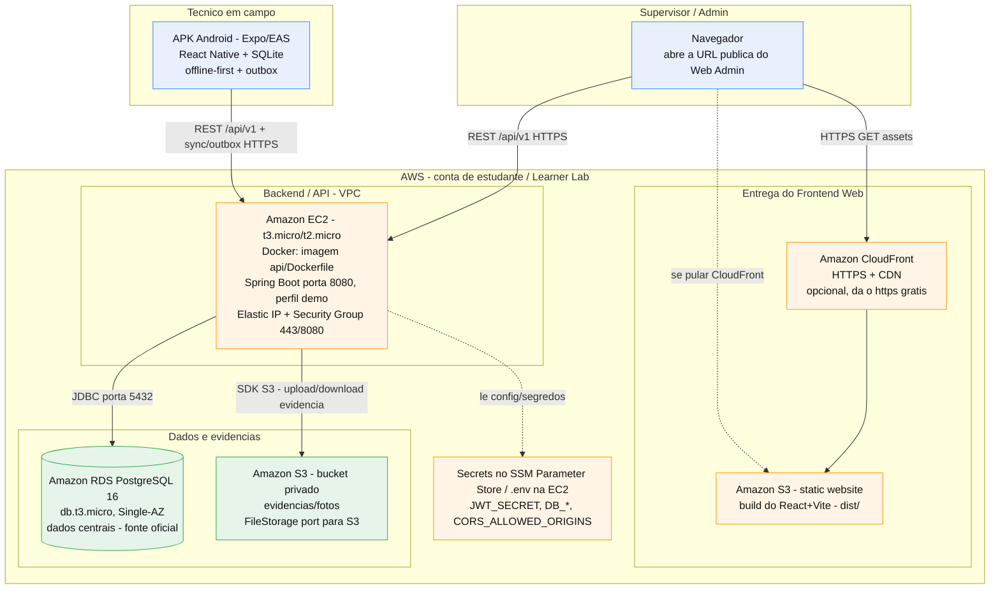

# Arquitetura do FieldOps na AWS (conta de estudante)

> Proposta de arquitetura de nuvem para a **apresentação final (FieldOps 2026)**,
> pensada para uma **conta de estudante com créditos/tokens limitados**
> (AWS Academy / Learner Lab ou Free Tier). O objetivo é atender aos requisitos
> obrigatórios do professor (hospedagem AWS + APK + offline-first) gastando o
> mínimo possível e com o menor número de peças.

## Resumo

A arquitetura traduz o deploy atual do projeto (Render para a API + banco,
Vercel para o Web Admin) para serviços equivalentes na AWS:

- **Web Admin (React + Vite)** → Amazon S3 (site estático) + CloudFront (HTTPS/CDN).
- **API (Java 21 + Spring Boot, dockerizada)** → Amazon EC2 rodando o container.
- **Banco (PostgreSQL 16 gerenciado)** → Amazon RDS PostgreSQL.
- **Evidências/fotos** → Amazon S3 (bucket privado), via o port `FileStorage` já existente.
- **Segredos/config** → SSM Parameter Store (ou `.env` na EC2).
- **APK (Expo/EAS)** → fora da AWS; apenas aponta `EXPO_PUBLIC_API_URL` para a URL pública.

## Diagrama

## Mapeamento requisito do professor → serviço AWS

| Componente (teste do professor) | Serviço AWS | Por quê (cenário estudante) |
|---|---|---|
| Frontend Web (Teste 01/03/04/11) | **S3 static website + CloudFront** | S3 hospeda o `dist/` do Vite por centavos; CloudFront dá HTTPS grátis e CDN. É o mais barato e não gasta compute. |
| Backend/API (Teste 01) | **EC2 `t3.micro`/`t2.micro` rodando o Docker** | O `Dockerfile` já existe. EC2 é o caminho mais simples e previsível no Learner Lab (evita a complexidade e o custo de ECS/Fargate). |
| Banco de dados (Teste 01/10) | **RDS PostgreSQL 16, `db.t3.micro`, Single-AZ** | É o "managed DB" do `render.yaml` traduzido. Sem Multi-AZ para não dobrar custo. |
| Evidências/fotos (Teste 08/10) | **S3 (bucket privado)** | Resolve a limitação do filesystem efêmero. Troca o `FileStorage` de disco para S3 (o port já existe). |
| Segredos/config | **SSM Parameter Store** (ou `.env` na EC2) | `JWT_SECRET`, `DB_*`, `CORS_ALLOWED_ORIGINS` sem hardcode. Parameter Store é grátis no tier padrão. |
| APK (Teste 02/07/09/12) | fora da AWS (**EAS build**) | Só precisa que `EXPO_PUBLIC_API_URL` aponte para a URL pública da EC2/CloudFront. |

## Cobertura dos 12 testes da apresentação

| Teste | O que a arquitetura entrega |
|---|---|
| 01 — AWS em produção | Web no S3/CloudFront, API na EC2, banco no RDS, tudo na AWS, sem localhost. |
| 02 — APK instalado | APK autônomo (EAS) autentica contra a API pública na AWS. |
| 03 — Login | Web → API (EC2) → RDS. |
| 04 — Cadastros | Web → API → RDS (vínculos persistidos). |
| 05 — Modelo de inspeção | Web → API → RDS. |
| 06 — Atribuição | Web → API → RDS. |
| 07 — Recebimento mobile + QR Code | APK sincroniza da API pública; QR Code é local do app. |
| 08 — Execução (checklist + NC + foto) | Respostas no RDS; foto no S3 de evidências. |
| 09 — Offline-first real | 100% local no APK (SQLite + outbox); independe da nuvem. |
| 10 — Reconexão e sync | Outbox → API (idempotente) → RDS + S3; sem duplicação. |
| 11 — Revisão no Web | Supervisor no Web (S3/CloudFront) → API → RDS. |
| 12 — Atualização no APK | APK sincroniza estado atualizado do servidor (RDS). |

## Decisões para "créditos/tokens limitados"

- **EC2 em vez de ECS/Fargate/App Runner:** menos peças, custo fixo baixo e menos
  risco de esbarrar em serviço bloqueado no Learner Lab. Como o AWS Academy zera a
  sessão a cada ~4h, a estratégia é subir, apresentar e desligar.
- **Single-AZ e instâncias `micro`:** nada de alta disponibilidade — é um MVP de
  demonstração, não produção real.
- **CloudFront é opcional:** resolve bem o HTTPS do front. Se o Learner Lab limitar
  CloudFront, dá para usar o S3 website direto (HTTP) e manter só a API/compute com
  TLS. Nesse caso o CORS precisa bater com a origem exata.
- **Secrets fora do código:** `JWT_SECRET`, `DB_*` e `CORS_ALLOWED_ORIGINS` via
  Parameter Store ou `.env` na EC2 — nunca hardcoded.

## Pontos de atenção (importantes para o Teste 01)

- **API precisa ser HTTPS público:** o professor verifica que as chamadas não usam
  localhost nem túnel. Com EC2 pura você tem IP/DNS público, mas o TLS fica por sua
  conta (Nginx/Caddy na frente da API, ou colocar a API também atrás do CloudFront).
  Decida isso cedo.
- **CORS com credenciais:** o backend usa `allowCredentials(true)`, que é
  **incompatível com `Access-Control-Allow-Origin: *`**. Logo, `CORS_ALLOWED_ORIGINS`
  precisa listar a(s) origem(ns) explícita(s) do Web Admin (URL do CloudFront/S3),
  nunca `*`.
- **Evidências efêmeras hoje:** a implementação atual grava em disco local
  (`FileSystemEvidenceStorage`), que some em filesystem efêmero. Para o Teste 10
  passar com fotos persistidas, a arquitetura usa **S3**.

## O que muda no código (pequeno, favorecido pela arquitetura atual)

1. **Nova implementação de `FileStorage` para S3** (`S3EvidenceStorage`): o port já
   existe, então é adicionar a classe e selecioná-la por perfil/env (DIP). É o que
   falta para as evidências sobreviverem (Teste 10).
2. **`EXPO_PUBLIC_API_URL`** do APK apontando para a URL pública da AWS (mesmo fluxo
   já documentado no `mobile/README.md`, só trocando o alvo Render pela URL AWS).
3. **`CORS_ALLOWED_ORIGINS`** = URL do CloudFront/S3 do Web Admin.

## Origem desta proposta (estado atual do repositório)

- **Web Admin:** React + Vite (SPA), hoje preparado para Vercel
  (`frontend/vercel.json` com rewrite para `index.html`).
- **API:** Java 21 + Spring Boot, dockerizada (`api/Dockerfile` +
  `docker-entrypoint.sh`), perfil `demo` com Flyway + seed, health em
  `/actuator/health`, CORS por env, port binding por `$PORT`/`SERVER_PORT`.
  Hoje preparada para Render (`render.yaml`).
- **Banco:** PostgreSQL 16 gerenciado (no `render.yaml`, um managed DB).
- **Evidências:** `FileSystemEvidenceStorage` (disco local) atrás do port
  `FileStorage` — troca para S3 é limpa.
- **Mobile:** APK via EAS, lê `EXPO_PUBLIC_API_URL`.
