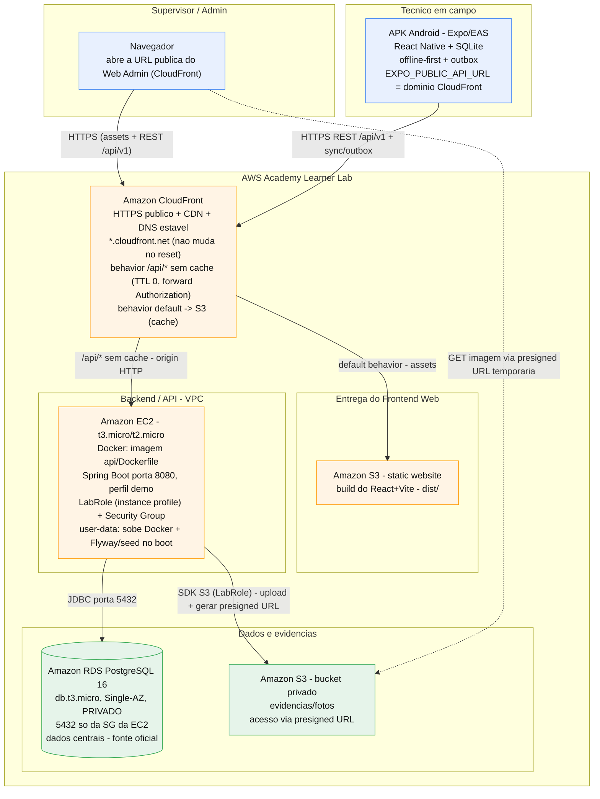

# Arquitetura do FieldOps na AWS (AWS Academy Learner Lab)

> Proposta de arquitetura de nuvem para a **apresentação final (FieldOps 2026)**,
> pensada para uma **conta AWS Academy Learner Lab** (role `LabRole` fixa, sessão
> reseta a cada ~4h, créditos limitados). O objetivo é atender aos requisitos
> obrigatórios do professor (hospedagem AWS + APK + offline-first) gastando o
> mínimo possível e com o menor número de peças.
>
> **As decisões de arquitetura estão consolidadas na seção
> [Decisões de arquitetura (congeladas)](#decisões-de-arquitetura-congeladas).**

## Resumo

A arquitetura traduz o deploy atual do projeto (Render para a API + banco,
Vercel para o Web Admin) para serviços equivalentes na AWS:

- **Web Admin (React + Vite)** → Amazon S3 (site estático) atrás do CloudFront.
- **API (Java 21 + Spring Boot, dockerizada)** → Amazon EC2 rodando o container,
  **atrás do CloudFront** (que fornece o HTTPS público).
- **HTTPS/CDN/DNS estável** → Amazon CloudFront. O domínio `*.cloudfront.net` é a
  **URL pública oficial** da API e do Web Admin e **não muda entre sessões** do
  Learner Lab (por isso o APK não precisa ser rebuildado a cada reset).
- **Banco (PostgreSQL 16 gerenciado)** → Amazon RDS PostgreSQL, **privado**
  (`Publicly accessible = No`), acessível só pela Security Group da EC2.
- **Evidências/fotos** → Amazon S3 (bucket privado), via o port `FileStorage`;
  exibição no Web Admin por **presigned URL** gerada pela API.
- **Credenciais EC2 → S3** → **`LabRole` como instance profile** da EC2 (sem chave no `.env`).
- **Segredos/config** → `.env` na EC2 (fora do git) / SSM Parameter Store.
- **APK (Expo/EAS)** → fora da AWS; `EXPO_PUBLIC_API_URL` aponta para o domínio
  estável do CloudFront.

## Diagrama

## Mapeamento requisito do professor → serviço AWS

| Componente (teste do professor) | Serviço AWS | Por quê (cenário Learner Lab) |
|---|---|---|
| HTTPS / DNS / CDN (Teste 01) | **CloudFront na frente de tudo** | Dá HTTPS automático em `*.cloudfront.net` sem domínio próprio nem Let's Encrypt, e o domínio é **estável entre resets** — serve como DNS fixo da API e do Web Admin. |
| Frontend Web (Teste 01/03/04/11) | **S3 static website (behavior default do CloudFront)** | S3 hospeda o `dist/` do Vite por centavos; o CloudFront entrega com cache e HTTPS. Barato e sem compute. |
| Backend/API (Teste 01) | **EC2 `t3.micro`/`t2.micro` com Docker, atrás do CloudFront** | O `Dockerfile` já existe. EC2 é o caminho mais simples e previsível no Learner Lab (evita custo/complexidade de ECS/Fargate). O behavior `/api/*` encaminha para a EC2 **sem cache**. |
| Banco de dados (Teste 01/10) | **RDS PostgreSQL 16, `db.t3.micro`, Single-AZ, privado** | É o "managed DB" do `render.yaml` traduzido. `Publicly accessible = No`; 5432 liberado só para a SG da EC2. Sem Multi-AZ para não dobrar custo. |
| Evidências/fotos (Teste 08/10) | **S3 (bucket privado) + presigned URL** | Resolve a limitação do filesystem efêmero. Troca o `FileStorage` de disco para S3 (o port já existe) e expõe as fotos ao Web Admin por URL temporária. |
| Credenciais EC2 → S3 | **`LabRole` como instance profile** | O SDK S3 pega a credencial via metadata da instância; **nenhuma chave no `.env`**. É a forma compatível com o Learner Lab (role fixa). |
| Segredos/config | **`.env` na EC2 (fora do git)** / SSM Parameter Store | `JWT_SECRET`, `DB_*`, `CORS_ALLOWED_ORIGINS` sem hardcode. |
| APK (Teste 02/07/09/12) | fora da AWS (**EAS build**) | `EXPO_PUBLIC_API_URL` aponta para o domínio **estável** do CloudFront, então não precisa rebuildar a cada sessão. |

## Cobertura dos 12 testes da apresentação

| Teste | O que a arquitetura entrega |
|---|---|
| 01 — AWS em produção | Web no S3 e API na EC2, **ambos atrás do CloudFront com HTTPS público** (`*.cloudfront.net`); banco no RDS privado. Tudo na AWS, sem localhost nem túnel. |
| 02 — APK instalado | APK autônomo (EAS) autentica contra a API pública na AWS. |
| 03 — Login | Web → API (EC2) → RDS. |
| 04 — Cadastros | Web → API → RDS (vínculos persistidos). |
| 05 — Modelo de inspeção | Web → API → RDS. |
| 06 — Atribuição | Web → API → RDS. |
| 07 — Recebimento mobile + QR Code | APK sincroniza da API pública; QR Code é local do app. |
| 08 — Execução (checklist + NC + foto) | Respostas no RDS; foto no S3 de evidências. |
| 09 — Offline-first real | 100% local no APK (SQLite + outbox); independe da nuvem. |
| 10 — Reconexão e sync | Outbox → API (idempotente) → RDS + S3; sem duplicação. |
| 11 — Revisão no Web | Supervisor no Web (CloudFront→S3) → API (CloudFront→EC2) → RDS; fotos via presigned URL. |
| 12 — Atualização no APK | APK sincroniza estado atualizado do servidor (RDS). |

## Decisões de arquitetura (congeladas)

Decisões tomadas para o cenário **AWS Academy Learner Lab** (role `LabRole` fixa,
sessão reseta a cada ~4h, créditos limitados). Prioridade: custo baixo, poucas peças
e compatibilidade com o Learner Lab.

| # | Tema | Decisão | Motivo |
|---|---|---|---|
| 1 | **TLS/HTTPS da API** | **CloudFront na frente da EC2** (origem HTTP). Behavior `/api/*` com cache desabilitado (TTL 0, forward de headers/query/cookies/`Authorization`). | HTTPS automático em `*.cloudfront.net` sem domínio próprio nem Let's Encrypt. Resolve o risco nº1 do Teste 01 (sem localhost/túnel). |
| 2 | **DNS estável da API** | O próprio domínio do CloudFront (`*.cloudfront.net`). | É estável mesmo com o reset do Learner Lab; dispensa DuckDNS. O APK é buildado com esse domínio e **não precisa ser rebuildado** a cada sessão. |
| 3 | **IAM (EC2 → S3)** | **`LabRole` como instance profile** da EC2. | O SDK S3 pega a credencial via metadata da instância; nenhuma chave no `.env`. É a forma compatível com o Learner Lab. |
| 4 | **Exibição das fotos** | **Presigned URL** gerada pela API; o Web Admin carrega a imagem direto do S3. | Mantém o bucket privado. Exige adicionar um método "gerar URL de download" ao port `FileStorage` (pequena mudança de código). |
| 5 | **Rede do RDS** | **Privado** (`Publicly accessible = No`); 5432 só para a SG da EC2. | Menor superfície de exposição. **Validar cedo** se o Learner Lab permite criar o DB subnet group. |
| 6 | **Persistência de evidências** | **S3 (bucket privado)**. | Sobrevive ao reset da EC2; é o que faz o Teste 10 passar com as fotos. |
| 7 | **Estratégia de reset (~4h)** | **Automático** via `user-data` da EC2: sobe o Docker da API e aplica Flyway + seed no startup. | Runbook "subir, demonstrar, desligar". Como o domínio do CloudFront é estável, o APK não muda entre sessões. |
| 8 | **Perfil Spring na EC2** | **`demo`**. | Roda Flyway + seed (idempotente), repopulando o dado de demonstração sozinho a cada subida. |

### Decisões consideradas conscientes (tradeoffs aceitos)

- **CloudFront → EC2 em HTTP na origem:** o cliente vê HTTPS de verdade, mas o trecho
  CloudFront↔EC2 trafega sem TLS. Aceitável para uma demo acadêmica; registrado como
  decisão consciente.
- **EC2 em vez de ECS/Fargate/App Runner:** menos peças, custo fixo baixo e menos
  risco de esbarrar em serviço bloqueado no Learner Lab.
- **Single-AZ e instâncias `micro`:** sem alta disponibilidade — é um MVP de
  demonstração, não produção real.

### Pontos já resolvidos / verificados (não são decisões abertas)

- **Health check:** `/actuator/health` já existe e é público (`{"status":"UP"}`).
- **Segredos no repo:** `api/.env` e afins estão ignorados pelo git (confirmado via
  `git check-ignore`; o `.gitignore` cobre `.env`/`.env.*` com exceção `!.env.example`).
  Nenhum segredo versionado. O `frontend/.env.production` é versionado, mas só com
  `VITE_API_URL=` vazio (variável pública por ser `VITE_*`) — nunca colocar segredo ali.

## CORS (ponto de atenção para o Teste 01)

O backend usa `allowCredentials(true)`, **incompatível com `Access-Control-Allow-Origin: *`**.
Com o Web Admin e a API **no mesmo domínio do CloudFront**, as chamadas do navegador
passam a ser **mesma origem**, o que simplifica bastante o CORS. Ainda assim,
`CORS_ALLOWED_ORIGINS` deve listar a origem explícita do CloudFront (nunca `*`) para
cobrir pré-flights e o portal do técnico.

## O que muda no código (pequeno, favorecido pela arquitetura atual)

1. **Nova implementação de `FileStorage` para S3** (`S3EvidenceStorage`): o port já
   existe, então é adicionar a classe e selecioná-la por perfil/env (DIP). É o que
   falta para as evidências sobreviverem (Teste 10).
2. **Método "gerar URL de download" (presigned URL) no port `FileStorage`**: pequena
   adição ao contrato para o Web Admin exibir fotos de bucket privado (decisão #4).
3. **`EXPO_PUBLIC_API_URL`** do APK apontando para o domínio estável do CloudFront
   (mesmo fluxo já documentado no `mobile/README.md`, só trocando o alvo Render).
4. **`CORS_ALLOWED_ORIGINS`** = domínio do CloudFront.

## Origem desta proposta (estado atual do repositório)

- **Web Admin:** React + Vite (SPA), hoje preparado para Vercel
  (`frontend/vercel.json` com rewrite para `index.html`).
- **API:** Java 21 + Spring Boot, dockerizada (`api/Dockerfile` +
  `docker-entrypoint.sh`), perfil `demo` com Flyway + seed, health em
  `/actuator/health`, CORS por env, port binding por `$PORT`/`SERVER_PORT`.
  Hoje preparada para Render (`render.yaml`).
- **Banco:** PostgreSQL 16 gerenciado (no `render.yaml`, um managed DB).
- **Evidências:** `FileSystemEvidenceStorage` (disco local) atrás do port
  `FileStorage` — troca para S3 é limpa.
- **Mobile:** APK via EAS, lê `EXPO_PUBLIC_API_URL`.
