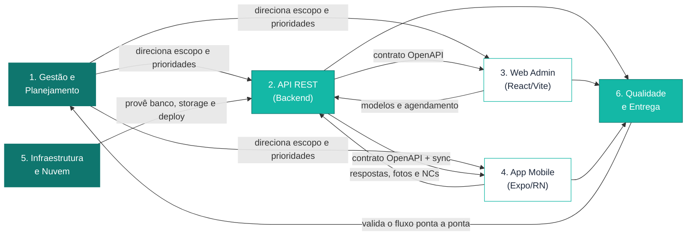
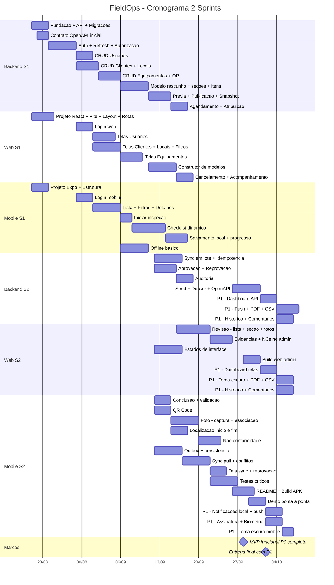
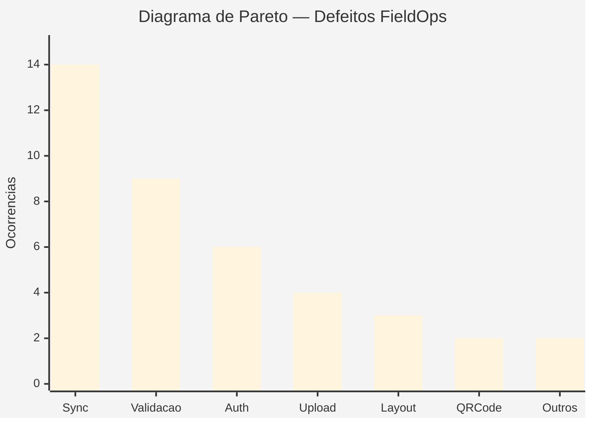
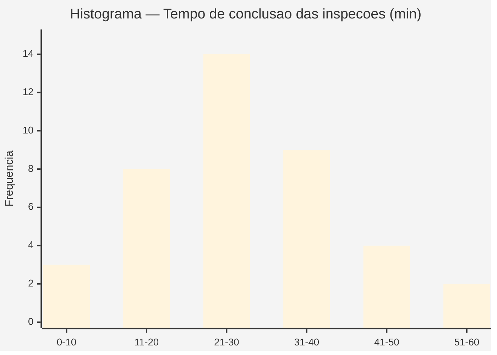
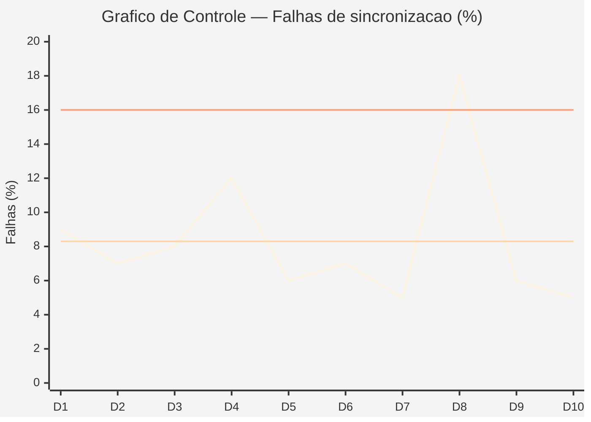
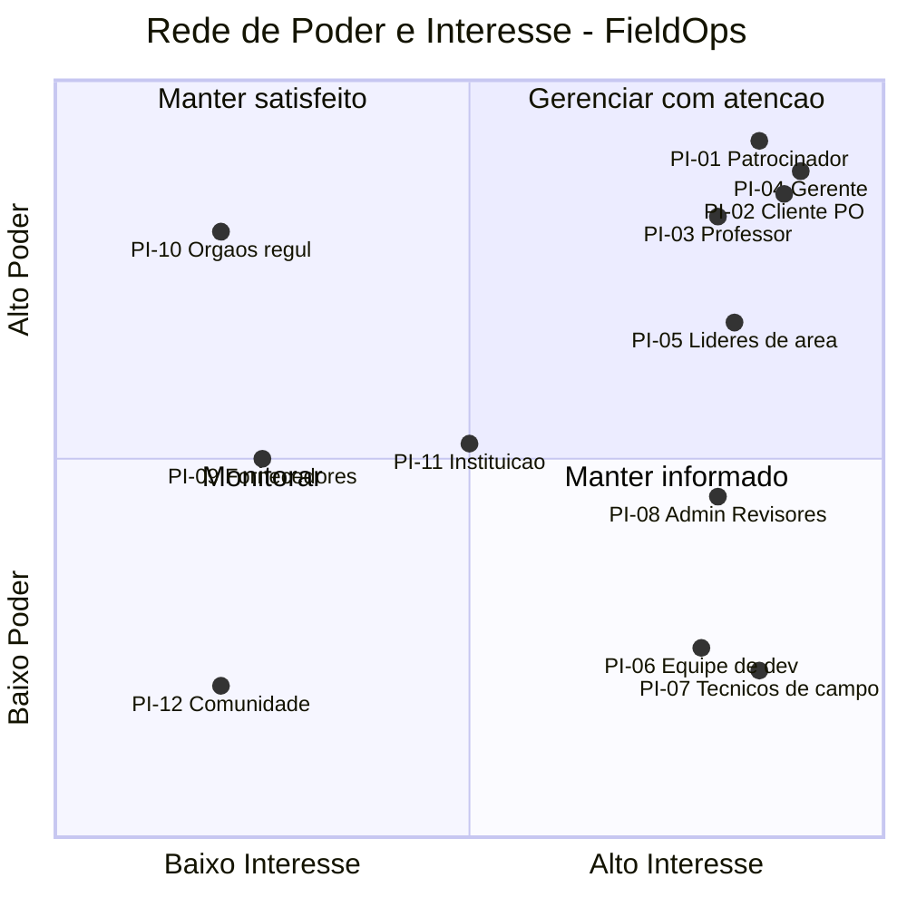

# FIELDOPS — PLATAFORMA DE INSPEÇÃO EM CAMPO
## Relatório Final

**Equipe:** 404 Not Found
**Instituição:** Centro Universitário SENAI São Paulo — UniSENAI-SP
**Curso:** Análise e Desenvolvimento de Sistemas
**Orientador:** Deivison Takatu
**Ano:** 2026

---

*Este documento consolida todos os capítulos do relatório final para visualização completa e estimativa de páginas.*

---

# Relatório Final — Elementos Pré-Textuais

## Capa
```
CENTRO UNIVERSITÁRIO SENAI SÃO PAULO — UniSENAI-SP
CAMPUS SOROCABA — SANTA ROSÁLIA
ANÁLISE E DESENVOLVIMENTO DE SISTEMAS


EQUIPE 404 NOT FOUND

Andressa Almeida Bartolomeu Custódio
Caroline de Almeida Arruda
Felipe Cutiur dos Santos
Ian Lucas Borges de Oliveira Pinto
Lucas Miguel Leite
Marcela Moraes Mulato
Natália Nogueira
Rodrigo Ferreira Soares


FIELDOPS — PLATAFORMA DE INSPEÇÃO EM CAMPO


SOROCABA, SP
2026
```

---

## Folha de Rosto
```
EQUIPE 404 NOT FOUND

Andressa Almeida Bartolomeu Custódio
Caroline de Almeida Arruda
Felipe Cutiur dos Santos
Ian Lucas Borges de Oliveira Pinto
Lucas Miguel Leite
Marcela Moraes Mulato
Natália Nogueira
Rodrigo Ferreira Soares


FIELDOPS — PLATAFORMA DE INSPEÇÃO EM CAMPO


Trabalho apresentado ao Centro Universitário SENAI São Paulo — UniSENAI-SP
Campus Sorocaba — Santa Rosália como instrumento de avaliação da disciplina de
Gestão de Projetos.

Orientador(a): Deivison Takatu


SOROCABA, SP
2026
```

---

## RESUMO
O FieldOps é uma plataforma digital para o planejamento, a execução, o
acompanhamento e a revisão de inspeções técnicas realizadas em campo,
desenvolvida para substituir formulários em papel, planilhas e mensagens
informais por um fluxo digital integrado, rastreável e com funcionamento
offline. A solução é composta por um aplicativo mobile (Expo/React Native) usado
pelos técnicos de campo, uma interface administrativa web (React/Vite) destinada
a supervisores e administradores, uma API REST (Java/Spring Boot) responsável
pelas regras de negócio, autenticação e persistência, e uma infraestrutura de
dados baseada em PostgreSQL, SQLite e armazenamento de objetos para evidências.
O principal desafio técnico é garantir a continuidade do trabalho em campo mesmo
sem conexão, por meio de armazenamento local e sincronização idempotente que
evita perda ou duplicação de informações. Este relatório descreve a gestão do
projeto nas áreas de conhecimento do PMBOK — integração, escopo, cronograma,
custos, qualidade, recursos, comunicações, riscos, aquisições e partes
interessadas —, aplicadas a um Produto Mínimo Viável (MVP) planejado para um teto
de investimento de R$ 204.000,00 e um prazo de execução de três meses, com
demonstração ponta a ponta ao final. Conclui-se que a organização integrada das
frentes de backend, web, mobile e infraestrutura, apoiada por artefatos de gestão
(EAP, cronograma, orçamento, matriz RACI, plano de comunicação e registro de
riscos), torna o escopo viável dentro das restrições de orçamento, prazo e
equipe.

**Palavras-chave:** Inspeção em Campo; Aplicativo Offline-First; Gestão de Projetos.

---

## ABSTRACT
FieldOps is a digital platform for planning, executing, monitoring and reviewing
field technical inspections, designed to replace paper forms, spreadsheets and
informal messaging with an integrated, traceable and offline-capable digital
workflow. The solution comprises a mobile application (Expo/React Native) used by
field technicians, a web administrative interface (React/Vite) for supervisors
and administrators, a REST API (Java/Spring Boot) responsible for business rules,
authentication and persistence, and a data infrastructure based on PostgreSQL,
SQLite and object storage for evidence. The main technical challenge is ensuring
that field work continues even without connectivity, through local storage and
idempotent synchronization that prevents data loss or duplication. This report
describes project management across the PMBOK knowledge areas — integration,
scope, schedule, cost, quality, resources, communications, risk, procurement and
stakeholders — applied to a Minimum Viable Product (MVP) planned within an
investment ceiling of R$ 204,000.00 and a three-month execution timeline, with an
end-to-end demonstration at the end. It is concluded that the integrated
organization of the backend, web, mobile and infrastructure fronts, supported by
management artifacts (WBS, schedule, budget, RACI matrix, communication plan and
risk register), makes the scope feasible within the budget, time and team
constraints.

**Keywords:** Field Inspection; Offline-First Application; Project Management.

---

## LISTA DE ILUSTRAÇÕES
| Ilustração | Título | Fonte |
|---|---|---|
| FIGURA 1 | Diagrama da EAP (Estrutura Analítica do Projeto) | [`eap.md`](./eap.md) |
| FIGURA 2 | Organograma da equipe | [`organograma.md`](./organograma.md) |
| FIGURA 3 | Gráfico de Gantt — cronograma das sprints | [`cronograma.md`](./cronograma.md) |
| FIGURA 4 | Fluxo de comunicação do projeto | [`plano-de-comunicacao.md`](./plano-de-comunicacao.md) |

> As figuras são diagramas em Mermaid, renderizados a partir dos documentos-fonte
> indicados. Caso o relatório final seja consolidado em `.docx`, as figuras devem
> ser exportadas como imagem a partir desses diagramas.

---

## LISTA DE TABELAS
| Tabela | Título | Capítulo |
|---|---|---|
| TABELA 1 | Parâmetros autorizados no TAP | 5 — Custos |
| TABELA 2 | Estimativa de três pontos (PERT) dos pacotes-chave | 5 — Custos |
| TABELA 3 | Distribuição dos custos por iniciativa | 5 — Custos |
| TABELA 4 | Orçamento consolidado por categoria | 5 — Custos |
| TABELA 5 | Registro de riscos (probabilidade × impacto × severidade) | 9 — Riscos |
| TABELA 6 | Necessidades de aquisição por categoria | 10 — Aquisições |

---

## LISTA DE QUADROS
| Quadro | Título | Capítulo |
|---|---|---|
| QUADRO 1 | Dicionário da EAP | 3 — Escopo |
| QUADRO 2 | Backlog por sprint e área (PBIs) | 4 — Cronograma |
| QUADRO 3 | Equipe e papéis | 7 — Recursos Humanos |
| QUADRO 4 | Plano de comunicação | 8 — Comunicações |
| QUADRO 5 | Critérios de seleção e gestão de fornecedores | 10 — Aquisições |

---

## LISTA DE ABREVIATURAS
| Abreviatura | Significado |
|---|---|
| Apênd. | Apêndice |
| Doc. | Documento |
| Fig. | Figura |
| Qtd. | Quantidade |
| Seç. | Seção |
| Vlr. | Valor |

---

## LISTA DE SIGLAS
| Sigla | Significado |
|---|---|
| ADS | Análise e Desenvolvimento de Sistemas |
| API | Application Programming Interface |
| APK | Android Package (pacote de instalação Android) |
| CI/CD | Continuous Integration / Continuous Delivery |
| CRUD | Create, Read, Update, Delete |
| CSV | Comma-Separated Values |
| EAP | Estrutura Analítica do Projeto |
| GP | Gerente de Projeto |
| JWT | JSON Web Token |
| MVP | Minimum Viable Product (Produto Mínimo Viável) |
| NC | Não Conformidade |
| PBI | Product Backlog Item |
| PDF | Portable Document Format |
| PERT | Program Evaluation and Review Technique |
| PMBOK | Project Management Body of Knowledge |
| PO | Product Owner |
| QA | Quality Assurance |
| QR Code | Quick Response Code |
| RACI | Responsible, Accountable, Consulted, Informed |
| REST | Representational State Transfer |
| SQL | Structured Query Language |
| TAP | Termo de Abertura do Projeto |
| UI/UX | User Interface / User Experience |
| WBS | Work Breakdown Structure |

---

## SUMÁRIO
| Capítulo / Seção | Documento-fonte |
|---|---|
| **1 INTRODUÇÃO** | [`relatorio-final-cap1-introducao.md`](./relatorio-final-cap1-introducao.md) |
| &nbsp;&nbsp;1.1 Contextualização do Problema | |
| &nbsp;&nbsp;1.2 Justificativa e Objetivos | |
| &nbsp;&nbsp;1.3 Metodologia Utilizada | |
| **2 GERENCIAMENTO DA INTEGRAÇÃO** | [`relatorio-final-cap2-gerenciamento-integracao.md`](./relatorio-final-cap2-gerenciamento-integracao.md) |
| &nbsp;&nbsp;2.1 Estrutura e Direcionamento do Portfólio | |
| &nbsp;&nbsp;2.2 Integração entre Portfólio, Programas e Projetos | |
| **3 GERENCIAMENTO DO ESCOPO** | [`relatorio-final-cap3-gerenciamento-escopo.md`](./relatorio-final-cap3-gerenciamento-escopo.md) |
| &nbsp;&nbsp;3.1 Definição do Escopo e Entregas | |
| &nbsp;&nbsp;3.2 Estrutura Analítica do Projeto (EAP) | |
| **4 GERENCIAMENTO DO CRONOGRAMA** | [`relatorio-final-cap4-cronograma-roadmap.md`](./relatorio-final-cap4-cronograma-roadmap.md) |
| &nbsp;&nbsp;4.1 Planejamento e Sequenciamento das Atividades | |
| &nbsp;&nbsp;4.2 Cronograma e Roadmap do Portfólio | |
| **5 GERENCIAMENTO DOS CUSTOS** | [`relatorio-final-cap5-gerenciamento-custos.md`](./relatorio-final-cap5-gerenciamento-custos.md) |
| &nbsp;&nbsp;5.1 Estimativa e Distribuição dos Custos | |
| &nbsp;&nbsp;5.2 Orçamento Consolidado do Portfólio | |
| **6 GERENCIAMENTO DA QUALIDADE** | *(a consolidar)* |
| &nbsp;&nbsp;6.1 Critérios e Indicadores de Qualidade | |
| &nbsp;&nbsp;6.2 Controle e Garantia da Qualidade | |
| **7 GERENCIAMENTO DOS RECURSOS HUMANOS** | [`relatorio-final-cap7-gerenciamento-recursos-humanos.md`](./relatorio-final-cap7-gerenciamento-recursos-humanos.md) |
| &nbsp;&nbsp;7.1 Recursos e Responsabilidades | |
| &nbsp;&nbsp;7.2 Alocação e Gestão dos Recursos | |
| **8 GERENCIAMENTO DAS COMUNICAÇÕES** | [`relatorio-final-cap8-gerenciamento-comunicacoes.md`](./relatorio-final-cap8-gerenciamento-comunicacoes.md) |
| &nbsp;&nbsp;8.1 Plano de Comunicação | |
| &nbsp;&nbsp;8.2 Comunicação com as Partes Interessadas | |
| **9 GERENCIAMENTO DOS RISCOS** | [`relatorio-final-cap9-gerenciamento-riscos.md`](./relatorio-final-cap9-gerenciamento-riscos.md) |
| &nbsp;&nbsp;9.1 Identificação e Análise dos Riscos | |
| &nbsp;&nbsp;9.2 Respostas e Monitoramento dos Riscos | |
| **10 GERENCIAMENTO DAS AQUISIÇÕES** | [`relatorio-final-cap10-gerenciamento-aquisicoes.md`](./relatorio-final-cap10-gerenciamento-aquisicoes.md) |
| &nbsp;&nbsp;10.1 Necessidades e Estratégia de Aquisições | |
| &nbsp;&nbsp;10.2 Seleção e Gestão de Fornecedores | |
| **11 GERENCIAMENTO DAS PARTES INTERESSADAS** | *(a consolidar)* |
| &nbsp;&nbsp;11.1 Identificação e Análise das Partes Interessadas | |
| &nbsp;&nbsp;11.2 Estratégias de Engajamento e Gestão das Expectativas | |
| **12 RESULTADOS E DISCUSSÃO** | *(a consolidar)* |
| &nbsp;&nbsp;12.1 Portfólio e Programas Propostos | |
| &nbsp;&nbsp;12.2 Análise da Estratégia e Viabilidade | |
| **13 CONSIDERAÇÕES FINAIS** | *(a consolidar)* |
| **REFERÊNCIAS** | |
| **APÊNDICE A — CRONOGRAMA DE ATIVIDADES** | [`cronograma.md`](./cronograma.md) |

> **Observação:** o sumário acima reflete a estrutura completa do template. Os
> capítulos já adaptados estão linkados ao respectivo documento-fonte; os
> capítulos 6, 11, 12 e 13 ainda estão em consolidação por outras issues da
> épica de adaptação ao template de Relatório Final.

---

# 1 INTRODUÇÃO

## 1.1 Contextualização do Problema
As inspeções técnicas em campo — vistorias de equipamentos, verificação de
conformidade e registro de ocorrências — são, em muitas organizações, executadas
com **formulários impressos, planilhas e mensagens informais**. Esse cenário
descentralizado dificulta a padronização das atividades e o acompanhamento das
informações geradas durante o trabalho em campo.

A organização analisada é uma **prestadora de serviços de inspeção** que atende
diferentes clientes, com equipes de técnicos que se deslocam até os locais dos
equipamentos. Os principais desafios enfrentados são:

- **Perda e inconsistência de dados:** preenchimentos incompletos, fotografias
  sem vínculo com a inspeção correspondente e registros que se perdem entre o
  campo e o escritório.
- **Demora na consolidação dos resultados:** o intervalo entre a execução da
  inspeção e a disponibilização dos resultados aos responsáveis é longo, gerando
  retrabalho.
- **Baixa rastreabilidade:** a ausência de um fluxo único dificulta identificar
  responsáveis, acompanhar alterações e analisar o histórico de cada inspeção.
- **Conectividade instável em campo:** muitas inspeções ocorrem em locais sem
  internet confiável, o que inviabiliza soluções exclusivamente online.

Diante disso, a organização precisa de uma solução digital integrada que conecte
o trabalho do técnico em campo às atividades administrativas de planejamento,
acompanhamento e revisão. A iniciativa, porém, está sujeita a **restrições**
relevantes que obrigam a priorização e a tomada de decisão sobre onde concentrar
recursos:

| Restrição | Descrição |
|---|---|
| **Orçamento** | Teto de investimento de **R$ 204.000,00** autorizado no TAP, usado como linha de base de custos. |
| **Prazo** | **Três meses** de execução a partir de agosto/2026, com demonstração ponta a ponta obrigatória ao final. |
| **Recursos humanos** | Equipe acadêmica enxuta de **9 integrantes**, com acúmulo de papéis (ex.: a gerente também atua no mobile). |
| **Tecnológicas** | Stack obrigatória: mobile em Expo/React Native, API em Java/Spring Boot, dados em PostgreSQL e SQLite, comunicação por API REST. |
| **Dependências** | Backend, web e mobile dependem de um contrato de API comum; atrasos em uma frente impactam a integração e os testes. |
| **Escopo** | Foco no MVP; funcionalidades complementares (roteirização automática, IoT, IA de diagnóstico, assinatura com validade jurídica) ficam fora do escopo inicial. |

Essas restrições tornam a **gestão integrada das frentes** (backend, web, mobile
e infraestrutura) um requisito, e não uma opção: o conjunto de iniciativas precisa
ser planejado de forma coordenada para caber no orçamento, no prazo e na
capacidade da equipe.

---

## 1.2 Justificativa e Objetivos
### Justificativa
A gestão do portfólio de iniciativas do FieldOps é importante porque o projeto
**não é um único entregável monolítico**, mas um conjunto de frentes
interdependentes (API, web, mobile e infraestrutura) que só geram valor quando
integradas em um fluxo completo de inspeção. Com recursos limitados (R$
204.000,00, três meses e nove pessoas), é indispensável **selecionar, priorizar e
organizar** o que será desenvolvido em cada sprint, considerando custos, prazos,
riscos, benefícios e dependências entre as frentes.

A execução atual com formulários impressos e planilhas provoca perda de dados,
retrabalho e baixa rastreabilidade. Centralizar essas atividades em uma
plataforma digital integrada traz benefícios diretos: maior **padronização** das
inspeções, melhor **qualidade** das informações coletadas, **redução de erros e
retrabalho** e maior **rastreabilidade** de todo o processo. O diferencial
estratégico é o funcionamento **offline-first**: o técnico continua trabalhando
mesmo sem conexão, com sincronização posterior confiável que evita perda ou
duplicação de informações.

### Objetivo geral
Desenvolver uma plataforma integrada que apoie todo o ciclo de inspeções técnicas
em campo — do planejamento à revisão final —, tornando o processo mais
padronizado, seguro, rastreável e eficiente, com funcionamento offline e
sincronização confiável, dentro das restrições de orçamento, prazo e equipe
definidas no TAP.

### Objetivos específicos
Os objetivos específicos representam as principais ações de planejamento e
execução conduzidas pela equipe e são mensuráveis em relação ao escopo do MVP:

1. **Digitalizar e padronizar** o processo de inspeção por meio de modelos e
   checklists previamente configurados e versionados.
2. **Planejar, agendar e atribuir** inspeções aos técnicos responsáveis a partir
   de modelos publicados.
3. **Executar inspeções no mobile** com checklist dinâmico, registro de respostas,
   observações, fotografias, leitura de QR Code de equipamentos, localização e não
   conformidades.
4. **Garantir a persistência local** dos dados ainda não sincronizados, inclusive
   após o fechamento do aplicativo (offline-first com SQLite).
5. **Implementar sincronização idempotente** entre mobile e API, evitando perda ou
   duplicação de informações.
6. **Centralizar regras de negócio, autenticação, autorização, persistência e
   auditoria** em uma API REST (Java/Spring Boot).
7. **Disponibilizar à supervisão** o acompanhamento das inspeções e a revisão dos
   resultados (aprovar, reprovar ou solicitar correção).
8. **Estruturar a gestão do projeto** nas áreas do PMBOK (integração, escopo,
   cronograma, custos, qualidade, recursos, comunicações, riscos, aquisições e
   partes interessadas), produzindo os artefatos correspondentes (EAP, cronograma,
   orçamento, RACI, plano de comunicação e registro de riscos).
9. **Demonstrar o fluxo ponta a ponta** do MVP ao final do prazo, comprovando a
   integração entre as frentes.

---

## 1.3 Metodologia Utilizada
A análise e a elaboração da proposta de portfólio seguiram uma abordagem
**ágil e incremental**, organizada em sprints, combinada com as **áreas de
conhecimento do PMBOK** para estruturar a gestão. O trabalho foi conduzido nas
seguintes etapas:

1. **Entendimento e abertura do projeto** — elaboração do Termo de Abertura do
   Projeto (TAP), definindo objetivos, premissas, restrições, orçamento, prazo,
   riscos e partes interessadas.
2. **Definição de escopo e backlog** — delimitação do MVP e organização do
   backlog de produto em *Product Backlog Items* (PBIs), com priorização P0
   (núcleo) e P1 (complementares).
3. **Decomposição das entregas** — construção da **EAP (WBS)**, quebrando o
   produto em seis grandes entregas (gestão, API, web, mobile, infraestrutura e
   qualidade/entrega) e seus pacotes de trabalho.
4. **Planejamento temporal** — montagem do **cronograma** por sprint e área, com
   sequenciamento, dependências e marcos (gráfico de Gantt em Mermaid).
5. **Estimativa e orçamento** — estimativa de custos pela técnica de **três
   pontos (PERT)** para os pacotes de maior incerteza e distribuição da linha de
   base de R$ 204.000,00 em cinco categorias de custo.
6. **Organização dos recursos** — definição do **organograma** e da **matriz
   RACI** (responsabilidades por card), tratando o acúmulo de papéis da equipe
   enxuta.
7. **Comunicação e riscos** — elaboração do **plano de comunicação** (canais,
   frequência e públicos) e do **registro de riscos** com análise de
   probabilidade × impacto e estratégias de resposta.
8. **Execução e verificação** — desenvolvimento incremental com revisão de código
   por *Pull Request*, testes dos fluxos críticos e demonstração ao fim de cada
   sprint.

### Critérios de análise e decisão
As decisões de seleção, priorização e agrupamento das iniciativas consideraram:
**alinhamento estratégico** com os objetivos do TAP, **investimento** dentro do
teto autorizado, **prazo** de três meses, **risco** (com destaque para a
sincronização offline), **benefícios** ao fluxo de inspeção, **dependências**
entre frentes e **disponibilidade de recursos** da equipe.

### Ferramentas e técnicas
| Ferramenta / técnica | Uso no projeto |
|---|---|
| **EAP (WBS)** | Decomposição das entregas e pacotes de trabalho ([`eap.md`](./eap.md)). |
| **Cronograma / Gantt** | Sequenciamento, dependências e marcos ([`cronograma.md`](./cronograma.md)). |
| **Roadmap por sprint** | Visão temporal das entregas P0 e P1. |
| **Estimativa de três pontos (PERT)** | Custos dos pacotes de maior incerteza ([`aula05-orcamento-custos.md`](./aula05-orcamento-custos.md)). |
| **Matriz RACI** | Responsabilidades por card ([`matriz-raci.md`](./matriz-raci.md)). |
| **Organograma** | Estrutura hierárquica e papéis ([`organograma.md`](./organograma.md)). |
| **Plano de comunicação** | Canais, frequência e públicos ([`plano-de-comunicacao.md`](./plano-de-comunicacao.md)). |
| **Registro de riscos** | Probabilidade × impacto e respostas ([`relatorio-final-cap9-gerenciamento-riscos.md`](./relatorio-final-cap9-gerenciamento-riscos.md)). |
| **GitHub Issues / Projects** | Backlog, board (Kanban) e rastreabilidade das tarefas. |
| **Mermaid** | Diagramas (EAP, Gantt, organograma, comunicação) versionados no repositório. |

O grupo organizou o trabalho em um **repositório único** com documentação
versionada em `docs/`, usando o board do GitHub como fonte da verdade das tarefas
e consolidando as informações de gestão nos documentos acima, que alimentam este
relatório final apresentado à diretoria (Cliente/Product Owner) e ao orientador.

---

# 2 GERENCIAMENTO DA INTEGRAÇÃO
Neste capítulo é apresentada a **visão geral integrada** do portfólio do FieldOps:
como os objetivos estratégicos da organização, o programa de desenvolvimento e as
iniciativas (frentes de trabalho) se relacionam, e de que forma as decisões
consideram os impactos que cada frente gera nas demais. O objetivo é demonstrar
que as decisões não foram tomadas de forma isolada, mas de maneira coordenada em
torno de um fluxo único de inspeção.

---

## 2.1 Estrutura e Direcionamento do Portfólio
O FieldOps é tratado como um **programa único** cujo propósito estratégico é
digitalizar e integrar o ciclo completo de inspeções técnicas em campo. Esse
programa se desdobra em **iniciativas (frentes de trabalho)** que correspondem às
grandes entregas da EAP e que, juntas, materializam o fluxo ponta a ponta.

### Direcionamento estratégico
| Nível | Elemento | Direcionamento |
|---|---|---|
| **Objetivo estratégico** | Digitalizar as inspeções em campo, com rastreabilidade e funcionamento offline | Substituir papel/planilhas por um fluxo digital integrado (TAP). |
| **Programa** | FieldOps — Plataforma de Inspeção em Campo | Entregar um MVP funcional em 3 meses, dentro do teto de R$ 204.000,00. |
| **Iniciativas (frentes)** | API REST, Web Admin, App Mobile, Infraestrutura, Gestão, Qualidade/Entrega | Cada frente contribui para um pedaço do fluxo e depende das demais. |

### Iniciativas do portfólio
As iniciativas correspondem às entregas de nível 1 da EAP:

| Iniciativa | Responsabilidade principal | Papel no fluxo de inspeção |
|---|---|---|
| **1. Gestão e Planejamento** | Documentação, escopo/backlog, arquitetura | Direciona e coordena as demais frentes. |
| **2. API REST (Backend)** | Regras de negócio, autenticação, persistência, sincronização | Núcleo integrador; fonte oficial dos dados após a sincronização. |
| **3. Interface Administrativa Web** | Cadastros, modelos, agendamento, revisão | Entrada das inspeções (planejamento) e saída (revisão/aprovação). |
| **4. Aplicativo Mobile** | Execução offline do checklist, evidências, sincronização | Coleta dos dados em campo. |
| **5. Infraestrutura e Nuvem** | Ambientes, banco, armazenamento de evidências, pipeline | Sustenta a operação de todas as frentes. |
| **6. Qualidade e Entrega** | Testes, implantação, demonstração | Valida e entrega o fluxo completo. |

### Critérios de direcionamento e priorização
O portfólio foi direcionado pela **priorização do fluxo principal (P0)** antes das
funcionalidades complementares (P1). Isso garante que o núcleo — autenticação,
modelos/checklist, execução offline, sincronização e revisão — esteja íntegro
antes de investir em itens como dashboard avançado, notificações push, relatório
PDF, exportação CSV e assinatura desenhada. Os critérios aplicados foram:
alinhamento com os objetivos do TAP, valor para o fluxo de inspeção, risco técnico
(com atenção à sincronização offline), dependências entre frentes e custo dentro
da linha de base.

---

## 2.2 Integração entre Portfólio, Programas e Projetos
A integração é o que garante que as seis iniciativas operem como **um sistema
único**, e não como projetos isolados. A espinha dorsal dessa integração é a **API
REST**, que atua como ponto central de regras de negócio e como fonte oficial dos
dados após a sincronização.

### Relações de dependência entre as frentes


### Como as decisões consideram impactos entre frentes
A integração é administrada por mecanismos concretos que tornam explícitas as
dependências e reduzem o risco de decisões isoladas:

| Mecanismo de integração | Como integra as frentes |
|---|---|
| **Contrato de API primeiro (OpenAPI/Swagger)** | Qualquer mudança no backend é publicada no contrato antes de impactar Web e Mobile, evitando retrabalho e quebra de integração. |
| **Snapshot de modelos** | Ao agendar a inspeção (web), a API congela o modelo em um snapshot; o mobile executa exatamente aquele checklist, garantindo consistência entre planejamento e execução. |
| **Sincronização idempotente** | O mobile envia operações com chave/UUID estável; a API concilia sem duplicar, integrando os dados coletados offline à fonte oficial. |
| **Estados da inspeção** | O ciclo RASCUNHO → ATRIBUÍDA → EM_ANDAMENTO → ENVIADA → EM_REVISÃO → APROVADA/REPROVADA/CANCELADA é compartilhado pelas três aplicações, mantendo todas alinhadas sobre a situação de cada inspeção. |
| **Infraestrutura compartilhada** | Banco PostgreSQL, armazenamento de evidências e pipeline de implantação sustentam simultaneamente API, web e mobile. |
| **Board e documentação únicos** | GitHub Issues/Projects e a pasta `docs/` centralizam decisões e status, servindo de ponto de integração da gestão com as frentes técnicas. |

### Integração por dependências, prioridades, recursos, custos e prazos
- **Dependências:** a Web e o Mobile só avançam com segurança após o contrato da
  API estar estável; por isso o backend concentra as entregas iniciais de
  autenticação e cadastros na Sprint 1, destravando as frentes consumidoras.
- **Prioridades:** o P0 (fluxo principal) é integrado e demonstrado antes do P1,
  assegurando que o conjunto esteja coeso antes de ampliar o escopo.
- **Recursos:** a equipe enxuta e o acúmulo de papéis exigem coordenação entre
  líderes (reunião técnica semanal) para evitar conflitos de alocação entre
  frentes — decisão registrada na gestão de recursos (Capítulo 7).
- **Custos:** a reserva de contingência (~7,7%) foi dimensionada justamente para
  os pontos de maior acoplamento e incerteza entre frentes (sincronização e
  construtor de modelos), conforme o Capítulo 5.
- **Prazos:** os marcos (MVP P0 completo e entrega final com P1) são
  compartilhados por todas as frentes, de modo que o sequenciamento de uma
  iniciativa respeite as demais.

> **Síntese da integração:** o FieldOps só entrega valor quando web, mobile, API e
> infraestrutura funcionam como um todo. A gestão da integração garante que cada
> decisão — de escopo, prazo, custo ou recurso — seja avaliada pelo seu impacto no
> fluxo completo de inspeção, e não apenas na frente onde é tomada.

---

# 3 GERENCIAMENTO DO ESCOPO
Neste capítulo é apresentado o escopo das principais iniciativas do FieldOps,
deixando claro o que cada frente pretende realizar e quais entregas são
esperadas, além das premissas e restrições consideradas. Em seguida, a Estrutura
Analítica do Projeto (EAP/WBS) representa a decomposição organizada das entregas.

---

## 3.1 Definição do Escopo e Entregas
O escopo do FieldOps concentra-se no **MVP do fluxo completo de inspeção**, do
planejamento à revisão, com funcionamento offline e sincronização confiável. As
entregas são organizadas nas seis grandes frentes da EAP.

### Escopo do MVP por frente (entregas)
| Frente (iniciativa) | Entregas principais do MVP |
|---|---|
| **1. Gestão e Planejamento** | Documentação do projeto, escopo e backlog definidos, arquitetura e modelo de dados. |
| **2. API REST (Backend)** | Autenticação/autorização (JWT), cadastros de domínio, modelos versionados, ciclo de vida da inspeção, evidências e não conformidades, sincronização offline, auditoria e OpenAPI. |
| **3. Interface Administrativa Web** | Base e design system, cadastros administrativos, construtor de modelos, agendamento/acompanhamento, revisão e aprovação. |
| **4. Aplicativo Mobile** | Base e design system, consulta/detalhes de inspeções, execução de checklist dinâmico, evidências + QR Code + geolocalização, armazenamento offline e sincronização. |
| **5. Infraestrutura e Nuvem** | Ambientes e banco provisionados, armazenamento de evidências, pipeline de implantação. |
| **6. Qualidade e Entrega** | Sistema testado, sistema implantado, protótipo e apresentação entregues. |

### Premissas do escopo
- Android é a plataforma mobile prioritária e obrigatória para validação.
- Cada inspeção tem **um** técnico responsável no MVP.
- As inspeções baseiam-se em **modelos previamente configurados e publicados**.
- Após a sincronização, a **API é a fonte oficial** de registro das informações.
- O aplicativo preserva localmente os dados ainda não sincronizados, inclusive
  após o fechamento.

### Restrições do escopo (fora do MVP)
Não fazem parte do escopo inicial, conforme o TAP: roteirização automática de
equipes, acompanhamento contínuo de localização, integração com ERP,
inteligência artificial para diagnóstico, sensores IoT e assinatura eletrônica
com validade jurídica. Essa delimitação protege o fluxo principal diante das
restrições de prazo (3 meses) e orçamento (R$ 204.000,00).

---

## 3.2 Estrutura Analítica do Projeto (EAP)
A EAP decompõe o produto FieldOps em seis entregas de nível 1 e seus pacotes de
trabalho. A estrutura textual, o diagrama e o dicionário abaixo são reproduzidos
de [`eap.md`](./eap.md).

### Identificação
| Campo | Informação |
|---|---|
| **Projeto** | FieldOps — Plataforma de Inspeção em Campo |
| **Gerente do projeto** | Natália |
| **Data** | 28/08/2026 |
| **Versão** | 1.0 |

### Estrutura textual da EAP
```text
FIELDOPS — PLATAFORMA DE INSPEÇÃO EM CAMPO
│
├── 1. GESTÃO E PLANEJAMENTO DO PROJETO
│   ├── 1.1 Documentação do projeto produzida
│   ├── 1.2 Escopo e backlog definidos
│   └── 1.3 Arquitetura e modelo de dados definidos
│
├── 2. API REST (BACKEND)
│   ├── 2.1 Autenticação e autorização implementadas
│   ├── 2.2 Cadastros de domínio implementados
│   ├── 2.3 Modelos de inspeção e versionamento implementados
│   ├── 2.4 Ciclo de vida da inspeção implementado
│   ├── 2.5 Evidências e não conformidades implementadas
│   ├── 2.6 Sincronização offline implementada
│   └── 2.7 Auditoria e documentação da API produzidas
│
├── 3. INTERFACE ADMINISTRATIVA WEB (REACT + VITE)
│   ├── 3.1 Base do app e design system implementados
│   ├── 3.2 Cadastros administrativos implementados
│   ├── 3.3 Construtor de modelos de inspeção implementado
│   ├── 3.4 Agendamento e acompanhamento implementados
│   └── 3.5 Revisão e aprovação implementadas
│
├── 4. APLICATIVO MOBILE (EXPO / REACT NATIVE)
│   ├── 4.1 Base do app e design system implementados
│   ├── 4.2 Consulta e detalhes de inspeções implementados
│   ├── 4.3 Execução de checklist implementada
│   ├── 4.4 Evidências, QR Code e geolocalização implementados
│   └── 4.5 Armazenamento offline e sincronização implementados
│
├── 5. INFRAESTRUTURA E NUVEM
│   ├── 5.1 Ambientes e banco de dados provisionados
│   ├── 5.2 Armazenamento de evidências configurado
│   └── 5.3 Pipeline de implantação configurado
│
└── 6. QUALIDADE E ENTREGA
    ├── 6.1 Sistema testado
    ├── 6.2 Sistema implantado
    └── 6.3 Protótipo e apresentação entregues
```

> **Nota sobre a stack web:** o diagrama de `eap.md` referencia "Angular" no texto
> da entrega 3. A stack real do web admin é **React + Vite + TypeScript**
> (confirmada em `frontend/` e em `docs/convencoes-frontend-web.md`). A estrutura
> textual acima já reflete a stack correta; recomenda-se alinhar o rótulo em
> `eap.md` para eliminar essa divergência.

### Diagrama da EAP (Mermaid)

```mermaid
flowchart TB
    P["FIELDOPS<br/>Plataforma de Inspeção em Campo"]

    G1["1. Gestão e<br/>Planejamento"]
    G2["2. API REST<br/>(Backend)"]
    G3["3. Interface<br/>Administrativa Web"]
    G4["4. Aplicativo<br/>Mobile"]
    G5["5. Infraestrutura<br/>e Nuvem"]
    G6["6. Qualidade<br/>e Entrega"]

    P --> G1
    P --> G2
    P --> G3
    P --> G4
    P --> G5
    P --> G6

    G1 --> G1_1["1.1 Documentação<br/>produzida"]
    G1 --> G1_2["1.2 Escopo e<br/>backlog definidos"]
    G1 --> G1_3["1.3 Arquitetura e<br/>modelo de dados"]

    G2 --> G2_1["2.1 Autenticação e<br/>autorização"]
    G2 --> G2_2["2.2 Cadastros de<br/>domínio"]
    G2 --> G2_3["2.3 Modelos e<br/>versionamento"]
    G2 --> G2_4["2.4 Ciclo de vida<br/>da inspeção"]
    G2 --> G2_5["2.5 Evidências e<br/>não conformidades"]
    G2 --> G2_6["2.6 Sincronização<br/>offline"]
    G2 --> G2_7["2.7 Auditoria e<br/>documentação da API"]

    G3 --> G3_1["3.1 Base e<br/>design system"]
    G3 --> G3_2["3.2 Cadastros<br/>administrativos"]
    G3 --> G3_3["3.3 Construtor de<br/>modelos"]
    G3 --> G3_4["3.4 Agendamento e<br/>acompanhamento"]
    G3 --> G3_5["3.5 Revisão e<br/>aprovação"]

    G4 --> G4_1["4.1 Base e<br/>design system"]
    G4 --> G4_2["4.2 Consulta e<br/>detalhes"]
    G4 --> G4_3["4.3 Execução de<br/>checklist"]
    G4 --> G4_4["4.4 Evidências, QR<br/>Code e localização"]
    G4 --> G4_5["4.5 Offline e<br/>sincronização"]

    G5 --> G5_1["5.1 Ambientes e<br/>banco de dados"]
    G5 --> G5_2["5.2 Armazenamento<br/>de evidências"]
    G5 --> G5_3["5.3 Pipeline de<br/>implantação"]

    G6 --> G6_1["6.1 Sistema<br/>testado"]
    G6 --> G6_2["6.2 Sistema<br/>implantado"]
    G6 --> G6_3["6.3 Protótipo e<br/>apresentação"]

    classDef projeto fill:#0F766E,stroke:#0F766E,color:#fff,font-weight:bold;
    classDef entrega fill:#14B8A6,stroke:#0F766E,color:#fff;
    classDef pacote fill:#FFFFFF,stroke:#14B8A6,color:#1E293B;

    class P projeto;
    class G1,G2,G3,G4,G5,G6 entrega;
    class G1_1,G1_2,G1_3,G2_1,G2_2,G2_3,G2_4,G2_5,G2_6,G2_7,G3_1,G3_2,G3_3,G3_4,G3_5,G4_1,G4_2,G4_3,G4_4,G4_5,G5_1,G5_2,G5_3,G6_1,G6_2,G6_3 pacote;
```


> Caso o relatório final seja consolidado em `.docx`, este diagrama deve ser
> exportado como imagem (FIGURA 1 na lista de ilustrações).

### Dicionário da EAP
| Código | Elemento | Descrição |
|---|---|---|
| 1.0 | Gestão e Planejamento do Projeto | Definição e organização do escopo, documentação e decisões estruturais do projeto |
| 1.1 | Documentação do projeto produzida | Documentos (visão, objetivos, personas, casos de uso, regras de negócio) organizados e revisados |
| 1.2 | Escopo e backlog definidos | Escopo do MVP delimitado e backlog do produto com histórias e critérios de aceitação |
| 1.3 | Arquitetura e modelo de dados definidos | Decisões arquiteturais, diagrama de componentes e modelo de dados documentados |
| 2.0 | API REST (Backend) | Serviço central em Java + Spring Boot com as regras de negócio e persistência |
| 2.1 | Autenticação e autorização implementadas | Login por JWT e controle de acesso por perfil (Técnico, Supervisor, Administrador) |
| 2.2 | Cadastros de domínio implementados | Endpoints de clientes, locais, equipamentos e usuários persistidos em PostgreSQL |
| 2.3 | Modelos de inspeção e versionamento implementados | Criação, publicação e versionamento de modelos com seções e itens |
| 2.4 | Ciclo de vida da inspeção implementado | Agendamento, atribuição, execução, envio e transições de estado |
| 2.5 | Evidências e não conformidades implementadas | Upload/consulta de fotos vinculadas a itens e registro de não conformidades |
| 2.6 | Sincronização offline implementada | Operações idempotentes para receber e conciliar dados enviados pelo mobile |
| 2.7 | Auditoria e documentação da API produzidas | Registro de auditoria de eventos e documentação OpenAPI/Swagger publicada |
| 3.0 | Interface Administrativa Web (React + Vite) | Aplicação web para supervisores e administradores |
| 3.1 | Base do app e design system implementados | Estrutura React/Vite, roteamento, layout e componentes reutilizáveis |
| 3.2 | Cadastros administrativos implementados | Telas de usuários, clientes, locais e equipamentos integradas à API |
| 3.3 | Construtor de modelos de inspeção implementado | Editor de modelos com seções, itens, tipos de resposta e validação de publicação |
| 3.4 | Agendamento e acompanhamento implementados | Telas de agendamento, listagem, filtros e dashboard de acompanhamento |
| 3.5 | Revisão e aprovação implementadas | Tela de revisão de respostas e evidências com aprovação, reprovação e NCs |
| 4.0 | Aplicativo Mobile (Expo / React Native) | Aplicativo para técnicos de campo, com suporte offline |
| 4.1 | Base do app e design system implementados | Estrutura Expo, navegação, autenticação e componentes reutilizáveis |
| 4.2 | Consulta e detalhes de inspeções implementados | Telas de início, lista e detalhes das inspeções atribuídas |
| 4.3 | Execução de checklist implementada | Checklist dinâmico com todos os tipos de resposta, salvamento local e obrigatoriedade |
| 4.4 | Evidências, QR Code e geolocalização implementados | Captura de fotos, leitura de QR Code e registro de localização |
| 4.5 | Armazenamento offline e sincronização implementados | Persistência local em SQLite e sincronização ao reconectar |
| 5.0 | Infraestrutura e Nuvem | Ambientes, serviços e recursos que sustentam a solução |
| 5.1 | Ambientes e banco de dados provisionados | Ambientes configurados e banco PostgreSQL provisionado |
| 5.2 | Armazenamento de evidências configurado | Serviço de armazenamento de objetos para fotos disponibilizado |
| 5.3 | Pipeline de implantação configurado | Build, containerização e implantação automatizados |
| 6.0 | Qualidade e Entrega | Verificação, disponibilização e demonstração da solução |
| 6.1 | Sistema testado | Testes de funcionalidades e de integração entre os componentes |
| 6.2 | Sistema implantado | Solução disponibilizada nos ambientes de destino |
| 6.3 | Protótipo e apresentação entregues | Protótipo navegável e apresentação do fluxo completo do MVP |

> **Rastreabilidade:** cada pacote da EAP corresponde a conjuntos de PBIs do
> [`cronograma.md`](./cronograma.md), o que liga diretamente o escopo (Capítulo 3)
> ao planejamento temporal (Capítulo 4).

---

# 4 GERENCIAMENTO DO CRONOGRAMA
Neste capítulo é apresentado como a equipe organizou temporalmente as frentes do
FieldOps, considerando prazos, dependências e sequência de execução. Indica-se
quais entregas precisam ocorrer antes de outras e quais podem ser realizadas em
paralelo, dentro das limitações de recursos da equipe. Em seguida, o cronograma
(Gantt) e o roadmap apresentam a visão temporal e os marcos do projeto.

---

## 4.1 Planejamento e Sequenciamento das Atividades
O projeto foi planejado em **duas sprints**, iniciando em 21/08/2026, com as três
frentes de desenvolvimento (Backend, Web e Mobile) trabalhando em paralelo, mas
condicionadas a dependências técnicas.

### Lógica de sequenciamento
- **O backend destrava as frentes consumidoras.** Autenticação/autorização e os
  cadastros de domínio são entregues cedo na Sprint 1, pois Web e Mobile dependem
  do contrato da API para avançar com segurança (login, telas e consumo de
  dados).
- **Modelos antes de execução.** O construtor de modelos (web) e a publicação com
  snapshot (API) precedem a execução do checklist dinâmico no mobile, já que o
  app executa exatamente o snapshot publicado.
- **Coleta antes de sincronização e revisão.** A execução offline e o
  salvamento local (mobile) precedem a sincronização em lote (API) e, por fim, a
  revisão e aprovação (web).
- **Paralelismo controlado.** Enquanto o backend evolui autenticação e cadastros,
  a Web monta base/layout/rotas e o Mobile monta a estrutura Expo e o offline
  básico — atividades sem dependência direta que podem ocorrer simultaneamente.

### Sequenciamento e dependências (Sprint 1)
| Ordem | Atividade | Frente | Depende de |
|---|---|---|---|
| 1 | Fundação + API + migrações | Backend | — |
| 1 | Projeto React + Vite + layout + rotas | Web | — (paralelo) |
| 1 | Projeto Expo + estrutura | Mobile | — (paralelo) |
| 2 | Autenticação + refresh + autorização | Backend | Fundação/API |
| 3 | Login web / Login mobile | Web / Mobile | Auth na API |
| 4 | CRUDs (usuários, clientes, locais, equipamentos) | Backend | Auth |
| 5 | Telas de cadastros | Web | CRUDs da API |
| 6 | Modelo rascunho + seções + itens + publicação + snapshot | Backend | CRUDs |
| 7 | Construtor de modelos | Web | Modelos na API |
| 8 | Checklist dinâmico (execução) | Mobile | Snapshot publicado |

### Sequenciamento e dependências (Sprint 2)
| Ordem | Atividade | Frente | Depende de |
|---|---|---|---|
| 1 | Conclusão + validação / QR Code / foto / localização | Mobile | Execução do checklist |
| 1 | Outbox + persistência | Mobile | Salvamento local |
| 2 | Sincronização em lote + idempotência | Backend | Outbox do mobile |
| 2 | Pull de alterações + conflitos | Mobile | Sync da API |
| 3 | Aprovação / reprovação + auditoria | Backend | Inspeção enviada |
| 4 | Revisão (lista + seção + fotos) + evidências/NCs | Web | Aprovação/reprovação na API |
| 5 | Seed + Docker + OpenAPI | Backend | Fluxo principal |
| 6 | Testes críticos + build APK + demo ponta a ponta | Mobile/Equipe | Fluxo integrado |
| 7 | P1 (dashboard, push, PDF, CSV, tema escuro, assinatura, biometria) | Todas | MVP P0 completo |

> **Limitações de recursos:** por ser equipe enxuta (9 integrantes com acúmulo de
> papéis), o sequenciamento concentra 4 desenvolvedores na Web e distribui pares
> em Backend e Mobile. Cards que cruzam frentes têm responsabilidade compartilhada
> (ver Capítulos 7 e 9), e a priorização P0 → P1 protege o núcleo caso o prazo
> aperte.

---

## 4.2 Cronograma e Roadmap do Portfólio
O roadmap cobre as duas sprints do projeto (a partir de 21/08/2026) e culmina nos
dois marcos principais: **MVP funcional P0 completo** e **entrega final com P1**.

### Gráfico de Gantt (Mermaid)


> Caso o relatório final seja consolidado em `.docx`, este Gantt deve ser
> exportado como imagem (FIGURA 3 na lista de ilustrações).

### Roadmap e marcos
| Marco | Data | Significado |
|---|---|---|
| **Início do projeto** | 21/08/2026 | Começo da Sprint 1 (fundação das três frentes). |
| **Fim da Sprint 1** | 14/09/2026 | Núcleo de auth, cadastros, modelos e execução do checklist encaminhado. |
| **Sprint 2** | 15/09 → 02/10/2026 | Sincronização, revisão/aprovação, qualidade, entrega e itens P1. |
| **MVP funcional P0 completo** | 28/09/2026 | Fluxo principal íntegro (auth, checklist, foto, offline, sync, revisão). |
| **Entrega final com P1** | 02/10/2026 | Demonstração ponta a ponta com as funcionalidades complementares. |

> **Aderência ao TAP:** o TAP estima três meses a partir de agosto/2026; o
> cronograma detalhado concentra as entregas do MVP nas duas sprints, com os
> marcos de MVP P0 e entrega final representados. O backlog completo por PBI,
> sprint e área está em [`cronograma.md`](./cronograma.md) (QUADRO 2 na lista de
> quadros).

---

# 5 GERENCIAMENTO DOS CUSTOS
Neste capítulo são apresentados os investimentos necessários para a execução do
projeto FieldOps e como os custos foram considerados na tomada de decisão. Os
valores previstos para cada iniciativa (frente de trabalho) são comparados com o
orçamento máximo disponibilizado pela organização — a **estimativa de
investimentos de R$ 204.000,00 autorizada no Termo de Abertura do Projeto
(TAP)**, que atua como teto de investimento e linha de base de custos.

A distribuição consolidada do orçamento demonstra quanto é destinado a cada
frente e qual é o investimento total, evidenciando que a estratégia proposta é
financeiramente compatível com os recursos disponíveis.

| Parâmetro do TAP | Valor |
|---|---|
| Estimativa de investimentos (teto autorizado) | **R$ 204.000,00** |
| Base de esforço | 9 integrantes × ~3.400 horas de trabalho |
| Estimativa de prazo | 3 meses, a partir de agosto/2026 |
| Patrocinador (sponsor) | Fundação Toyota do Brasil |
| Gerente do projeto | Natália Nogueira |

---

## 5.1 Estimativa e Distribuição dos Custos
A estimativa de custos partiu da linha de base autorizada no TAP
(R$ 204.000,00) e foi distribuída entre as iniciativas (frentes de trabalho) do
projeto. As premissas de custeio adotadas foram:

| Premissa | Valor adotado |
|---|---|
| Regime de trabalho | Equipe de 9 integrantes (conforme TAP) |
| Esforço total de mão de obra | ~3.400 horas (conforme TAP) |
| Duração base | 3 meses a partir de agosto/2026 (conforme TAP) |
| Custo-hora — Desenvolvedor (Back/Web/Mobile) | R$ 50,00 |
| Custo-hora — Gerente / Coordenador de Projeto | R$ 90,00 |
| Custo-hora — Especialista de Nuvem / DevOps | R$ 70,00 |
| Custo-hora — QA / Testes | R$ 45,00 |
| Custo-hora — Designer (UI/UX) | R$ 55,00 |
| Custo-hora médio da mão de obra | ~R$ 54,00 |
| Moeda | Real (R$) |
| Impostos e encargos | Não considerados (projeto acadêmico) |

### Método de estimativa — Três pontos (PERT)
Para os principais pacotes de trabalho utilizou-se a **estimativa de três
pontos (PERT)**, combinando os cenários otimista (cO), mais provável (cM) e
pessimista (cP) para obter o custo esperado (cE):

```
cE = (cO + 4·cM + cP) / 6
```

| Pacote de trabalho | cO (R$) | cM (R$) | cP (R$) | cE = (cO+4cM+cP)/6 |
|---|---:|---:|---:|---:|
| API — Autenticação e autorização (JWT) | 6.000 | 8.000 | 12.000 | **8.333,33** |
| Sincronização offline (mobile ↔ API) | 8.000 | 10.500 | 15.000 | **10.833,33** |
| Construtor de modelos de inspeção (web) | 7.000 | 9.500 | 13.500 | **9.750,00** |
| Execução de checklist dinâmico (mobile) | 7.500 | 10.000 | 14.500 | **10.166,67** |
| Provisionamento de infraestrutura/nuvem | 5.000 | 7.500 | 11.000 | **7.583,33** |

> A estimativa de três pontos concentra atenção nos pacotes de maior incerteza
> (sincronização offline e construtor de modelos), cuja folga entre os cenários
> otimista e pessimista é maior. Esse é o insumo que justifica a reserva de
> contingência apresentada em 5.2.

### Distribuição dos custos por iniciativa
Aplicando as premissas acima, o investimento distribui-se entre as cinco
iniciativas (categorias) do projeto. Cada valor previsto está dentro do teto de
R$ 204.000,00 autorizado pela organização:

| Iniciativa (categoria) | Investimento previsto (R$) | Participação |
|---|---:|---:|
| A — Recursos Humanos (mão de obra das frentes back, web, mobile, gestão, DevOps, design e QA) | 184.950,00 | 90,7% |
| B — Infraestrutura e Nuvem | 1.480,00 | 0,7% |
| C — Ferramentas e Licenças de Software | 865,00 | 0,4% |
| D — Equipamentos e Materiais | 2.100,00 | 1,0% |
| E — Reserva de Contingência (~7,7% dos custos diretos) | 14.605,00 | 7,2% |
| **Total estimado** | **204.000,00** | **100%** |

> O maior peso está em **Recursos Humanos** (90,7%), coerente com o TAP, cuja
> estimativa parte da mão de obra de 9 integrantes por ~3.400 horas. O esforço
> distribuído (3.425 h) e o custo-hora médio (~R$ 54,00) reproduzem essa base.
> O detalhamento item a item (37 itens) está em
> [`aula05-orcamento-custos.md`](./aula05-orcamento-custos.md).

---

## 5.2 Orçamento Consolidado do Portfólio
O orçamento consolidado demonstra a distribuição do investimento entre custos
diretos e reserva de contingência, chegando ao investimento total do projeto. O
total consolidado coincide com a linha de base autorizada no TAP, comprovando
que a estratégia proposta é financeiramente compatível com os recursos
disponibilizados pela organização.

| Categoria | Total (R$) | % do total |
|---|---:|---:|
| A — Recursos Humanos | 184.950,00 | 90,7% |
| B — Infraestrutura e Nuvem | 1.480,00 | 0,7% |
| C — Ferramentas e Licenças | 865,00 | 0,4% |
| D — Equipamentos e Materiais | 2.100,00 | 1,0% |
| **Subtotal — Custos Diretos** | **189.395,00** | **92,8%** |
| E — Reserva de Contingência | 14.605,00 | 7,2% |
| **TOTAL CONSOLIDADO DO PROJETO** | **204.000,00** | **100%** |

- **Investimento total:** R$ 204.000,00, exatamente o teto autorizado no TAP —
  não há projeto adiado ou descartado por restrição orçamentária, pois a
  estratégia proposta cabe integralmente dentro da linha de base.
- **Custos diretos:** R$ 189.395,00 (92,8%), concentrados em Recursos Humanos.
- **Reserva de contingência:** R$ 14.605,00 (~7,7% dos custos diretos), dentro
  do teto do TAP, dimensionada para cobrir os riscos de maior incerteza
  identificados na estimativa de três pontos (retrabalho de sincronização
  offline e ajustes no construtor de modelos).

> **Aderência ao TAP:** o total consolidado de **R$ 204.000,00** coincide com a
> estimativa de investimentos autorizada no Termo de Abertura do Projeto,
> atendendo ao critério de coerência com a linha de base. Este orçamento
> constitui a base de custos do FieldOps e deve ser monitorado no processo
> *7.4 — Controlar os custos*, comparando o previsto com o realizado ao longo
> das sprints.

---

# 6 GERENCIAMENTO DA QUALIDADE
Este capítulo descreve como a qualidade foi planejada, garantida e controlada
ao longo do projeto FieldOps. O trabalho seguiu os três processos da área de
Gerenciamento da Qualidade do PMBOK: planejar (definir padrões e indicadores),
garantir (verificar se o processo está sendo seguido) e controlar (medir
resultados e corrigir desvios).

---

## 6.1 Critérios e Indicadores de Qualidade
### 6.1.1 Critérios de qualidade do produto
A equipe definiu os critérios abaixo como padrão mínimo para cada dimensão
relevante do produto. São os requisitos que o FieldOps precisa atender para ser
considerado funcional com qualidade.

| Dimensão | Critério |
|---|---|
| **Funcionalidade offline** | A inspeção deve poder ser executada sem internet após o download e nenhuma resposta confirmada deve ser perdida ao fechar o aplicativo |
| **Idempotência de sincronização** | Reenviar a mesma operação não pode criar registros duplicados no servidor |
| **Integridade do checklist** | Itens obrigatórios sem resposta bloqueiam a conclusão; itens não conformes com exigência de observação ou evidência também bloqueiam |
| **Rastreabilidade** | Cada resposta fica vinculada à versão do modelo de inspeção vigente no momento do agendamento; mudanças no modelo não afetam inspeções em andamento |
| **Segurança** | Tokens e senhas não aparecem em logs; autorizações são validadas pelo servidor, não apenas pela interface |
| **Revisão e aprovação** | Toda inspeção enviada passa por revisão do supervisor antes da aprovação; inspeções aprovadas ficam protegidas contra edição |
| **Conformidade de dados** | O banco de dados central é a fonte oficial após a sincronização |

### 6.1.2 Indicadores de qualidade
Os indicadores abaixo foram definidos para medir numericamente se os critérios
estão sendo cumpridos. A maioria foi levantado a partir dos defeitos observados
nos testes da Sprint 1.

| Indicador | Como é medido | Meta |
|---|---|:--:|
| Taxa de falha de sincronização | Operações com erro ÷ total de operações enviadas × 100 | < 10% |
| Cobertura de testes unitários | Linhas cobertas ÷ total de linhas testáveis × 100 | ≥ 70% |
| Defeitos abertos por categoria | Contagem semanal de issues abertas por tipo (sync, auth, validação, upload) | Redução progressiva |
| Conformidade do fluxo ponta a ponta | Verificação manual dos critérios de sucesso do MVP na demo | 100% |
| Tempo médio de conclusão de inspeção | Média entre o início e a conclusão registrados pelo dispositivo | 15–35 min |
| Regressões por sprint | Issues reabertas ou quebras em funcionalidades já entregues | 0 |

### 6.1.3 Critérios de qualidade do processo
Além do produto, a equipe definiu padrões de processo para reduzir a chance de
defeitos na origem.

| Padrão | Como é verificado |
|---|---|
| Pull Requests revisados antes do merge | Nenhuma mudança vai direto para a branch principal |
| Testes automatizados passando antes do merge | Verificação manual pré-merge (Jest no mobile, Vitest no frontend) |
| TypeScript sem erros de tipo | Checagem obrigatória antes de abrir PR |
| Issues rastreadas no board | Todo trabalho passa pelas colunas do Kanban (Backlog → In Progress → In Review → Done) |
| Documentação da API atualizada | Revisada junto com cada PR de back-end |

---

## 6.2 Controle e Garantia da Qualidade
### 6.2.1 Ferramentas de controle aplicadas
A equipe aplicou as Sete Ferramentas da Qualidade ao projeto para identificar
causas, priorizar correções e monitorar o desempenho ao longo das sprints. Os
resultados mais relevantes estão descritos a seguir.

#### Diagrama de Causa e Efeito (Ishikawa)
O problema analisado foi a perda ou inconsistência de respostas de inspeção
durante o uso offline e a sincronização — o risco técnico mais crítico do
projeto.

As causas de maior impacto ficaram em duas categorias:

- **Método:** reenvio de operações sem identificador único (ausência de
  idempotência) e regras de conflito não definidas.
- **Máquina/Tecnologia:** falhas de gravação no banco local e instabilidade de
  rede durante a sincronização.

Essas causas foram endereçadas diretamente no backlog: a implementação de um
identificador único por operação na fila de sincronização resolveu o problema
de duplicidade; o mecanismo de outbox com retry garantiu que as operações não
se percam em caso de falha de rede.

#### Fluxograma do ciclo de vida da inspeção
O mapeamento do fluxo completo — do agendamento à aprovação — mostrou dois
pontos de controle de qualidade embutidos no processo:

1. **Validação de obrigatórios** no aplicativo mobile, antes da conclusão:
   impede que checklists incompletos cheguem ao supervisor.
2. **Revisão do supervisor** na interface web: barreira humana antes da
   aprovação; o supervisor pode reprovar e solicitar correções.

Esses dois pontos garantem que a qualidade é verificada antes do resultado
ser considerado final, e não só no fim do processo.

#### Folha de Verificação e Diagrama de Pareto
A equipe coletou e classificou os defeitos encontrados durante 40 casos de
teste nas primeiras sprints.

| Categoria | Ocorrências | % Acumulado |
|---|:--:|:--:|
| Falha de sincronização offline | 14 | 35,0% |
| Validação de formulário/checklist | 9 | 57,5% |
| Autenticação / sessão | 6 | 72,5% |
| Upload de evidências | 4 | 82,5% |
| Layout / responsividade | 3 | 90,0% |
| Leitura de QR Code | 2 | 95,0% |
| Outros | 2 | 100,0% |

Pelo princípio de Pareto, as três primeiras categorias — sincronização,
validação e autenticação — respondem por 72,5% de todos os defeitos. A equipe
concentrou os esforços de correção e teste nessas três áreas ao longo das
sprints seguintes.



#### Histograma — Tempo de conclusão das inspeções
A distribuição do tempo de conclusão em 40 inspeções de teste ficou concentrada
na faixa de 21 a 30 minutos, com comportamento aproximadamente normal. Os 6
casos acima de 40 minutos correspondem a inspeções com muitas não conformidades
ou problemas de conexão durante os testes — situações que a equipe monitorou
separadamente.



#### Gráfico de Controle — Taxa de falhas de sincronização
A taxa diária de falhas de sincronização foi monitorada ao longo de 10 dias de
testes, com os seguintes parâmetros:

- Média (linha central): 8,3%
- Limite Superior de Controle: 16%
- Limite Inferior de Controle: 0%



O Dia 8 (18%) ultrapassou o limite superior, indicando um ponto fora de
controle. A causa foi uma instabilidade no ambiente de testes naquele dia. A
equipe investigou, corrigiu o ambiente e os dois dias seguintes voltaram aos
patamares normais. Os demais nove pontos ficaram dentro dos limites, mostrando
que o processo de sincronização opera de forma majoritariamente estável.

#### Diagrama de Dispersão — Complexidade do checklist e defeitos
A análise mostrou correlação positiva entre o número de itens no checklist e
a quantidade de defeitos: modelos com mais de 25 itens concentraram os casos
mais problemáticos. Isso levou a equipe a dar atenção especial a testes com
checklists maiores nas sprints seguintes.

### 6.2.2 Mecanismos de garantia da qualidade
A garantia da qualidade acompanha se o processo está sendo executado conforme
planejado, independente do resultado pontual.

| Mecanismo | Frequência | Responsável |
|---|:--:|---|
| Revisão de PR por outro membro | A cada PR | Revisor designado |
| Testes automatizados antes do merge | A cada PR | Autor do PR |
| Verificação de tipos (TypeScript) | A cada PR | Autor do PR |
| Atualização do board (Kanban) | A cada entrega | Responsável pela issue |
| Retrospectiva de sprint | A cada sprint | Toda a equipe |
| Revisão do indicador de falhas de sincronização | Semanal | Equipe técnica |

### 6.2.3 Ações corretivas e preventivas
| Ação | Tipo | Prioridade | Status |
|---|:--:|:--:|---|
| Idempotência na fila de sincronização (identificador único por operação) | Corretiva / Preventiva | Alta | ✅ Concluída |
| Testes de regressão para o fluxo de sincronização | Preventiva | Alta | ✅ Concluída |
| Validação de itens obrigatórios no mobile antes da conclusão | Preventiva | Alta | ✅ Concluída |
| Renovação automática de token expirado | Corretiva | Média | ✅ Concluída |
| Testes específicos para checklists com mais de 25 itens | Preventiva | Média | 🔄 Em andamento |
| Monitoramento semanal da taxa de falhas de sincronização | Preventiva | Média | 🔄 Em andamento |
| Investigação de causa especial quando o LSC for ultrapassado | Corretiva | Alta | ✅ Aplicada (Dia 8) |

### 6.2.4 Conclusão
Quatro pontos se destacaram ao longo do gerenciamento da qualidade do projeto.

Primeiro, a sincronização offline se confirmou como o risco de qualidade mais
crítico: liderou o Pareto com 35% dos defeitos e gerou o único ponto fora de
controle no monitoramento. A implementação da idempotência foi a correção de
maior impacto.

Segundo, os dois pontos de controle embutidos no fluxo — a validação de
obrigatórios no mobile e a revisão do supervisor — funcionaram como filtros
efetivos antes da aprovação final.

Terceiro, o processo de sincronização se mostrou majoritariamente estável:
nove dos dez dias monitorados ficaram dentro dos limites de controle, o que
significa que a variação observada é previsível e controlável.

Por fim, a complexidade do checklist influencia diretamente a quantidade de
defeitos: modelos maiores exigem cobertura de testes mais cuidadosa, e esse
padrão guiou a priorização dos testes nas sprints finais.

---

# 7 GERENCIAMENTO DOS RECURSOS HUMANOS
Neste capítulo são apresentados os recursos necessários para a execução do
projeto FieldOps, com destaque para os **recursos humanos** disponibilizados
pela organização. São identificados os profissionais envolvidos, suas
responsabilidades e quais frentes de trabalho necessitam de cada recurso.
Também são analisadas a disponibilidade e as limitações desses recursos, com as
soluções adotadas para os conflitos de alocação.

O projeto é conduzido por uma equipe de **9 integrantes**, organizada em quatro
frentes — **Gestão, Backend, Web e Mobile** (com Nuvem/Infraestrutura apoiada
por Backend e Web) — sob a coordenação da Gerente de Projeto, Natália Nogueira.

---

## 7.1 Recursos e Responsabilidades
Os recursos humanos do projeto e seus papéis seguem a estrutura hierárquica do
organograma. Cada integrante está associado a uma frente de trabalho, e alguns
acumulam papéis em razão da equipe enxuta de um projeto acadêmico.

### Equipe e papéis
| Integrante | Papel no projeto | Frente |
|---|---|---|
| **Natália** | Gerente de Projeto + Líder Mobile | Gestão / Mobile |
| **Marcela** | Líder de Backend + Nuvem | Backend / Nuvem |
| **Lucas** | Desenvolvedor Backend | Backend |
| **Júlia** | Líder Web + Nuvem | Web / Nuvem |
| **Andressa** | Desenvolvedora Web | Web |
| **Carol** | Desenvolvedora Web | Web |
| **Ian** | Desenvolvedor Web | Web |
| **Rodrigo** | Desenvolvedor Mobile | Mobile |
| **Felipe (Cutiur)** | Desenvolvedor Mobile | Mobile |

### Estrutura hierárquica
```text
Product Owner / Cliente (Stakeholders)
└── Natália — Gerente de Projeto
    ├── Backend
    │   ├── Marcela (Líder Backend + Nuvem)
    │   └── Lucas (Dev Backend)
    ├── Web
    │   ├── Júlia (Líder Web + Nuvem)
    │   ├── Andressa (Dev Web)
    │   ├── Carol (Dev Web)
    │   └── Ian (Dev Web)
    └── Mobile
        ├── Natália (Líder Mobile)
        ├── Rodrigo (Dev Mobile)
        └── Felipe / Cutiur (Dev Mobile)
```

> O organograma completo em formato gráfico (Mermaid) está em
> [`organograma.md`](./organograma.md).

### Responsabilidades por nível
- **Product Owner / Cliente (Stakeholders):** define a visão do produto, as
  prioridades de negócio e valida as entregas de valor (aprovação final do MVP).
- **Gerente de Projeto — Natália:** responsável pela gestão e planejamento (EAP,
  backlog, cronograma), pela coordenação entre as três frentes de
  desenvolvimento e pela comunicação com os stakeholders; acompanha desempenho,
  remove impedimentos e conduz as cerimônias.
- **Líderes de área:**
  - **Marcela — Líder Backend + Nuvem:** conduz a API REST (Java + Spring Boot),
    autenticação, regras de negócio, persistência e sincronização, e apoia a
    infraestrutura/nuvem; é a aprovadora das entregas de backend.
  - **Júlia — Líder Web + Nuvem:** conduz a interface administrativa
    (React/Vite) e apoia a infraestrutura/nuvem.
  - **Natália — Líder Mobile:** conduz o aplicativo (Expo/React Native),
    acumulando com a gerência do projeto.
- **Desenvolvedores:** Backend — Lucas; Web — Andressa, Carol e Ian; Mobile —
  Rodrigo e Felipe (Cutiur).

---

## 7.2 Alocação e Gestão dos Recursos
A alocação dos recursos aos pacotes de trabalho é formalizada pela **Matriz de
Responsabilidades (RACI)**, que associa cada card/PBI aos papéis **R**
(Responsável, executa), **A** (Aprovador, presta contas — único por atividade),
**C** (Consultado) e **I** (Informado). A matriz completa cobre 48 cards de
todas as áreas; o quadro abaixo resume a alocação por frente.

### Responsabilidade por frente de trabalho
| Frente | Aprovador (A) | Responsáveis pela execução (R) | Observação de alocação |
|---|---|---|---|
| **Gestão / Planejamento** | Natália (GP) | Natália | Coordena as três frentes e a entrega. |
| **Backend (API REST)** | Marcela (Líder Backend) | Lucas, Marcela | Marcela acumula Nuvem; é consultada pelas frentes que consomem a API. |
| **Web (admin)** | Júlia (Líder Web) | Júlia, Andressa, Carol, Ian | Maior equipe de execução; consome contratos do Backend. |
| **Mobile (app)** | Natália (Líder Mobile) | Rodrigo, Felipe (Cutiur) | Natália aprova acumulando a gerência. |
| **Nuvem / Entrega** | Marcela / Natália | Marcela, Júlia | Infraestrutura apoiada por Backend e Web. |

> A matriz RACI detalhada (por card/PBI) e o diagrama de responsabilidades por
> área estão em [`matriz-raci.md`](./matriz-raci.md).

### Regras de atribuição adotadas
- **Um único Aprovador (A) por atividade:** a aprovação cabe ao **líder da
  área** do card — Marcela aprova Backend e Nuvem, Júlia aprova Web e Natália
  (GP + Líder Mobile) aprova Mobile e Gestão/Entrega. Em cards de execução
  própria, o líder acumula A/R.
- **Responsável (R):** sempre o(s) desenvolvedor(es) da área que executa(m) o
  card.
- **Consultado (C):** tipicamente a área que fornece o contrato/dependência
  (ex.: Backend é consultado por Web/Mobile em cards que consomem a API).
- **Informado (I):** as demais áreas que precisam conhecer o resultado sem atuar
  diretamente.

### Disponibilidade, limitações e conflitos
- **Acúmulo de papéis (limitação principal):** por ser um projeto acadêmico com
  equipe enxuta, há sobreposição de funções — Natália é Gerente e Líder Mobile;
  Marcela e Júlia acumulam Nuvem com suas frentes de desenvolvimento. Isso
  concentra responsabilidade de aprovação em poucas pessoas e reduz a folga de
  disponibilidade das lideranças.
- **Dependências entre frentes:** Web e Mobile dependem dos contratos entregues
  pelo Backend (API). Um atraso no Backend pode ociosar as frentes consumidoras.
- **Soluções de gestão adotadas:**
  - **Redistribuição de profissionais:** a frente Web, com quatro
    desenvolvedores, absorve picos de demanda sem sobrecarregar uma única
    pessoa; cards que cruzam frentes (ex.: *Aprovar inspeção*, *CRUD de
    usuários*) têm **R** tanto no Backend (endpoint) quanto no Web (tela),
    dividindo o esforço.
  - **Sequenciamento por dependência:** os contratos de API (OpenAPI/dados
    simulados) são priorizados para destravar Web e Mobile cedo, reduzindo
    ociosidade.
  - **Priorização pela gerência:** quando há conflito de alocação das
    lideranças, a Gerente de Projeto repriorizia os cards conforme o cronograma,
    em vez de recorrer a contratação externa (fora do escopo acadêmico).

> **Cobertura das frentes:** backend, web, mobile e gestão estão representados
> tanto em 7.1 (papéis) quanto em 7.2 (alocação RACI), atendendo ao critério de
> aceite de representar as responsabilidades por frente.

---

# 8 GERENCIAMENTO DAS COMUNICAÇÕES
Neste capítulo é apresentado como as informações do projeto FieldOps são
comunicadas aos envolvidos: **quais** informações precisam ser compartilhadas,
**quem** deve recebê-las, por **quais canais** e com **qual frequência**. O
plano considera os diferentes públicos — Cliente/Product Owner, Gerente de
Projeto, líderes de área, equipe de desenvolvimento e orientador —, adequando o
tipo e o nível de informação às necessidades de cada um.

---

## 8.1 Plano de Comunicação
O plano de comunicação define, para cada tipo de comunicação, a frequência, o
canal (síncrono ou assíncrono), o público, o responsável (proprietário), o
formato e o momento em que ocorre.

| Descrição da comunicação | Frequência | Canal (síncrono/assíncrono) | Público | Proprietário | Formato | Momento |
|---|---|---|---|---|---|---|
| **Daily / alinhamento rápido** | Diária | WhatsApp (assíncrono) / chamada (síncrono) | Equipe de desenvolvimento | Natália (GP) | Feito / a fazer / impedimentos | Início do dia |
| **Planejamento de Sprint** | A cada sprint | Google Meet (síncrono) | Toda a equipe | Natália (GP) | Backlog e metas da sprint | Início da sprint |
| **Revisão de Sprint (demo)** | A cada sprint | Google Meet (síncrono) | Equipe + Cliente/PO + Orientador | Natália (GP) | Demonstração das entregas | Fim da sprint |
| **Retrospectiva** | A cada sprint | Google Meet (síncrono) | Equipe de desenvolvimento | Natália (GP) | O que manter / melhorar | Fim da sprint |
| **Coordenação técnica entre áreas** | Semanal | Google Meet / GitHub | Líderes (Backend, Web, Mobile, Nuvem) | Líderes de área | Alinhamento de contratos/integração | Meio da semana |
| **Revisão de código (Pull Request)** | Contínua (a cada PR) | GitHub — Pull Requests (assíncrono) | Área responsável + revisores | Autor do PR | Descrição do PR + comentários | A cada entrega de código |
| **Acompanhamento do backlog / board** | Contínua | GitHub Issues / Projects (assíncrono) | Toda a equipe | Natália (GP) | Cards (PBIs) com status | Ao longo da sprint |
| **Contrato de API (OpenAPI/Swagger)** | A cada mudança | GitHub + Swagger UI (assíncrono) | Backend, Web, Mobile | Marcela (Líder Backend) | Documentação OpenAPI publicada | A cada alteração de endpoint |
| **Relatório de status ao Cliente/PO** | Quinzenal / por sprint | E-mail (assíncrono) | Cliente / Product Owner | Natália (GP) | Progresso, riscos e próximos passos | Fim de cada sprint |
| **Comunicação de riscos e impedimentos** | Conforme necessário | WhatsApp / Google Meet (síncrono) | GP + Líderes + envolvidos | Quem identifica o risco | Alerta + plano de ação | Ao surgir o risco |
| **Documentação do projeto (docs/)** | Conforme necessário | Repositório GitHub (assíncrono) | Toda a equipe + Orientador | Autor do documento | Markdown versionado | A cada atualização |
| **Entrega final / apresentação do MVP** | Uma vez (marco) | Presencial / Meet (síncrono) | Cliente/PO + Orientador + Equipe | Natália (GP) | Apresentação + demo ponta a ponta | Encerramento do projeto |

### Matriz de canais
| Canal | Tipo | Uso principal |
|---|---|---|
| **WhatsApp** | Assíncrono / Síncrono | Comunicação rápida do dia a dia, alertas e impedimentos |
| **Google Meet** | Síncrono | Cerimônias Scrum (planning, review, retro) e alinhamentos |
| **GitHub (Issues/Projects)** | Assíncrono | Backlog, acompanhamento de cards (PBIs) e status |
| **GitHub (Pull Requests)** | Assíncrono | Revisão de código e integração entre áreas |
| **Swagger UI / OpenAPI** | Assíncrono | Contrato da API compartilhado entre Backend, Web e Mobile |
| **E-mail** | Assíncrono | Relatórios de status formais ao Cliente/PO e Orientador |
| **Repositório `docs/`** | Assíncrono | Documentação versionada do projeto |

> O fluxo de comunicação completo em formato gráfico (Mermaid) está em
> [`plano-de-comunicacao.md`](./plano-de-comunicacao.md).

---

## 8.2 Comunicação com as Partes Interessadas
A comunicação é adequada ao tipo e ao nível de informação que cada público
precisa. O quadro abaixo relaciona cada parte interessada ao seu interesse
principal, canal preferencial, frequência e nível de detalhe.

| Parte interessada | Interesse principal | Canal preferencial | Frequência | Nível de informação |
|---|---|---|---|---|
| **Cliente / Product Owner** | Valor entregue, andamento do MVP | Reunião (demo) + e-mail | Por sprint / quinzenal | Executivo: progresso, riscos e próximos passos, sem detalhe técnico |
| **Professor / Orientador** | Evolução e entregas acadêmicas | Reunião + repositório | Por sprint / marcos | Evolução das entregas e artefatos de gestão/documentação |
| **Gerente de Projeto (Natália)** | Andamento geral, riscos, impedimentos | Todos | Contínua | Visão completa: backlog, riscos, integração entre frentes |
| **Líderes de área (Marcela, Júlia, Natália)** | Coordenação técnica entre frentes | Google Meet + GitHub | Semanal + contínua | Técnico de coordenação: contratos, dependências e integração |
| **Equipe de desenvolvimento** | Tarefas, dúvidas técnicas, integração | WhatsApp + GitHub | Diária / contínua | Operacional: cards, PRs e dúvidas técnicas do dia a dia |

### Matriz de interesse × influência
| Parte interessada | Interesse | Influência | Estratégia de engajamento |
|---|:--:|:--:|---|
| Cliente / Product Owner | Alto | Alta | **Gerenciar de perto:** demos por sprint e relatório de status; administrar expectativas e manter o apoio. |
| Professor / Orientador | Alto | Alta | **Gerenciar de perto:** apresentar evolução e entregas nos marcos; repositório sempre atualizado. |
| Líderes de área | Alto | Média/Alta | **Manter envolvido:** coordenação técnica semanal e decisões registradas em PRs/`docs/`. |
| Equipe de desenvolvimento | Alto | Média | **Manter informado e ativo:** daily, board e WhatsApp para fluxo rápido. |

### Estratégias de comunicação por público
- **Diretoria / Cliente / PO:** comunicação executiva e orientada a valor —
  demonstração ao fim de cada sprint (síncrono) e relatório de status quinzenal
  por e-mail (assíncrono), focando progresso, riscos e próximos passos, sem
  ruído técnico. Objetivo: manter o apoio e alinhar expectativas.
- **Orientador:** evolução acadêmica e artefatos — acompanhada via repositório
  (`docs/` versionado) e nas revisões de sprint/marcos.
- **Líderes de área:** coordenação técnica — alinhamento semanal de contratos e
  integração (API ↔ Web ↔ Mobile), com o contrato de API comunicado via
  OpenAPI/Swagger antes de impactar as frentes consumidoras.
- **Equipe de desenvolvimento:** comunicação operacional e de alta frequência —
  daily, board (Issues/Projects) e Pull Requests, com WhatsApp para dúvidas e
  alertas rápidos.

### Diretrizes de relacionamento
- **Fonte única da verdade:** backlog e status oficiais no GitHub
  (Issues/Projects); decisões técnicas registradas em PRs e na pasta `docs/`.
- **Contratos primeiro:** mudanças de API são comunicadas via OpenAPI/Swagger
  antes de impactar Web e Mobile, reduzindo retrabalho e conflito entre frentes.
- **Escalada de impedimentos:** dev → líder de área → Gerente de Projeto →
  Cliente/PO, quando necessário.
- **Transparência com o cliente:** relatórios de status e demonstrações a cada
  sprint asseguram que as necessidades das partes interessadas sejam atendidas
  ao longo de todo o ciclo de vida do projeto.

> **Cobertura de públicos e canais:** o plano contempla públicos distintos
> (Cliente/PO, orientador, GP, líderes e equipe) e múltiplos canais (WhatsApp,
> Google Meet, GitHub Issues/PR, Swagger/OpenAPI, e-mail e `docs/`), atendendo
> ao critério de aceite.

---

# 9 GERENCIAMENTO DOS RISCOS
Neste capítulo são identificados os principais riscos do projeto FieldOps. Para
cada risco relevante consideram-se a **probabilidade de ocorrência** e o
**impacto** sobre custo, prazo, qualidade, recursos e resultados esperados. Em
seguida são apresentadas as **estratégias de resposta** (evitar, reduzir,
transferir ou aceitar) e o **plano de monitoramento**, demonstrando como o
acompanhamento reduz impactos negativos e aumenta a chance de alcançar os
objetivos.

---

## 9.1 Identificação e Análise dos Riscos
Os riscos foram identificados a partir dos artefatos do projeto, com destaque
para a sincronização offline — apontada como risco central pelo diagrama de
Ishikawa e líder do diagrama de Pareto de defeitos (35%).

### Escala adotada
- **Probabilidade:** Baixa / Média / Alta.
- **Impacto:** Baixo / Médio / Alto, avaliado sobre custo, prazo, qualidade,
  recursos e resultados.
- **Severidade (exposição):** combinação de probabilidade × impacto
  (Baixa/Média/Alta/Crítica), usada para priorizar as respostas.

### Registro de riscos
| ID | Risco | Categoria | Prob. | Impacto | Dimensões mais afetadas | Severidade |
|---|---|---|:--:|:--:|---|:--:|
| **R1** | Perda ou inconsistência de respostas durante o uso offline / sincronização | Técnico | Alta | Alto | Qualidade, Resultados | **Crítica** |
| **R2** | Atraso do cronograma (prazo de 3 meses apertado para o escopo) | Prazo | Média | Alto | Prazo, Resultados | **Alta** |
| **R3** | Limitação de recursos humanos / acúmulo de papéis (equipe enxuta) | Recursos | Média | Médio | Recursos, Prazo | **Média** |
| **R4** | Falha de integração entre frentes por mudança de contrato da API | Técnico/Integração | Média | Médio | Qualidade, Prazo | **Média** |
| **R5** | Falha de validação de obrigatórios no checklist (2º no Pareto) | Qualidade | Média | Médio | Qualidade | **Média** |
| **R6** | Falha de autenticação/sessão — expiração de token (3º no Pareto) | Técnico | Média | Médio | Qualidade, Resultados | **Média** |
| **R7** | Perda de evidência fotográfica (upload falho ou foto sem vínculo ao item) | Técnico/Dados | Baixa | Alto | Qualidade, Resultados | **Média** |
| **R8** | Instabilidade de rede/ambiente na demonstração do MVP (causa especial) | Operacional | Média | Alto | Resultados | **Alta** |

> **Riscos centrais exigidos cobertos:** sincronização offline (**R1**), prazo
> (**R2**) e recursos (**R3**). As demais entradas complementam com os riscos
> técnicos e operacionais já observados nos dados de qualidade.

### Mapa de exposição (probabilidade × impacto)
| Probabilidade \ Impacto | Baixo | Médio | Alto |
|---|:--:|:--:|:--:|
| **Alta** | — | — | **R1** |
| **Média** | — | R3, R4, R5, R6 | R2, R8 |
| **Baixa** | — | — | R7 |

As causas-raiz de **R1** (risco crítico) foram mapeadas no diagrama de Ishikawa
e concentram-se em **Método** (falta de idempotência no reenvio, regras de
conflito mal definidas) e **Máquina/Tecnologia** (falha de gravação no SQLite,
instabilidade de rede) — exatamente os pontos endereçados pelos PBIs 050–055.

---

## 9.2 Respostas e Monitoramento dos Riscos
Para cada risco define-se a estratégia de resposta (evitar, reduzir, transferir
ou aceitar), as ações associadas e o responsável.

| ID | Estratégia | Ações de resposta | Responsável |
|---|---|---|---|
| **R1** | **Reduzir** | Outbox persistente com operações idempotentes (chave/UUID estável); regras de conflito por versão; tela de status de sincronização; testes automatizados dedicados de sync (PBIs 050–055). | Marcela (Backend) / Natália (Mobile) |
| **R2** | **Reduzir / Aceitar** | Priorização do backlog por valor; redução de escopo pré-definida em caso de atraso (ordem da seção 16.7: remover dashboard avançado → limitar tipos de resposta → só foto capturada → construtor sem drag-and-drop → conflito só detecção/bloqueio → adiar notificações/PDF/assinatura), mantendo o núcleo (auth, checklist, foto, offline, sync, revisão). | Natália (GP) |
| **R3** | **Reduzir** | Distribuição de carga na frente Web (4 devs); cards que cruzam frentes com R compartilhado; repriorização pela gerência em vez de contratação externa (fora do escopo acadêmico). | Natália (GP) / Líderes |
| **R4** | **Reduzir / Evitar** | "Contratos primeiro": mudança de API comunicada via OpenAPI/Swagger antes de impactar Web e Mobile; alinhamento técnico semanal entre líderes. | Marcela (Líder Backend) |
| **R5** | **Reduzir** | Barreira de validação de obrigatórios no mobile antes do envio; revisão do supervisor na web; testes de regressão para checklists com mais de 25 itens (correlação itens × defeitos). | Rodrigo/Felipe (Mobile) |
| **R6** | **Reduzir** | Renovação automática de sessão (refresh token) e tratamento explícito de 401; testes dos fluxos de autenticação. | Lucas/Marcela (Backend) |
| **R7** | **Reduzir** | Evidência vinculada ao item com dependência na outbox (foto espera o answer); nunca deletar arquivo em falha, mantendo-o para retry; persistência do erro para sobreviver a reinício. | Natália/Rodrigo (Mobile) |
| **R8** | **Evitar / Reduzir** | Ensaio da demonstração; ambiente de homologação preparado; dados de demonstração reproduzíveis (seed) e API em contêiner Docker; plano B offline para a demo. | Marcela / Júlia (Nuvem) |

### Plano de monitoramento
- **Indicador-chave (R1):** taxa de sincronizações com falha (%), acompanhada no
  **gráfico de controle** semanal (média ~8,3%; LSC ~16%). Pontos acima do LSC
  (como o Dia 8, 18%) disparam investigação de causa especial.
- **Folha de verificação** de defeitos adotada como rotina em todas as sprints,
  alimentando o Pareto para repriorizar onde o retorno é maior (sync, validação
  e autenticação respondem por ~72,5% dos defeitos).
- **Revisão de riscos** nas cerimônias de sprint (planning/retro); novos riscos
  ou mudanças de severidade são registrados aqui.
- **Comunicação e escalada de impedimentos:** dev → líder de área → Gerente de
  Projeto → Cliente/PO, conforme o plano de comunicação; riscos e impedimentos
  são comunicados assim que surgem (WhatsApp/Meet) com alerta + plano de ação.

> **Reserva de contingência:** o orçamento reserva ~7,7% dos custos diretos
> (R$ 14.605,00, Capítulo 5) para cobrir os riscos de maior incerteza
> — notadamente retrabalho de sincronização (R1) e ajustes no construtor de
> modelos —, mantendo o projeto dentro do teto de R$ 204.000,00 do TAP.

---

# 10 GERENCIAMENTO DAS AQUISIÇÕES
Neste capítulo são identificados os produtos, serviços, equipamentos e recursos
externos necessários à execução do FieldOps, distinguindo o que é atendido
internamente (pela própria equipe) do que exige contratação de fornecedores ou
aquisição externa. Em seguida, apresenta-se a estratégia e os critérios de
seleção e gestão de fornecedores.

---

## 10.1 Necessidades e Estratégia de Aquisições
### Interno x contratado
- **Atendido internamente (sem aquisição):** todo o desenvolvimento — backend,
  web, mobile, DevOps, design, QA, gestão e documentação — é realizado pela
  própria equipe (categoria A — Recursos Humanos do orçamento). Não há contratação
  de mão de obra externa; conflitos de recursos são resolvidos por
  repriorização da gerência, não por contratação (ver Capítulos 7 e 9).
- **Contratado / adquirido externamente:** serviços de nuvem, ferramentas/licenças
  de software e equipamentos/materiais, que correspondem às categorias B, C e D do
  orçamento.

### Necessidades de aquisição por categoria
#### Categoria B — Infraestrutura e Nuvem (serviços externos)
| Item | Natureza | Qtd | Unid | Total (R$) | Responsável |
|---|---|---:|---|---:|---|
| Servidor de aplicação (hospedagem API) | Serviço (assinatura) | 2 | mês | 360,00 | Júlia |
| Banco de dados PostgreSQL gerenciado | Serviço (assinatura) | 2 | mês | 300,00 | Marcela |
| Armazenamento de objetos (evidências/fotos) | Serviço (assinatura) | 2 | mês | 180,00 | Júlia |
| Domínio e certificado SSL | Serviço (anual) | 1 | ano | 120,00 | Júlia |
| Serviço de notificações push | Serviço (assinatura) | 2 | mês | 120,00 | Marcela |
| Pipeline CI/CD (build e deploy) | Serviço (assinatura) | 2 | mês | 160,00 | Júlia |
| Ambiente de homologação/testes | Serviço (assinatura) | 2 | mês | 240,00 | Marcela |
| **Subtotal B** | | | | **1.480,00** | |

#### Categoria C — Ferramentas e Licenças de Software
| Item | Natureza | Qtd | Unid | Total (R$) | Responsável |
|---|---|---:|---|---:|---|
| Licença Figma (design/protótipo) | Licença (assinatura) | 2 | mês | 150,00 | Andressa |
| Conta de distribuição Google Play (build APK) | Licença (única) | 1 | única | 135,00 | Rodrigo |
| Ferramenta de gestão de projeto (board/backlog) | Licença (assinatura) | 2 | mês | 100,00 | Natália |
| IDEs e plugins premium | Licença | 9 | licença | 360,00 | Equipe completa |
| Ferramenta de testes de API (ex.: Postman) | Licença (assinatura) | 2 | mês | 120,00 | Lucas |
| **Subtotal C** | | | | **865,00** | |

#### Categoria D — Equipamentos e Materiais
| Item | Natureza | Qtd | Unid | Total (R$) | Responsável |
|---|---|---:|---|---:|---|
| Dispositivo Android para testes de campo | Equipamento | 2 | un | 1.800,00 | Equipe Mobile |
| Impressão de etiquetas QR Code para equipamentos | Material | 100 | un | 120,00 | Natália |
| Material de transporte para visita de campo (demo) | Serviço/material | 2 | visita | 100,00 | Equipe |
| Impressão de documentação e material de apresentação | Material | 1 | pacote | 80,00 | Natália |
| **Subtotal D** | | | | **2.100,00** | |

### Estratégia de aquisição
| Diretriz | Descrição |
|---|---|
| **Preferência por serviços gerenciados por assinatura** | Nuvem (hospedagem, PostgreSQL gerenciado, storage, CI/CD, homologação) contratada por mês, dimensionada para os ~2 meses de execução, evitando investimento em hardware de servidor. |
| **Licenças mínimas e essenciais** | Apenas ferramentas realmente necessárias ao fluxo (design, distribuição de app, board, testes de API, IDEs). Preferência por opções com planos gratuitos/educacionais quando equivalentes. |
| **Equipamento obrigatório priorizado** | Dispositivos Android são obrigatórios para validação do mobile (premissa do TAP); por isso compõem a maior parte da categoria D. |
| **Aderência ao orçamento** | Total de aquisições externas = B + C + D = **R$ 4.445,00** (≈ 2,2% do orçamento de R$ 204.000,00), dentro da linha de base de custos. |
| **Sem contratação de mão de obra** | O desenvolvimento é interno; não há aquisição de serviços de terceiros para codificação. |

> **Total de aquisições externas:** R$ 1.480,00 (B) + R$ 865,00 (C) + R$ 2.100,00
> (D) = **R$ 4.445,00**, coerente com o orçamento consolidado (Capítulo 5).

---

## 10.2 Seleção e Gestão de Fornecedores
Como as aquisições são de baixo valor e majoritariamente serviços por assinatura,
a seleção prioriza **custo-benefício, confiabilidade e baixo risco de lock-in**,
sem necessidade de concorrência formal.

### Critérios de seleção
| Critério | Peso | O que avalia |
|---|:--:|---|
| **Custo** | Alto | Preço mensal/total compatível com a linha de base; preferência por planos gratuitos/educacionais equivalentes. |
| **Prazo / disponibilidade** | Alto | Provisionamento rápido (self-service) para não bloquear o cronograma apertado de 3 meses. |
| **Qualidade / confiabilidade** | Alto | Estabilidade do serviço (uptime), maturidade e suporte, especialmente para banco e storage de evidências. |
| **Capacidade técnica / compatibilidade** | Médio | Aderência à stack (PostgreSQL gerenciado, storage S3-compatível, build Android, OpenAPI). |
| **Risco (lock-in e dados)** | Médio | Preferência por padrões abertos (S3-compatível, PostgreSQL, OpenAPI) que permitam troca de fornecedor sem reescrita. |

### Tipos de fornecedor e critérios aplicados
| Tipo de fornecedor | Exemplos de aquisição | Critério decisivo |
|---|---|---|
| **Provedor de nuvem / PaaS** | Hospedagem da API, PostgreSQL gerenciado, storage, CI/CD, homologação | Confiabilidade + custo mensal + padrão aberto (anti lock-in). |
| **Plataforma de distribuição de app** | Conta Google Play (APK) | Obrigatória para publicar no Android (premissa do TAP). |
| **Ferramentas de produtividade** | Figma, board de projeto, Postman, IDEs | Custo e produtividade; planos educacionais quando disponíveis. |
| **Fornecedor de equipamento/material** | Dispositivo Android, etiquetas QR, impressão | Preço e disponibilidade local; equipamento obrigatório para validação de campo. |

### Gestão e acompanhamento dos fornecedores
- **Responsáveis definidos:** cada item de aquisição tem um responsável nomeado
  (coluna "Responsável" em 10.1), que cuida da contratação, do pagamento e do
  acompanhamento do serviço.
- **Monitoramento de custo:** as assinaturas são acompanhadas junto ao controle de
  custos (processo *7.4 — Controlar os custos*), comparando o previsto com o
  realizado ao longo das sprints, de modo a não ultrapassar o teto do TAP.
- **Revisão de continuidade:** serviços contratados por mês são reavaliados ao fim
  de cada sprint; o que não for mais necessário é descontinuado para preservar o
  orçamento.
- **Redução de risco de fornecedor:** o uso de padrões abertos (PostgreSQL,
  storage S3-compatível, OpenAPI) mantém a capacidade de trocar de fornecedor sem
  retrabalho significativo, o que também endereça o risco de dependência externa.

> **Coerência com o orçamento:** as necessidades e os critérios deste capítulo
> derivam diretamente das categorias B, C e D de
> [`aula05-orcamento-custos.md`](./aula05-orcamento-custos.md), somando
> R$ 4.445,00 em aquisições externas, integralmente dentro da linha de base de
> R$ 204.000,00 autorizada no TAP.

---

# 11 GERENCIAMENTO DAS PARTES INTERESSADAS
Neste capítulo são identificadas as partes interessadas do projeto FieldOps —
pessoas, grupos ou organizações que podem impactar ou ser impactados por uma
decisão, atividade ou resultado do projeto. Para cada parte interessada analisam-se
o **poder** (capacidade de influenciar decisões e recursos do projeto) e o
**interesse** (grau de preocupação com os resultados), além das expectativas e do
nível de engajamento. Em seguida são apresentadas a **rede de poder/interesse** e as
**estratégias de engajamento** adotadas para manter as partes alinhadas e
comprometidas ao longo de todo o ciclo de vida do projeto.

---

## 11.1 Identificação e Análise das Partes Interessadas
As partes interessadas foram identificadas considerando quem financia, decide,
executa, usa ou é afetado pelo FieldOps — incluindo o patrocinador, o cliente, a
equipe, os usuários finais, os fornecedores e os órgãos externos. Para cada parte
são descritos o tipo (interna ou externa), o poder, o interesse e a principal
expectativa em relação ao projeto.

### Escalas adotadas
- **Poder:** Baixo / Médio / Alto — capacidade de influenciar decisões, recursos,
  escopo ou prioridades do projeto.
- **Interesse:** Baixo / Médio / Alto — grau de preocupação com o andamento e os
  resultados do projeto.
- **Nível de engajamento:** Desinformado / Resistente / Neutro / Dá apoio / Lidera —
  classifica o envolvimento da parte interessada com o êxito do projeto.

### Registro das partes interessadas
| # | Parte interessada | Tipo | Poder | Interesse | Principal expectativa |
|---|---|---|:--:|:--:|---|
| PI-01 | Fundação Toyota do Brasil (Patrocinador) | Externa | Alto | Alto | Retorno do investimento de R$ 204.000,00 e MVP entregue no prazo |
| PI-02 | Cliente / Product Owner | Externa | Alto | Alto | Valor entregue e aderência aos requisitos de negócio |
| PI-03 | Professor / Orientador | Externa | Alto | Alto | Evolução acadêmica, qualidade e cumprimento das entregas |
| PI-04 | Natália — Gerente de Projeto | Interna | Alto | Alto | Projeto dentro de prazo, custo e escopo; sucesso do MVP |
| PI-05 | Líderes de área (Marcela, Júlia, Natália) | Interna | Médio/Alto | Alto | Coordenação técnica e integração entre as frentes |
| PI-06 | Equipe de desenvolvimento (Lucas, Andressa, Carol, Ian, Rodrigo, Felipe) | Interna | Baixo | Alto | Tarefas claras, dúvidas resolvidas e entregas concluídas |
| PI-07 | Técnicos de campo (usuários finais do app) | Externa | Baixo | Alto | App funcional, confiável e com bom uso offline |
| PI-08 | Administradores / Revisores (usuários do painel web) | Externa | Médio | Alto | Painel ágil para cadastro, revisão e aprovação de inspeções |
| PI-09 | Fornecedores de nuvem e serviços | Externa | Médio | Baixo | Contratação dos serviços e pagamentos em dia |
| PI-10 | Órgãos regulamentadores | Externa | Alto | Baixo | Conformidade legal e com normas de inspeção |
| PI-11 | Instituição de ensino (SENAI) | Externa | Médio | Médio | Reputação acadêmica e aderência à metodologia PBL |
| PI-12 | Comunidade / demais colegas de turma | Externa | Baixo | Baixo | Acompanhamento do projeto como referência |

> As partes internas (PI-04 a PI-06) executam e coordenam o projeto; as externas
> financiam, avaliam, usam ou regulam a solução. Os usuários finais (PI-07 e PI-08)
> têm baixo/médio poder formal, mas suas necessidades direcionam decisões de produto
> e critérios de aceite das entregas.

---

## 11.2 Estratégias de Engajamento e Gestão das Expectativas
### Rede de poder/interesse
A rede cruza o **poder** (eixo vertical) com o **interesse** (eixo horizontal),
definindo a estratégia de engajamento de cada quadrante: **monitorar**,
**manter informado**, **manter satisfeito** e **gerenciar com atenção**.



> PI-09 (Fornecedores) e PI-11 (Instituição) têm poder médio e interesse de médio a
> baixo; foram posicionados na faixa limítrofe entre "Monitorar" e "Manter
> satisfeito/informado" e recebem o esforço de engajamento do quadrante mais próximo.

### Estratégias de engajamento por quadrante
#### Gerenciar com atenção (Alto poder · Alto interesse)
Partes mais importantes — devem ser plenamente engajadas e mantidas satisfeitas.

| Parte interessada | Estratégia de engajamento | Canal |
|---|---|---|
| PI-01 Patrocinador (Toyota) | Relatórios de status e demonstração do valor entregue; alinhamento de investimento e prazo | Relatório quinzenal (e-mail) + demo por sprint |
| PI-02 Cliente / PO | Validação contínua das entregas, priorização do backlog e aprovação do MVP | Reunião + e-mail; demo de sprint |
| PI-03 Professor / Orientador | Apresentação da evolução e das entregas acadêmicas | Reunião + repositório |
| PI-04 Gerente de Projeto (Natália) | Condução integral do projeto, coordenação das frentes e das cerimônias | Todos os canais |

#### Manter satisfeito (Alto poder · Baixo interesse)
Pouco interesse no dia a dia, mas alto poder — manter satisfeitas sem sobrecarregar
com detalhes operacionais.

| Parte interessada | Estratégia de engajamento | Canal |
|---|---|---|
| PI-10 Órgãos regulamentadores | Garantir conformidade legal/normativa das inspeções; acionar somente quando necessário | Comunicação formal pontual |

#### Manter informado (Baixo poder · Alto interesse)
Muito interessadas e com baixo poder formal — manter bem informadas e engajadas.

| Parte interessada | Estratégia de engajamento | Canal |
|---|---|---|
| PI-05 Líderes de área | Alinhamento técnico e de integração entre Backend, Web e Mobile | Coordenação técnica semanal |
| PI-06 Equipe de desenvolvimento | Backlog claro, dailies, resolução de dúvidas e revisão de código | WhatsApp + GitHub (Issues/PR) |
| PI-07 Técnicos de campo (usuários) | Coletar feedback de usabilidade do app e do fluxo offline | Testes de campo + demonstrações |
| PI-08 Administradores / Revisores | Coletar feedback do painel de cadastro, revisão e aprovação | Demonstrações + homologação |

#### Monitorar (Baixo poder · Baixo interesse)
Acompanhar com esforço mínimo, sem comunicação intensa.

| Parte interessada | Estratégia de engajamento | Canal |
|---|---|---|
| PI-09 Fornecedores de serviços | Acompanhar contratos, SLA e pagamentos | Portais dos fornecedores |
| PI-11 Instituição de ensino (SENAI) | Manter aderência à metodologia PBL e disponibilizar o repositório | Repositório + entregas |
| PI-12 Comunidade / colegas | Compartilhar resultados ao final, sem comunicação dedicada | Repositório público |

### Nível de engajamento (atual × desejado)
A técnica analítica das partes interessadas classifica o engajamento **atual (C)** e
**desejado (D)** das principais partes, apontando as lacunas que direcionam as ações.

| Parte interessada | Desinformado | Resistente | Neutro | Dá apoio | Lidera |
|---|:--:|:--:|:--:|:--:|:--:|
| PI-01 Patrocinador (Toyota) | | | | C | D |
| PI-02 Cliente / PO | | | C | D | |
| PI-03 Professor / Orientador | | | | C → D | |
| PI-04 Gerente (Natália) | | | | | C/D |
| PI-05 Líderes de área | | | | | C/D |
| PI-06 Equipe de desenvolvimento | | | | C/D | |
| PI-07 Técnicos de campo | C | | D | | |
| PI-08 Administradores / Revisores | C | | D | | |

> **Legenda:** **C** = engajamento atual · **D** = engajamento desejado. As lacunas —
> como técnicos de campo e revisores ainda desinformados — direcionam ações de
> engajamento, como demonstrações e coleta de feedback ao longo das sprints.

### Monitoramento do engajamento
- O quadrante **"Gerenciar com atenção"** concentra Patrocinador, Cliente/PO,
  Professor e Gerente de Projeto — os atores de maior poder e interesse, que recebem
  comunicação mais frequente e formal.
- Cada estratégia de engajamento reutiliza os canais e frequências de comunicação já
  adotados pela equipe (relatório quinzenal ao cliente, demonstrações por sprint,
  coordenação técnica semanal e acompanhamento do backlog no board).
- O engajamento dos **fornecedores** conecta-se ao gerenciamento das aquisições e ao
  risco de indisponibilidade dos serviços de nuvem/API.
- A classificação e as estratégias são revisadas ao longo do projeto, ajustando o
  engajamento conforme novas partes interessadas surgem ou mudam de posição na rede.

---

# 12 RESULTADOS E DISCUSSÃO
Este capítulo apresenta os principais resultados alcançados no desenvolvimento
do FieldOps e analisa a adequação das estratégias adotadas para atender aos
objetivos definidos para o projeto. A discussão considera os resultados
funcionais, técnicos e de gestão obtidos ao longo das etapas de desenvolvimento,
distinguindo as entregas já implementadas e testadas daquelas que ainda dependem
da homologação final em ambiente integrado.

---

## 12.1 Portfólio e Programas Propostos
No contexto do FieldOps, o portfólio não corresponde a produtos independentes,
mas a um produto integrado para planejamento, execução e revisão de inspeções
em campo. A decomposição em frentes permite organizar dependências, recursos e
entregas sem perder a visão única do fluxo: o administrador configura e
acompanha inspeções no painel Web; o técnico as executa no aplicativo; e a API
centraliza regras de negócio, persistência e sincronização. Essa estrutura é
coerente com a [EAP](./eap.md), que reúne gestão, backend, Web, Mobile,
infraestrutura e qualidade como componentes da mesma entrega.

| Frente / entrega | Objetivo no produto integrado | Resultado atual |
|---|---|---|
| API Backend | Oferecer autenticação por perfis, regras de negócio, cadastros, modelos, inspeções, revisão, auditoria e sincronização. | Implementada e testada em escopo automatizado registrado. |
| Painel Web administrativo | Permitir cadastros, construtor de modelos, agendamento, revisão, decisão e acompanhamento por dashboard. | Implementado e testado em escopo automatizado registrado. |
| Aplicativo Mobile | Permitir ao técnico consultar, executar e concluir inspeções em campo. | Implementado; validação em APK/dispositivo permanece necessária. |
| Persistência e sincronização offline | Manter dados locais, enfileirar operações e reconciliar alterações ao reconectar. | Implementada; validação E2E em dispositivo permanece necessária. |
| Recursos nativos e evidências | Apoiar leitura de QR Code, câmera, evidências e localização na atividade de campo. | Implementados no código; homologação em dispositivo e fluxo integrado pendentes. |
| Infraestrutura e implantação | Disponibilizar Web, API, banco e evidências no ambiente final. | Planejada para ambiente AWS; implantação e validação final pendentes. |
| Gestão, qualidade e documentação | Controlar escopo, custos, responsabilidades, comunicação, riscos e evidências técnicas. | Implementados e documentados ao longo do projeto. |

O núcleo técnico conecta autenticação e autorização por perfil aos cadastros de
usuários, clientes, locais e equipamentos; estes sustentam os modelos de
inspeção versionados, o agendamento e a atribuição. No Mobile, o checklist
dinâmico utiliza o snapshot da inspeção, armazena respostas e não
conformidades em SQLite e as registra em uma outbox. A sincronização trata
operações como respostas e não conformidades com identificadores estáveis,
idempotência e pull incremental por cursor. Após o envio, a inspeção pode ser
revisada no Web, aprovada ou reprovada, com eventos de auditoria associados às
transições de estado. Os diagramas de entidades e de estados documentam essa
integração em [Diagramas da API](../arquitetura/api-diagrams.md).

Também estão presentes funcionalidades de apoio ao trabalho de campo, como
leitura de QR Code, captura de evidências por câmera e captura de localização
no início e na conclusão. Esses recursos, assim como a fila de evidências e as
tentativas de reenvio, representam resultados de implementação; a sua operação
conjunta em aparelho físico, rede real e revisão Web ainda depende de registro
de validação.

Quanto à qualidade, a evidência mais recente registrada em
[Testes e qualidade](../avaliacao/test-results.md) informa 180 testes da API
sem falhas ou erros na auditoria técnica; para o Web, o registro de 08/11/2026
informa build aprovado e 219 testes aprovados em 42 arquivos; e, para o
Mobile, a mesma atualização registra 141 testes aprovados em 15 suítes por
`npx jest --ci`. Essa última execução ocorreu com Node 24 e
`npm ci --ignore-scripts`, enquanto o projeto declara Node 22, razão pela qual
ela não substitui a preparação reproduzível do ambiente padrão, o APK nem os
testes em dispositivo. Em nenhum dos casos os resultados automatizados provam
a demonstração E2E final.

O resultado consolidado, portanto, é uma solução com frentes técnicas
conectadas e mecanismos de teste e documentação disponíveis, mas com a
homologação do caminho completo ainda em etapa de validação final. A execução
dos 12 testes ponta a ponta na AWS, vinculada à atividade de validação própria,
deverá ser registrada na etapa de encerramento; não constitui resultado
concluído deste capítulo.

## 12.2 Análise da Estratégia e Viabilidade
A estratégia de dividir a solução entre API Spring Boot, painel React/Vite e
aplicativo Expo/React Native foi adequada ao problema de inspeção em campo. A
API concentra o domínio e o PostgreSQL; o Web atende administrador e
supervisor; e o Mobile atende o técnico quando a conectividade é limitada. O
uso de SQLite, outbox, idempotência e pull incremental busca reduzir o risco de
perda, duplicidade ou inconsistência de dados na sincronização e as dependências
entre as frentes de desenvolvimento.

Essa separação, porém, exigiu coordenação contínua. Mudanças de contrato da API
podem afetar simultaneamente Web e Mobile; por isso, o projeto adotou OpenAPI,
alinhamentos entre lideranças e revisão de código como mecanismos de integração,
conforme o [Plano de Comunicação](./plano-de-comunicacao.md). A divisão de
responsabilidades da equipe de nove integrantes, registrada na
[Matriz RACI](./matriz-raci.md), concentrou a execução em Backend, Web, Mobile e
Gestão, mas também trouxe a limitação de acúmulo de papéis nas lideranças. Essa
restrição reforçou a necessidade de priorização do MVP e de sequenciamento das
dependências, em vez de tratar todas as funcionalidades como independentes.

Sob o aspecto econômico, a proposta é viável dentro da linha de base aprovada:
o investimento consolidado de R$ 204.000,00 inclui R$ 189.395,00 em custos
diretos e R$ 14.605,00 de reserva de contingência. A maior parcela é destinada
a recursos humanos, o que é compatível com a natureza de desenvolvimento e
integração do produto.

Em prazo, o cronograma organizou o núcleo do MVP nas duas sprints, priorizando
autenticação, cadastros, checklist, operação offline, sincronização e revisão.
A estratégia de redução de escopo documentada preserva esse caminho crítico e
posterga diferenciais quando necessário. Essa decisão é compatível com o
[cronograma do projeto](./cronograma.md), mas não elimina a dependência de
ambiente para a demonstração final.

Quanto à infraestrutura, a proposta AWS prevê Web estático em S3 com
CloudFront, API Spring Boot em EC2, PostgreSQL em RDS privado e evidências em
S3 privado. A compatibilidade da arquitetura com a stack foi analisada em
[Arquitetura do FieldOps na AWS](../arquitetura/arquitetura-aws.md), inclusive
quanto ao uso de configuração por ambiente, CORS e armazenamento de evidências.
Trata-se de plano de implantação e validação: não há, nesta evidência,
confirmação de URL pública, recursos AWS ativos, evidência em S3/CloudFront/EC2
ou RDS, nem homologação dos 12 testes do professor.

A análise crítica indica que as decisões técnicas endereçaram os pontos mais
sensíveis do domínio — execução offline, rastreabilidade de mudanças e revisão
administrativa — e que a documentação reduziu ambiguidades entre as frentes.
Em contrapartida, a complexidade de sincronizar dados e evidências, a
necessidade de configurar ambiente acessível ao aplicativo e a validação de
recursos nativos aumentam o risco de integração. As limitações verificáveis,
como validação de ambiente público, APK/dispositivo e fluxo E2E, permanecem
registradas em [Limitações conhecidas](../avaliacao/known-limitations.md).

Assim, a solução apresenta viabilidade técnica, operacional e econômica para
o escopo do MVP, condicionada à conclusão da homologação. A infraestrutura
final encontra-se no plano de implantação/validação, e a validação ponta a
ponta final será registrada na etapa de encerramento, sem antecipar como
concluídos resultados que ainda dependem dessa evidência.

---

# 13 CONSIDERAÇÕES FINAIS
O desenvolvimento do FieldOps transformou requisitos, protótipos e artefatos de
planejamento em uma solução integrada para inspeções em campo. O resultado
reúne API Backend, painel Web administrativo, aplicativo Mobile, persistência
offline, sincronização, recursos nativos, revisão e auditoria, além dos
artefatos de gestão e documentação que orientaram sua execução.

## 13.1 Síntese dos Resultados e Relação com os Objetivos
Os resultados indicam aderência ao núcleo do MVP proposto. A solução implementa
o planejamento e o gerenciamento de inspeções pelo ambiente administrativo, a
execução pelo técnico no aplicativo e a revisão posterior pelo supervisor. A
arquitetura adotada também contempla armazenamento local, outbox e
sincronização, de modo a suportar o cenário de conectividade intermitente que
caracteriza a atividade de campo. A rastreabilidade é sustentada pelos estados
da inspeção, pelos registros de auditoria e pelos mecanismos de revisão.

Essa composição é coerente com as entregas previstas na [EAP](./eap.md) e com a
priorização do [cronograma](./cronograma.md). Os registros de qualidade
disponíveis informam 180 testes automatizados aprovados na API, 219 testes
aprovados no Web e 141 testes aprovados no Mobile na atualização de 08/11/2026.
Tais resultados oferecem evidência relevante sobre componentes da solução, mas
não substituem a homologação em dispositivo, a integração com ambiente público
ou a demonstração ponta a ponta.

Portanto, a avaliação objetiva é que o projeto atingiu a implementação do
núcleo funcional planejado, incluindo suporte estrutural ao uso offline e ao
fluxo de revisão administrativa. A confirmação definitiva desses resultados no
ambiente de destino permanece dependente da homologação final, sem que os
resultados automatizados sejam tratados como evidência de execução E2E.

## 13.2 Lições Aprendidas
O desenvolvimento evidenciou que contratos claros entre Backend, Web e Mobile
são essenciais para reduzir impactos de integração. A adoção de OpenAPI, a
coordenação entre as frentes e os canais definidos no
[Plano de Comunicação](./plano-de-comunicacao.md) contribuíram para tornar
dependências técnicas visíveis e tratáveis.

Também se verificou que a sincronização offline requer mais controle que fluxos
tradicionais conectados: persistência local, ordenação de operações,
idempotência, conflitos e evidências precisam ser tratados conjuntamente. Essa
complexidade reforçou a priorização do risco de sincronização e de medidas para
sua mitigação.

Por fim, a experiência reforçou que testes automatizados, responsabilidades
definidas e documentação versionada são complementares, não intercambiáveis.
A [Matriz RACI](./matriz-raci.md) apoiou a divisão das frentes, enquanto o
[registro de testes](../avaliacao/test-results.md) e a
[matriz de rastreabilidade](../avaliacao/matriz-rastreabilidade.md) deixaram
explícita a diferença entre implementar, testar e homologar. Integrações tardias
e demonstrações dependentes de ambiente demandam infraestrutura reproduzível e
revisão contínua do backlog e dos requisitos.

## 13.3 Limitações, Etapas Finais e Recomendações
No momento desta redação, o FieldOps encontra-se em fase final de homologação.
A etapa final prevê a validação em AWS, a execução e o registro dos 12 testes
E2E relacionados à issue #316, a demonstração ponta a ponta relacionada à
issue #92 e a consolidação das evidências finais. Os resultados finais da
implantação serão incorporados após a execução desses testes; não há neste
capítulo afirmação de que a infraestrutura AWS, o APK em dispositivo ou a
demonstração E2E já foram concluídos.

As limitações documentadas incluem a necessidade de comprovação do fluxo
integrado em dispositivo, de ambiente público validado e de operação das
evidências no cenário E2E. Esses pontos, bem como eventuais ajustes encontrados
na homologação, devem ser tratados segundo as prioridades registradas em
[Limitações conhecidas](../avaliacao/known-limitations.md), preservando o
caminho crítico do MVP.

Após a homologação, recomenda-se manter o monitoramento da sincronização,
ampliar a cobertura de testes E2E e a observabilidade do ambiente, e evoluir a
infraestrutura de modo controlado. Também são recomendadas melhorias graduais
de experiência de uso e a redução das vulnerabilidades residuais já registradas,
sempre condicionadas à estabilidade do fluxo principal e à disponibilidade de
recursos.

Em síntese, a solução demonstra uma base integrada e gerenciável para o domínio
de inspeções em campo. A etapa de homologação final permanece necessária para
confirmar, em ambiente AWS e com dispositivos reais, que os componentes
implementados operam conjuntamente conforme os objetivos definidos para o MVP.

---

# REFERÊNCIAS
AMAZON WEB SERVICES. *Overview of Amazon Web Services*. Disponível em:
<https://docs.aws.amazon.com/whitepapers/latest/aws-overview/introduction.html>.
Acesso em: 11 nov. 2026.

EXPO. *Build APKs for Android Emulators and devices*. Disponível em:
<https://docs.expo.dev/build-reference/apk/>. Acesso em: 10 nov. 2026.

EXPO. *Expo SDK reference*. Disponível em:
<https://docs.expo.dev/versions/v57.0.0/>. Acesso em: 10 nov. 2026.

MERMAID. *Mermaid*. Disponível em: <https://mermaid.js.org/>. Acesso em:
10 nov. 2026.

OPENAPI INITIATIVE. *OpenAPI Specification*. Disponível em:
<https://spec.openapis.org/oas/latest.html>. Acesso em: 11 nov. 2026.

POSTGRESQL GLOBAL DEVELOPMENT GROUP. *PostgreSQL documentation*. Disponível
em: <https://www.postgresql.org/docs/>. Acesso em: 11 nov. 2026.

REACT. *Quick Start*. Disponível em: <https://react.dev/learn>. Acesso em:
11 nov. 2026.

SPRING. *Spring Boot*. Disponível em:
<https://docs.spring.io/spring-boot/index.html>. Acesso em: 11 nov. 2026.

SQLITE. *SQLite Documentation*. Disponível em:
<https://www.sqlite.org/docs.html>. Acesso em: 11 nov. 2026.

VITE. *Getting Started*. Disponível em: <https://vite.dev/guide/>. Acesso em:
11 nov. 2026.

---

# APÊNDICES E ANEXOS
Os apêndices reúnem materiais produzidos pela equipe que complementam a
compreensão do planejamento, da organização e da validação do FieldOps. Para
evitar duplicação, este documento os contextualiza e direciona aos artefatos
completos e versionados no repositório.

## APÊNDICE A — Cronograma de Atividades
O cronograma organiza as entregas do projeto em duas sprints, distribuindo os
PBIs entre as frentes de Backend, Web e Mobile. Ele também registra os marcos
do MVP e da entrega planejada, permitindo relacionar dependências técnicas,
prioridades e prazo do projeto. O detalhamento das atividades, períodos e
marcos está disponível no [Cronograma do projeto](./cronograma.md).

## APÊNDICE B — Estrutura Analítica do Projeto (EAP)
A EAP decompõe o FieldOps em seis frentes: gestão e planejamento, API Backend,
interface administrativa Web, aplicativo Mobile, infraestrutura e nuvem, e
qualidade e entrega. Essa decomposição apoia o controle do escopo e a relação
entre os pacotes de trabalho descritos no relatório. A estrutura hierárquica e
o respectivo dicionário estão disponíveis na [EAP](./eap.md).

## APÊNDICE C — Matriz de Responsabilidades
A matriz RACI relaciona os cards e as frentes do projeto aos papéis de
Responsável, Aprovador, Consultado e Informado. O artefato apoia a distribuição
de responsabilidades entre Gestão, Backend, Web, Mobile e Nuvem, além de
favorecer a coordenação das dependências. A matriz detalhada está disponível em
[Matriz RACI](./matriz-raci.md); a estrutura de papéis é complementada pelo
[Organograma](./organograma.md) e pelo [Plano de Comunicação](./plano-de-comunicacao.md).

## APÊNDICE D — Evidências de Validação e Demonstração
Este apêndice reúne a estrutura documental preparada para a validação do MVP:
o [Roteiro de demonstração E2E](../avaliacao/demo-runbook.md), o arquivo de
[Evidências E2E](../avaliacao/evidencias-e2e.md) e a
[Matriz de rastreabilidade](../avaliacao/matriz-rastreabilidade.md). Esses
artefatos permitem relacionar requisitos, implementação, testes e aceite, sem
substituir a execução observada do fluxo completo.

No estado atual, a coleta de evidências da demonstração ponta a ponta e a
validação dos 12 testes em AWS permanecem como etapa final de homologação. A
[Arquitetura do FieldOps na AWS](../arquitetura/arquitetura-aws.md) descreve o
plano de implantação, mas não constitui evidência de infraestrutura ativa ou
de testes concluídos.

## ANEXOS
Nesta versão do relatório não foram identificados anexos externos necessários;
os materiais complementares produzidos pela equipe estão organizados como
apêndices.

---

