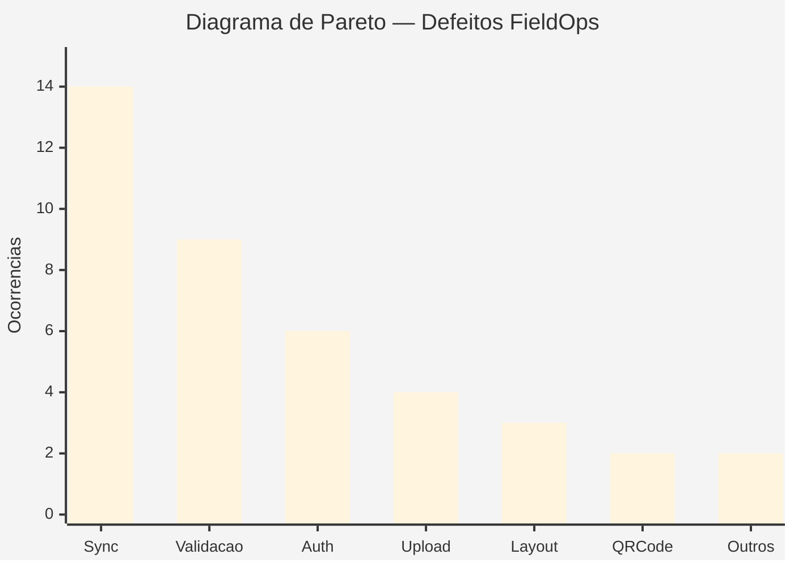
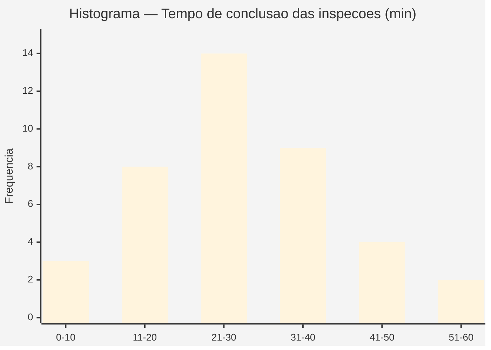
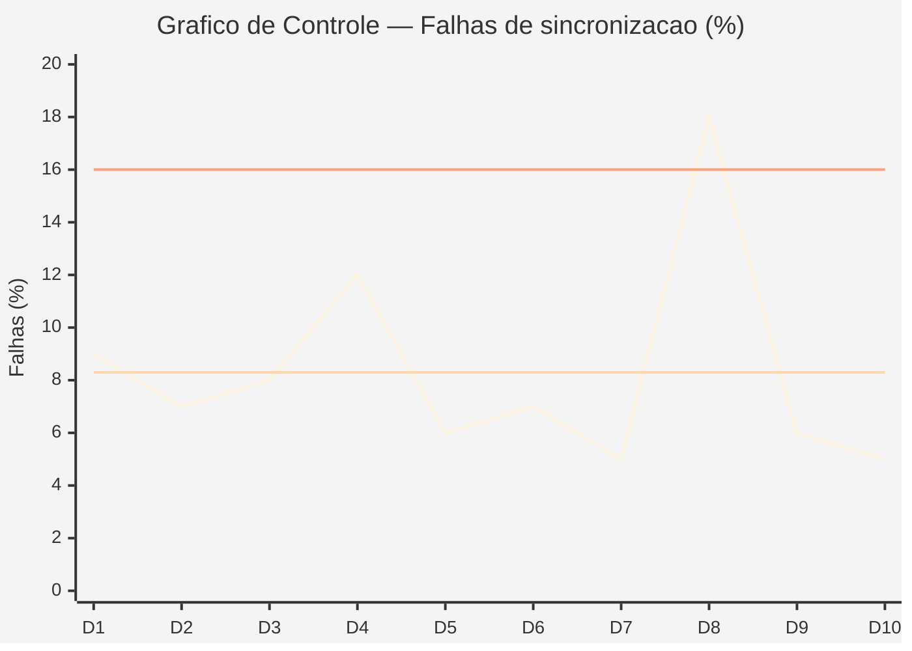

# 6 GERENCIAMENTO DA QUALIDADE

> **Projeto:** FieldOps — Plataforma de Inspeção em Campo
> **Equipe:** 404 Not Found

Este capítulo descreve como a qualidade foi planejada, garantida e controlada
ao longo do projeto FieldOps. O trabalho seguiu os três processos da área de
Gerenciamento da Qualidade do PMBOK: planejar (definir padrões e indicadores),
garantir (verificar se o processo está sendo seguido) e controlar (medir
resultados e corrigir desvios).

---

## 6.1 Critérios e Indicadores de Qualidade

### 6.1.1 Critérios de qualidade do produto

A equipe definiu os critérios abaixo como padrão mínimo para cada dimensão
relevante do produto. São os requisitos que o FieldOps precisa atender para ser
considerado funcional com qualidade.

| Dimensão | Critério |
|---|---|
| **Funcionalidade offline** | A inspeção deve poder ser executada sem internet após o download e nenhuma resposta confirmada deve ser perdida ao fechar o aplicativo |
| **Idempotência de sincronização** | Reenviar a mesma operação não pode criar registros duplicados no servidor |
| **Integridade do checklist** | Itens obrigatórios sem resposta bloqueiam a conclusão; itens não conformes com exigência de observação ou evidência também bloqueiam |
| **Rastreabilidade** | Cada resposta fica vinculada à versão do modelo de inspeção vigente no momento do agendamento; mudanças no modelo não afetam inspeções em andamento |
| **Segurança** | Tokens e senhas não aparecem em logs; autorizações são validadas pelo servidor, não apenas pela interface |
| **Revisão e aprovação** | Toda inspeção enviada passa por revisão do supervisor antes da aprovação; inspeções aprovadas ficam protegidas contra edição |
| **Conformidade de dados** | O banco de dados central é a fonte oficial após a sincronização |

### 6.1.2 Indicadores de qualidade

Os indicadores abaixo foram definidos para medir numericamente se os critérios
estão sendo cumpridos. A maioria foi levantado a partir dos defeitos observados
nos testes da Sprint 1.

| Indicador | Como é medido | Meta |
|---|---|:--:|
| Taxa de falha de sincronização | Operações com erro ÷ total de operações enviadas × 100 | < 10% |
| Cobertura de testes unitários | Linhas cobertas ÷ total de linhas testáveis × 100 | ≥ 70% |
| Defeitos abertos por categoria | Contagem semanal de issues abertas por tipo (sync, auth, validação, upload) | Redução progressiva |
| Conformidade do fluxo ponta a ponta | Verificação manual dos critérios de sucesso do MVP na demo | 100% |
| Tempo médio de conclusão de inspeção | Média entre o início e a conclusão registrados pelo dispositivo | 15–35 min |
| Regressões por sprint | Issues reabertas ou quebras em funcionalidades já entregues | 0 |

### 6.1.3 Critérios de qualidade do processo

Além do produto, a equipe definiu padrões de processo para reduzir a chance de
defeitos na origem.

| Padrão | Como é verificado |
|---|---|
| Pull Requests revisados antes do merge | Nenhuma mudança vai direto para a branch principal |
| Testes automatizados passando antes do merge | Verificação manual pré-merge (Jest no mobile, Vitest no frontend) |
| TypeScript sem erros de tipo | Checagem obrigatória antes de abrir PR |
| Issues rastreadas no board | Todo trabalho passa pelas colunas do Kanban (Backlog → In Progress → In Review → Done) |
| Documentação da API atualizada | Revisada junto com cada PR de back-end |

---

## 6.2 Controle e Garantia da Qualidade

### 6.2.1 Ferramentas de controle aplicadas

A equipe aplicou as Sete Ferramentas da Qualidade ao projeto para identificar
causas, priorizar correções e monitorar o desempenho ao longo das sprints. Os
resultados mais relevantes estão descritos a seguir.

#### Diagrama de Causa e Efeito (Ishikawa)

O problema analisado foi a perda ou inconsistência de respostas de inspeção
durante o uso offline e a sincronização — o risco técnico mais crítico do
projeto.

As causas de maior impacto ficaram em duas categorias:

- **Método:** reenvio de operações sem identificador único (ausência de
  idempotência) e regras de conflito não definidas.
- **Máquina/Tecnologia:** falhas de gravação no banco local e instabilidade de
  rede durante a sincronização.

Essas causas foram endereçadas diretamente no backlog: a implementação de um
identificador único por operação na fila de sincronização resolveu o problema
de duplicidade; o mecanismo de outbox com retry garantiu que as operações não
se percam em caso de falha de rede.

#### Fluxograma do ciclo de vida da inspeção

O mapeamento do fluxo completo — do agendamento à aprovação — mostrou dois
pontos de controle de qualidade embutidos no processo:

1. **Validação de obrigatórios** no aplicativo mobile, antes da conclusão:
   impede que checklists incompletos cheguem ao supervisor.
2. **Revisão do supervisor** na interface web: barreira humana antes da
   aprovação; o supervisor pode reprovar e solicitar correções.

Esses dois pontos garantem que a qualidade é verificada antes do resultado
ser considerado final, e não só no fim do processo.

#### Folha de Verificação e Diagrama de Pareto

A equipe coletou e classificou os defeitos encontrados durante 40 casos de
teste nas primeiras sprints.

| Categoria | Ocorrências | % Acumulado |
|---|:--:|:--:|
| Falha de sincronização offline | 14 | 35,0% |
| Validação de formulário/checklist | 9 | 57,5% |
| Autenticação / sessão | 6 | 72,5% |
| Upload de evidências | 4 | 82,5% |
| Layout / responsividade | 3 | 90,0% |
| Leitura de QR Code | 2 | 95,0% |
| Outros | 2 | 100,0% |

Pelo princípio de Pareto, as três primeiras categorias — sincronização,
validação e autenticação — respondem por 72,5% de todos os defeitos. A equipe
concentrou os esforços de correção e teste nessas três áreas ao longo das
sprints seguintes.

#### Histograma — Tempo de conclusão das inspeções

A distribuição do tempo de conclusão em 40 inspeções de teste ficou concentrada
na faixa de 21 a 30 minutos, com comportamento aproximadamente normal. Os 6
casos acima de 40 minutos correspondem a inspeções com muitas não conformidades
ou problemas de conexão durante os testes — situações que a equipe monitorou
separadamente.

#### Gráfico de Controle — Taxa de falhas de sincronização

A taxa diária de falhas de sincronização foi monitorada ao longo de 10 dias de
testes, com os seguintes parâmetros:

- Média (linha central): 8,3%
- Limite Superior de Controle: 16%
- Limite Inferior de Controle: 0%

O Dia 8 (18%) ultrapassou o limite superior, indicando um ponto fora de
controle. A causa foi uma instabilidade no ambiente de testes naquele dia. A
equipe investigou, corrigiu o ambiente e os dois dias seguintes voltaram aos
patamares normais. Os demais nove pontos ficaram dentro dos limites, mostrando
que o processo de sincronização opera de forma majoritariamente estável.

#### Diagrama de Dispersão — Complexidade do checklist e defeitos

A análise mostrou correlação positiva entre o número de itens no checklist e
a quantidade de defeitos: modelos com mais de 25 itens concentraram os casos
mais problemáticos. Isso levou a equipe a dar atenção especial a testes com
checklists maiores nas sprints seguintes.

### 6.2.2 Mecanismos de garantia da qualidade

A garantia da qualidade acompanha se o processo está sendo executado conforme
planejado, independente do resultado pontual.

| Mecanismo | Frequência | Responsável |
|---|:--:|---|
| Revisão de PR por outro membro | A cada PR | Revisor designado |
| Testes automatizados antes do merge | A cada PR | Autor do PR |
| Verificação de tipos (TypeScript) | A cada PR | Autor do PR |
| Atualização do board (Kanban) | A cada entrega | Responsável pela issue |
| Retrospectiva de sprint | A cada sprint | Toda a equipe |
| Revisão do indicador de falhas de sincronização | Semanal | Equipe técnica |

### 6.2.3 Ações corretivas e preventivas

| Ação | Tipo | Prioridade | Status |
|---|:--:|:--:|---|
| Idempotência na fila de sincronização (identificador único por operação) | Corretiva / Preventiva | Alta | ✅ Concluída |
| Testes de regressão para o fluxo de sincronização | Preventiva | Alta | ✅ Concluída |
| Validação de itens obrigatórios no mobile antes da conclusão | Preventiva | Alta | ✅ Concluída |
| Renovação automática de token expirado | Corretiva | Média | ✅ Concluída |
| Testes específicos para checklists com mais de 25 itens | Preventiva | Média | 🔄 Em andamento |
| Monitoramento semanal da taxa de falhas de sincronização | Preventiva | Média | 🔄 Em andamento |
| Investigação de causa especial quando o LSC for ultrapassado | Corretiva | Alta | ✅ Aplicada (Dia 8) |

### 6.2.4 Conclusão

Quatro pontos se destacaram ao longo do gerenciamento da qualidade do projeto.

Primeiro, a sincronização offline se confirmou como o risco de qualidade mais
crítico: liderou o Pareto com 35% dos defeitos e gerou o único ponto fora de
controle no monitoramento. A implementação da idempotência foi a correção de
maior impacto.

Segundo, os dois pontos de controle embutidos no fluxo — a validação de
obrigatórios no mobile e a revisão do supervisor — funcionaram como filtros
efetivos antes da aprovação final.

Terceiro, o processo de sincronização se mostrou majoritariamente estável:
nove dos dez dias monitorados ficaram dentro dos limites de controle, o que
significa que a variação observada é previsível e controlável.

Por fim, a complexidade do checklist influencia diretamente a quantidade de
defeitos: modelos maiores exigem cobertura de testes mais cuidadosa, e esse
padrão guiou a priorização dos testes nas sprints finais.
