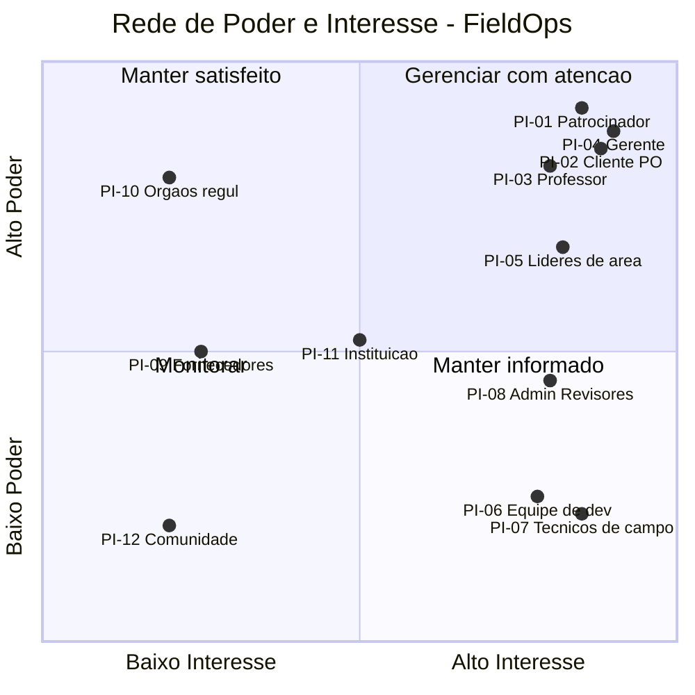

# 11 GERENCIAMENTO DAS PARTES INTERESSADAS

> **Projeto:** FieldOps — Plataforma de Inspeção em Campo
> **Equipe:** 404 Not Found
> **Documento:** Capítulo 11 do Relatório Final, adaptado ao *Template - Relatório Final*
> (seção *Gerenciamento das Partes Interessadas*, itens 11.1 e 11.2).

Neste capítulo são identificadas as partes interessadas do projeto FieldOps —
pessoas, grupos ou organizações que podem impactar ou ser impactados por uma
decisão, atividade ou resultado do projeto. Para cada parte interessada analisam-se
o **poder** (capacidade de influenciar decisões e recursos do projeto) e o
**interesse** (grau de preocupação com os resultados), além das expectativas e do
nível de engajamento. Em seguida são apresentadas a **rede de poder/interesse** e as
**estratégias de engajamento** adotadas para manter as partes alinhadas e
comprometidas ao longo de todo o ciclo de vida do projeto.

---

## 11.1 Identificação e Análise das Partes Interessadas

As partes interessadas foram identificadas considerando quem financia, decide,
executa, usa ou é afetado pelo FieldOps — incluindo o patrocinador, o cliente, a
equipe, os usuários finais, os fornecedores e os órgãos externos. Para cada parte
são descritos o tipo (interna ou externa), o poder, o interesse e a principal
expectativa em relação ao projeto.

### Escalas adotadas

- **Poder:** Baixo / Médio / Alto — capacidade de influenciar decisões, recursos,
  escopo ou prioridades do projeto.
- **Interesse:** Baixo / Médio / Alto — grau de preocupação com o andamento e os
  resultados do projeto.
- **Nível de engajamento:** Desinformado / Resistente / Neutro / Dá apoio / Lidera —
  classifica o envolvimento da parte interessada com o êxito do projeto.

### Registro das partes interessadas

| # | Parte interessada | Tipo | Poder | Interesse | Principal expectativa |
|---|---|---|:--:|:--:|---|
| PI-01 | Fundação Toyota do Brasil (Patrocinador) | Externa | Alto | Alto | Retorno do investimento de R$ 204.000,00 e MVP entregue no prazo |
| PI-02 | Cliente / Product Owner | Externa | Alto | Alto | Valor entregue e aderência aos requisitos de negócio |
| PI-03 | Professor / Orientador | Externa | Alto | Alto | Evolução acadêmica, qualidade e cumprimento das entregas |
| PI-04 | Natália — Gerente de Projeto | Interna | Alto | Alto | Projeto dentro de prazo, custo e escopo; sucesso do MVP |
| PI-05 | Líderes de área (Marcela, Júlia, Natália) | Interna | Médio/Alto | Alto | Coordenação técnica e integração entre as frentes |
| PI-06 | Equipe de desenvolvimento (Lucas, Andressa, Carol, Ian, Rodrigo, Felipe) | Interna | Baixo | Alto | Tarefas claras, dúvidas resolvidas e entregas concluídas |
| PI-07 | Técnicos de campo (usuários finais do app) | Externa | Baixo | Alto | App funcional, confiável e com bom uso offline |
| PI-08 | Administradores / Revisores (usuários do painel web) | Externa | Médio | Alto | Painel ágil para cadastro, revisão e aprovação de inspeções |
| PI-09 | Fornecedores de nuvem e serviços | Externa | Médio | Baixo | Contratação dos serviços e pagamentos em dia |
| PI-10 | Órgãos regulamentadores | Externa | Alto | Baixo | Conformidade legal e com normas de inspeção |
| PI-11 | Instituição de ensino (SENAI) | Externa | Médio | Médio | Reputação acadêmica e aderência à metodologia PBL |
| PI-12 | Comunidade / demais colegas de turma | Externa | Baixo | Baixo | Acompanhamento do projeto como referência |

> As partes internas (PI-04 a PI-06) executam e coordenam o projeto; as externas
> financiam, avaliam, usam ou regulam a solução. Os usuários finais (PI-07 e PI-08)
> têm baixo/médio poder formal, mas suas necessidades direcionam decisões de produto
> e critérios de aceite das entregas.

---

## 11.2 Estratégias de Engajamento e Gestão das Expectativas

### Rede de poder/interesse

A rede cruza o **poder** (eixo vertical) com o **interesse** (eixo horizontal),
definindo a estratégia de engajamento de cada quadrante: **monitorar**,
**manter informado**, **manter satisfeito** e **gerenciar com atenção**.

> PI-09 (Fornecedores) e PI-11 (Instituição) têm poder médio e interesse de médio a
> baixo; foram posicionados na faixa limítrofe entre "Monitorar" e "Manter
> satisfeito/informado" e recebem o esforço de engajamento do quadrante mais próximo.

### Estratégias de engajamento por quadrante

#### Gerenciar com atenção (Alto poder · Alto interesse)

Partes mais importantes — devem ser plenamente engajadas e mantidas satisfeitas.

| Parte interessada | Estratégia de engajamento | Canal |
|---|---|---|
| PI-01 Patrocinador (Toyota) | Relatórios de status e demonstração do valor entregue; alinhamento de investimento e prazo | Relatório quinzenal (e-mail) + demo por sprint |
| PI-02 Cliente / PO | Validação contínua das entregas, priorização do backlog e aprovação do MVP | Reunião + e-mail; demo de sprint |
| PI-03 Professor / Orientador | Apresentação da evolução e das entregas acadêmicas | Reunião + repositório |
| PI-04 Gerente de Projeto (Natália) | Condução integral do projeto, coordenação das frentes e das cerimônias | Todos os canais |

#### Manter satisfeito (Alto poder · Baixo interesse)

Pouco interesse no dia a dia, mas alto poder — manter satisfeitas sem sobrecarregar
com detalhes operacionais.

| Parte interessada | Estratégia de engajamento | Canal |
|---|---|---|
| PI-10 Órgãos regulamentadores | Garantir conformidade legal/normativa das inspeções; acionar somente quando necessário | Comunicação formal pontual |

#### Manter informado (Baixo poder · Alto interesse)

Muito interessadas e com baixo poder formal — manter bem informadas e engajadas.

| Parte interessada | Estratégia de engajamento | Canal |
|---|---|---|
| PI-05 Líderes de área | Alinhamento técnico e de integração entre Backend, Web e Mobile | Coordenação técnica semanal |
| PI-06 Equipe de desenvolvimento | Backlog claro, dailies, resolução de dúvidas e revisão de código | WhatsApp + GitHub (Issues/PR) |
| PI-07 Técnicos de campo (usuários) | Coletar feedback de usabilidade do app e do fluxo offline | Testes de campo + demonstrações |
| PI-08 Administradores / Revisores | Coletar feedback do painel de cadastro, revisão e aprovação | Demonstrações + homologação |

#### Monitorar (Baixo poder · Baixo interesse)

Acompanhar com esforço mínimo, sem comunicação intensa.

| Parte interessada | Estratégia de engajamento | Canal |
|---|---|---|
| PI-09 Fornecedores de serviços | Acompanhar contratos, SLA e pagamentos | Portais dos fornecedores |
| PI-11 Instituição de ensino (SENAI) | Manter aderência à metodologia PBL e disponibilizar o repositório | Repositório + entregas |
| PI-12 Comunidade / colegas | Compartilhar resultados ao final, sem comunicação dedicada | Repositório público |

### Nível de engajamento (atual × desejado)

A técnica analítica das partes interessadas classifica o engajamento **atual (C)** e
**desejado (D)** das principais partes, apontando as lacunas que direcionam as ações.

| Parte interessada | Desinformado | Resistente | Neutro | Dá apoio | Lidera |
|---|:--:|:--:|:--:|:--:|:--:|
| PI-01 Patrocinador (Toyota) | | | | C | D |
| PI-02 Cliente / PO | | | C | D | |
| PI-03 Professor / Orientador | | | | C → D | |
| PI-04 Gerente (Natália) | | | | | C/D |
| PI-05 Líderes de área | | | | | C/D |
| PI-06 Equipe de desenvolvimento | | | | C/D | |
| PI-07 Técnicos de campo | C | | D | | |
| PI-08 Administradores / Revisores | C | | D | | |

> **Legenda:** **C** = engajamento atual · **D** = engajamento desejado. As lacunas —
> como técnicos de campo e revisores ainda desinformados — direcionam ações de
> engajamento, como demonstrações e coleta de feedback ao longo das sprints.

### Monitoramento do engajamento

- O quadrante **"Gerenciar com atenção"** concentra Patrocinador, Cliente/PO,
  Professor e Gerente de Projeto — os atores de maior poder e interesse, que recebem
  comunicação mais frequente e formal.
- Cada estratégia de engajamento reutiliza os canais e frequências de comunicação já
  adotados pela equipe (relatório quinzenal ao cliente, demonstrações por sprint,
  coordenação técnica semanal e acompanhamento do backlog no board).
- O engajamento dos **fornecedores** conecta-se ao gerenciamento das aquisições e ao
  risco de indisponibilidade dos serviços de nuvem/API.
- A classificação e as estratégias são revisadas ao longo do projeto, ajustando o
  engajamento conforme novas partes interessadas surgem ou mudam de posição na rede.
