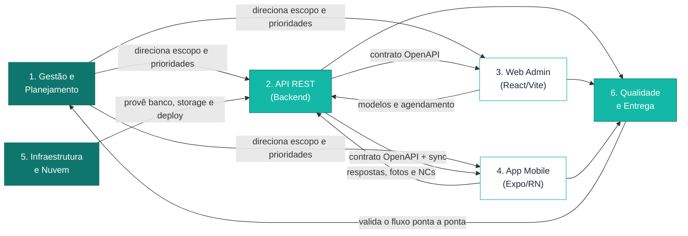

# 2 GERENCIAMENTO DA INTEGRAÇÃO

> **Projeto:** FieldOps — Plataforma de Inspeção em Campo
> **Equipe:** 404 Not Found
> **Documento:** Capítulo 2 do Relatório Final, adaptado ao *Template - Relatório Final*
> (seção *Gerenciamento da Integração*, itens 2.1 e 2.2).
>
> Não há um arquivo dedicado de integração em `docs/gestao/`; este capítulo é
> **derivado** do Termo de Abertura do Projeto (TAP), do `project-context.md`
> (steering) e da [`eap.md`](./eap.md), demonstrando como as frentes do FieldOps
> se articulam. Mantêm-se a numeração e os títulos do template.

Neste capítulo é apresentada a **visão geral integrada** do portfólio do FieldOps:
como os objetivos estratégicos da organização, o programa de desenvolvimento e as
iniciativas (frentes de trabalho) se relacionam, e de que forma as decisões
consideram os impactos que cada frente gera nas demais. O objetivo é demonstrar
que as decisões não foram tomadas de forma isolada, mas de maneira coordenada em
torno de um fluxo único de inspeção.

---

## 2.1 Estrutura e Direcionamento do Portfólio

O FieldOps é tratado como um **programa único** cujo propósito estratégico é
digitalizar e integrar o ciclo completo de inspeções técnicas em campo. Esse
programa se desdobra em **iniciativas (frentes de trabalho)** que correspondem às
grandes entregas da EAP e que, juntas, materializam o fluxo ponta a ponta.

### Direcionamento estratégico

| Nível | Elemento | Direcionamento |
|---|---|---|
| **Objetivo estratégico** | Digitalizar as inspeções em campo, com rastreabilidade e funcionamento offline | Substituir papel/planilhas por um fluxo digital integrado (TAP). |
| **Programa** | FieldOps — Plataforma de Inspeção em Campo | Entregar um MVP funcional em 3 meses, dentro do teto de R$ 204.000,00. |
| **Iniciativas (frentes)** | API REST, Web Admin, App Mobile, Infraestrutura, Gestão, Qualidade/Entrega | Cada frente contribui para um pedaço do fluxo e depende das demais. |

### Iniciativas do portfólio

As iniciativas correspondem às entregas de nível 1 da EAP:

| Iniciativa | Responsabilidade principal | Papel no fluxo de inspeção |
|---|---|---|
| **1. Gestão e Planejamento** | Documentação, escopo/backlog, arquitetura | Direciona e coordena as demais frentes. |
| **2. API REST (Backend)** | Regras de negócio, autenticação, persistência, sincronização | Núcleo integrador; fonte oficial dos dados após a sincronização. |
| **3. Interface Administrativa Web** | Cadastros, modelos, agendamento, revisão | Entrada das inspeções (planejamento) e saída (revisão/aprovação). |
| **4. Aplicativo Mobile** | Execução offline do checklist, evidências, sincronização | Coleta dos dados em campo. |
| **5. Infraestrutura e Nuvem** | Ambientes, banco, armazenamento de evidências, pipeline | Sustenta a operação de todas as frentes. |
| **6. Qualidade e Entrega** | Testes, implantação, demonstração | Valida e entrega o fluxo completo. |

### Critérios de direcionamento e priorização

O portfólio foi direcionado pela **priorização do fluxo principal (P0)** antes das
funcionalidades complementares (P1). Isso garante que o núcleo — autenticação,
modelos/checklist, execução offline, sincronização e revisão — esteja íntegro
antes de investir em itens como dashboard avançado, notificações push, relatório
PDF, exportação CSV e assinatura desenhada. Os critérios aplicados foram:
alinhamento com os objetivos do TAP, valor para o fluxo de inspeção, risco técnico
(com atenção à sincronização offline), dependências entre frentes e custo dentro
da linha de base.

---

## 2.2 Integração entre Portfólio, Programas e Projetos

A integração é o que garante que as seis iniciativas operem como **um sistema
único**, e não como projetos isolados. A espinha dorsal dessa integração é a **API
REST**, que atua como ponto central de regras de negócio e como fonte oficial dos
dados após a sincronização.

### Relações de dependência entre as frentes

### Como as decisões consideram impactos entre frentes

A integração é administrada por mecanismos concretos que tornam explícitas as
dependências e reduzem o risco de decisões isoladas:

| Mecanismo de integração | Como integra as frentes |
|---|---|
| **Contrato de API primeiro (OpenAPI/Swagger)** | Qualquer mudança no backend é publicada no contrato antes de impactar Web e Mobile, evitando retrabalho e quebra de integração. |
| **Snapshot de modelos** | Ao agendar a inspeção (web), a API congela o modelo em um snapshot; o mobile executa exatamente aquele checklist, garantindo consistência entre planejamento e execução. |
| **Sincronização idempotente** | O mobile envia operações com chave/UUID estável; a API concilia sem duplicar, integrando os dados coletados offline à fonte oficial. |
| **Estados da inspeção** | O ciclo RASCUNHO → ATRIBUÍDA → EM_ANDAMENTO → ENVIADA → EM_REVISÃO → APROVADA/REPROVADA/CANCELADA é compartilhado pelas três aplicações, mantendo todas alinhadas sobre a situação de cada inspeção. |
| **Infraestrutura compartilhada** | Banco PostgreSQL, armazenamento de evidências e pipeline de implantação sustentam simultaneamente API, web e mobile. |
| **Board e documentação únicos** | GitHub Issues/Projects e a pasta `docs/` centralizam decisões e status, servindo de ponto de integração da gestão com as frentes técnicas. |

### Integração por dependências, prioridades, recursos, custos e prazos

- **Dependências:** a Web e o Mobile só avançam com segurança após o contrato da
  API estar estável; por isso o backend concentra as entregas iniciais de
  autenticação e cadastros na Sprint 1, destravando as frentes consumidoras.
- **Prioridades:** o P0 (fluxo principal) é integrado e demonstrado antes do P1,
  assegurando que o conjunto esteja coeso antes de ampliar o escopo.
- **Recursos:** a equipe enxuta e o acúmulo de papéis exigem coordenação entre
  líderes (reunião técnica semanal) para evitar conflitos de alocação entre
  frentes — decisão registrada na gestão de recursos (Capítulo 7).
- **Custos:** a reserva de contingência (~7,7%) foi dimensionada justamente para
  os pontos de maior acoplamento e incerteza entre frentes (sincronização e
  construtor de modelos), conforme o Capítulo 5.
- **Prazos:** os marcos (MVP P0 completo e entrega final com P1) são
  compartilhados por todas as frentes, de modo que o sequenciamento de uma
  iniciativa respeite as demais.

> **Síntese da integração:** o FieldOps só entrega valor quando web, mobile, API e
> infraestrutura funcionam como um todo. A gestão da integração garante que cada
> decisão — de escopo, prazo, custo ou recurso — seja avaliada pelo seu impacto no
> fluxo completo de inspeção, e não apenas na frente onde é tomada.
