# 3 GERENCIAMENTO DO ESCOPO

> **Projeto:** FieldOps — Plataforma de Inspeção em Campo
> **Equipe:** 404 Not Found
> **Documento:** Capítulo 3 do Relatório Final, adaptado ao *Template - Relatório Final*
> (seção *Gerenciamento do Escopo*, itens 3.1 e 3.2).
>
> Este capítulo **reaproveita** a EAP já consolidada em [`eap.md`](./eap.md),
> encaixando-a na numeração e no formato do template (3.1 / 3.2). A EAP não é
> recriada: a estrutura, o diagrama e o dicionário permanecem os mesmos de
> `eap.md`; o que muda é a organização nos subitens. Não há divergência entre a
> EAP deste relatório e o documento-fonte.

Neste capítulo é apresentado o escopo das principais iniciativas do FieldOps,
deixando claro o que cada frente pretende realizar e quais entregas são
esperadas, além das premissas e restrições consideradas. Em seguida, a Estrutura
Analítica do Projeto (EAP/WBS) representa a decomposição organizada das entregas.

---

## 3.1 Definição do Escopo e Entregas

O escopo do FieldOps concentra-se no **MVP do fluxo completo de inspeção**, do
planejamento à revisão, com funcionamento offline e sincronização confiável. As
entregas são organizadas nas seis grandes frentes da EAP.

### Escopo do MVP por frente (entregas)

| Frente (iniciativa) | Entregas principais do MVP |
|---|---|
| **1. Gestão e Planejamento** | Documentação do projeto, escopo e backlog definidos, arquitetura e modelo de dados. |
| **2. API REST (Backend)** | Autenticação/autorização (JWT), cadastros de domínio, modelos versionados, ciclo de vida da inspeção, evidências e não conformidades, sincronização offline, auditoria e OpenAPI. |
| **3. Interface Administrativa Web** | Base e design system, cadastros administrativos, construtor de modelos, agendamento/acompanhamento, revisão e aprovação. |
| **4. Aplicativo Mobile** | Base e design system, consulta/detalhes de inspeções, execução de checklist dinâmico, evidências + QR Code + geolocalização, armazenamento offline e sincronização. |
| **5. Infraestrutura e Nuvem** | Ambientes e banco provisionados, armazenamento de evidências, pipeline de implantação. |
| **6. Qualidade e Entrega** | Sistema testado, sistema implantado, protótipo e apresentação entregues. |

### Premissas do escopo

- Android é a plataforma mobile prioritária e obrigatória para validação.
- Cada inspeção tem **um** técnico responsável no MVP.
- As inspeções baseiam-se em **modelos previamente configurados e publicados**.
- Após a sincronização, a **API é a fonte oficial** de registro das informações.
- O aplicativo preserva localmente os dados ainda não sincronizados, inclusive
  após o fechamento.

### Restrições do escopo (fora do MVP)

Não fazem parte do escopo inicial, conforme o TAP: roteirização automática de
equipes, acompanhamento contínuo de localização, integração com ERP,
inteligência artificial para diagnóstico, sensores IoT e assinatura eletrônica
com validade jurídica. Essa delimitação protege o fluxo principal diante das
restrições de prazo (3 meses) e orçamento (R$ 204.000,00).

---

## 3.2 Estrutura Analítica do Projeto (EAP)

A EAP decompõe o produto FieldOps em seis entregas de nível 1 e seus pacotes de
trabalho. A estrutura textual, o diagrama e o dicionário abaixo são reproduzidos
de [`eap.md`](./eap.md).

### Identificação

| Campo | Informação |
|---|---|
| **Projeto** | FieldOps — Plataforma de Inspeção em Campo |
| **Gerente do projeto** | Natália |
| **Data** | 28/08/2026 |
| **Versão** | 1.0 |

### Estrutura textual da EAP

```text
FIELDOPS — PLATAFORMA DE INSPEÇÃO EM CAMPO
│
├── 1. GESTÃO E PLANEJAMENTO DO PROJETO
│   ├── 1.1 Documentação do projeto produzida
│   ├── 1.2 Escopo e backlog definidos
│   └── 1.3 Arquitetura e modelo de dados definidos
│
├── 2. API REST (BACKEND)
│   ├── 2.1 Autenticação e autorização implementadas
│   ├── 2.2 Cadastros de domínio implementados
│   ├── 2.3 Modelos de inspeção e versionamento implementados
│   ├── 2.4 Ciclo de vida da inspeção implementado
│   ├── 2.5 Evidências e não conformidades implementadas
│   ├── 2.6 Sincronização offline implementada
│   └── 2.7 Auditoria e documentação da API produzidas
│
├── 3. INTERFACE ADMINISTRATIVA WEB (REACT + VITE)
│   ├── 3.1 Base do app e design system implementados
│   ├── 3.2 Cadastros administrativos implementados
│   ├── 3.3 Construtor de modelos de inspeção implementado
│   ├── 3.4 Agendamento e acompanhamento implementados
│   └── 3.5 Revisão e aprovação implementadas
│
├── 4. APLICATIVO MOBILE (EXPO / REACT NATIVE)
│   ├── 4.1 Base do app e design system implementados
│   ├── 4.2 Consulta e detalhes de inspeções implementados
│   ├── 4.3 Execução de checklist implementada
│   ├── 4.4 Evidências, QR Code e geolocalização implementados
│   └── 4.5 Armazenamento offline e sincronização implementados
│
├── 5. INFRAESTRUTURA E NUVEM
│   ├── 5.1 Ambientes e banco de dados provisionados
│   ├── 5.2 Armazenamento de evidências configurado
│   └── 5.3 Pipeline de implantação configurado
│
└── 6. QUALIDADE E ENTREGA
    ├── 6.1 Sistema testado
    ├── 6.2 Sistema implantado
    └── 6.3 Protótipo e apresentação entregues
```

> **Nota sobre a stack web:** o diagrama de `eap.md` referencia "Angular" no texto
> da entrega 3. A stack real do web admin é **React + Vite + TypeScript**
> (confirmada em `frontend/` e em `docs/convencoes-frontend-web.md`). A estrutura
> textual acima já reflete a stack correta; recomenda-se alinhar o rótulo em
> `eap.md` para eliminar essa divergência.

### Diagrama da EAP (Mermaid)

```mermaid
flowchart TB
    P["FIELDOPS<br/>Plataforma de Inspeção em Campo"]

    G1["1. Gestão e<br/>Planejamento"]
    G2["2. API REST<br/>(Backend)"]
    G3["3. Interface<br/>Administrativa Web"]
    G4["4. Aplicativo<br/>Mobile"]
    G5["5. Infraestrutura<br/>e Nuvem"]
    G6["6. Qualidade<br/>e Entrega"]

    P --> G1
    P --> G2
    P --> G3
    P --> G4
    P --> G5
    P --> G6

    G1 --> G1_1["1.1 Documentação<br/>produzida"]
    G1 --> G1_2["1.2 Escopo e<br/>backlog definidos"]
    G1 --> G1_3["1.3 Arquitetura e<br/>modelo de dados"]

    G2 --> G2_1["2.1 Autenticação e<br/>autorização"]
    G2 --> G2_2["2.2 Cadastros de<br/>domínio"]
    G2 --> G2_3["2.3 Modelos e<br/>versionamento"]
    G2 --> G2_4["2.4 Ciclo de vida<br/>da inspeção"]
    G2 --> G2_5["2.5 Evidências e<br/>não conformidades"]
    G2 --> G2_6["2.6 Sincronização<br/>offline"]
    G2 --> G2_7["2.7 Auditoria e<br/>documentação da API"]

    G3 --> G3_1["3.1 Base e<br/>design system"]
    G3 --> G3_2["3.2 Cadastros<br/>administrativos"]
    G3 --> G3_3["3.3 Construtor de<br/>modelos"]
    G3 --> G3_4["3.4 Agendamento e<br/>acompanhamento"]
    G3 --> G3_5["3.5 Revisão e<br/>aprovação"]

    G4 --> G4_1["4.1 Base e<br/>design system"]
    G4 --> G4_2["4.2 Consulta e<br/>detalhes"]
    G4 --> G4_3["4.3 Execução de<br/>checklist"]
    G4 --> G4_4["4.4 Evidências, QR<br/>Code e localização"]
    G4 --> G4_5["4.5 Offline e<br/>sincronização"]

    G5 --> G5_1["5.1 Ambientes e<br/>banco de dados"]
    G5 --> G5_2["5.2 Armazenamento<br/>de evidências"]
    G5 --> G5_3["5.3 Pipeline de<br/>implantação"]

    G6 --> G6_1["6.1 Sistema<br/>testado"]
    G6 --> G6_2["6.2 Sistema<br/>implantado"]
    G6 --> G6_3["6.3 Protótipo e<br/>apresentação"]

    classDef projeto fill:#0F766E,stroke:#0F766E,color:#fff,font-weight:bold;
    classDef entrega fill:#14B8A6,stroke:#0F766E,color:#fff;
    classDef pacote fill:#FFFFFF,stroke:#14B8A6,color:#1E293B;

    class P projeto;
    class G1,G2,G3,G4,G5,G6 entrega;
    class G1_1,G1_2,G1_3,G2_1,G2_2,G2_3,G2_4,G2_5,G2_6,G2_7,G3_1,G3_2,G3_3,G3_4,G3_5,G4_1,G4_2,G4_3,G4_4,G4_5,G5_1,G5_2,G5_3,G6_1,G6_2,G6_3 pacote;
```



> Caso o relatório final seja consolidado em `.docx`, este diagrama deve ser
> exportado como imagem (FIGURA 1 na lista de ilustrações).

### Dicionário da EAP

| Código | Elemento | Descrição |
|---|---|---|
| 1.0 | Gestão e Planejamento do Projeto | Definição e organização do escopo, documentação e decisões estruturais do projeto |
| 1.1 | Documentação do projeto produzida | Documentos (visão, objetivos, personas, casos de uso, regras de negócio) organizados e revisados |
| 1.2 | Escopo e backlog definidos | Escopo do MVP delimitado e backlog do produto com histórias e critérios de aceitação |
| 1.3 | Arquitetura e modelo de dados definidos | Decisões arquiteturais, diagrama de componentes e modelo de dados documentados |
| 2.0 | API REST (Backend) | Serviço central em Java + Spring Boot com as regras de negócio e persistência |
| 2.1 | Autenticação e autorização implementadas | Login por JWT e controle de acesso por perfil (Técnico, Supervisor, Administrador) |
| 2.2 | Cadastros de domínio implementados | Endpoints de clientes, locais, equipamentos e usuários persistidos em PostgreSQL |
| 2.3 | Modelos de inspeção e versionamento implementados | Criação, publicação e versionamento de modelos com seções e itens |
| 2.4 | Ciclo de vida da inspeção implementado | Agendamento, atribuição, execução, envio e transições de estado |
| 2.5 | Evidências e não conformidades implementadas | Upload/consulta de fotos vinculadas a itens e registro de não conformidades |
| 2.6 | Sincronização offline implementada | Operações idempotentes para receber e conciliar dados enviados pelo mobile |
| 2.7 | Auditoria e documentação da API produzidas | Registro de auditoria de eventos e documentação OpenAPI/Swagger publicada |
| 3.0 | Interface Administrativa Web (React + Vite) | Aplicação web para supervisores e administradores |
| 3.1 | Base do app e design system implementados | Estrutura React/Vite, roteamento, layout e componentes reutilizáveis |
| 3.2 | Cadastros administrativos implementados | Telas de usuários, clientes, locais e equipamentos integradas à API |
| 3.3 | Construtor de modelos de inspeção implementado | Editor de modelos com seções, itens, tipos de resposta e validação de publicação |
| 3.4 | Agendamento e acompanhamento implementados | Telas de agendamento, listagem, filtros e dashboard de acompanhamento |
| 3.5 | Revisão e aprovação implementadas | Tela de revisão de respostas e evidências com aprovação, reprovação e NCs |
| 4.0 | Aplicativo Mobile (Expo / React Native) | Aplicativo para técnicos de campo, com suporte offline |
| 4.1 | Base do app e design system implementados | Estrutura Expo, navegação, autenticação e componentes reutilizáveis |
| 4.2 | Consulta e detalhes de inspeções implementados | Telas de início, lista e detalhes das inspeções atribuídas |
| 4.3 | Execução de checklist implementada | Checklist dinâmico com todos os tipos de resposta, salvamento local e obrigatoriedade |
| 4.4 | Evidências, QR Code e geolocalização implementados | Captura de fotos, leitura de QR Code e registro de localização |
| 4.5 | Armazenamento offline e sincronização implementados | Persistência local em SQLite e sincronização ao reconectar |
| 5.0 | Infraestrutura e Nuvem | Ambientes, serviços e recursos que sustentam a solução |
| 5.1 | Ambientes e banco de dados provisionados | Ambientes configurados e banco PostgreSQL provisionado |
| 5.2 | Armazenamento de evidências configurado | Serviço de armazenamento de objetos para fotos disponibilizado |
| 5.3 | Pipeline de implantação configurado | Build, containerização e implantação automatizados |
| 6.0 | Qualidade e Entrega | Verificação, disponibilização e demonstração da solução |
| 6.1 | Sistema testado | Testes de funcionalidades e de integração entre os componentes |
| 6.2 | Sistema implantado | Solução disponibilizada nos ambientes de destino |
| 6.3 | Protótipo e apresentação entregues | Protótipo navegável e apresentação do fluxo completo do MVP |

> **Rastreabilidade:** cada pacote da EAP corresponde a conjuntos de PBIs do
> [`cronograma.md`](./cronograma.md), o que liga diretamente o escopo (Capítulo 3)
> ao planejamento temporal (Capítulo 4).
