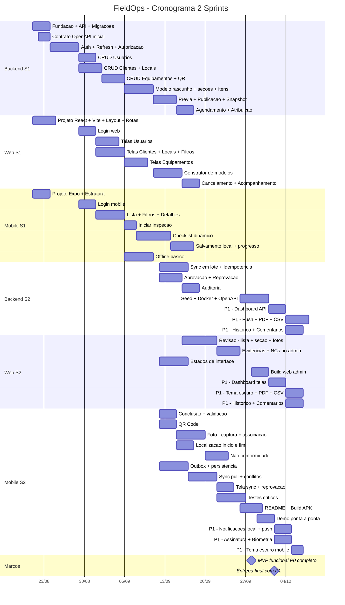

# 4 GERENCIAMENTO DO CRONOGRAMA

> **Projeto:** FieldOps — Plataforma de Inspeção em Campo
> **Equipe:** 404 Not Found
> **Documento:** Capítulo 4 do Relatório Final, adaptado ao *Template - Relatório Final*
> (seção *Gerenciamento do Tempo*, itens 4.1 e 4.2).
>
> Este capítulo **reaproveita** o [`cronograma.md`](./cronograma.md) — backlog por
> sprint/área e gráfico de Gantt em Mermaid com marcos —, encaixando-o na
> numeração e no formato do template (4.1 / 4.2). O cronograma não é recriado: o
> sequenciamento, as dependências e os marcos permanecem os mesmos do
> documento-fonte; o que muda é a organização nos subitens.

Neste capítulo é apresentado como a equipe organizou temporalmente as frentes do
FieldOps, considerando prazos, dependências e sequência de execução. Indica-se
quais entregas precisam ocorrer antes de outras e quais podem ser realizadas em
paralelo, dentro das limitações de recursos da equipe. Em seguida, o cronograma
(Gantt) e o roadmap apresentam a visão temporal e os marcos do projeto.

---

## 4.1 Planejamento e Sequenciamento das Atividades

O projeto foi planejado em **duas sprints**, iniciando em 21/08/2026, com as três
frentes de desenvolvimento (Backend, Web e Mobile) trabalhando em paralelo, mas
condicionadas a dependências técnicas.

### Lógica de sequenciamento

- **O backend destrava as frentes consumidoras.** Autenticação/autorização e os
  cadastros de domínio são entregues cedo na Sprint 1, pois Web e Mobile dependem
  do contrato da API para avançar com segurança (login, telas e consumo de
  dados).
- **Modelos antes de execução.** O construtor de modelos (web) e a publicação com
  snapshot (API) precedem a execução do checklist dinâmico no mobile, já que o
  app executa exatamente o snapshot publicado.
- **Coleta antes de sincronização e revisão.** A execução offline e o
  salvamento local (mobile) precedem a sincronização em lote (API) e, por fim, a
  revisão e aprovação (web).
- **Paralelismo controlado.** Enquanto o backend evolui autenticação e cadastros,
  a Web monta base/layout/rotas e o Mobile monta a estrutura Expo e o offline
  básico — atividades sem dependência direta que podem ocorrer simultaneamente.

### Sequenciamento e dependências (Sprint 1)

| Ordem | Atividade | Frente | Depende de |
|---|---|---|---|
| 1 | Fundação + API + migrações | Backend | — |
| 1 | Projeto React + Vite + layout + rotas | Web | — (paralelo) |
| 1 | Projeto Expo + estrutura | Mobile | — (paralelo) |
| 2 | Autenticação + refresh + autorização | Backend | Fundação/API |
| 3 | Login web / Login mobile | Web / Mobile | Auth na API |
| 4 | CRUDs (usuários, clientes, locais, equipamentos) | Backend | Auth |
| 5 | Telas de cadastros | Web | CRUDs da API |
| 6 | Modelo rascunho + seções + itens + publicação + snapshot | Backend | CRUDs |
| 7 | Construtor de modelos | Web | Modelos na API |
| 8 | Checklist dinâmico (execução) | Mobile | Snapshot publicado |

### Sequenciamento e dependências (Sprint 2)

| Ordem | Atividade | Frente | Depende de |
|---|---|---|---|
| 1 | Conclusão + validação / QR Code / foto / localização | Mobile | Execução do checklist |
| 1 | Outbox + persistência | Mobile | Salvamento local |
| 2 | Sincronização em lote + idempotência | Backend | Outbox do mobile |
| 2 | Pull de alterações + conflitos | Mobile | Sync da API |
| 3 | Aprovação / reprovação + auditoria | Backend | Inspeção enviada |
| 4 | Revisão (lista + seção + fotos) + evidências/NCs | Web | Aprovação/reprovação na API |
| 5 | Seed + Docker + OpenAPI | Backend | Fluxo principal |
| 6 | Testes críticos + build APK + demo ponta a ponta | Mobile/Equipe | Fluxo integrado |
| 7 | P1 (dashboard, push, PDF, CSV, tema escuro, assinatura, biometria) | Todas | MVP P0 completo |

> **Limitações de recursos:** por ser equipe enxuta (9 integrantes com acúmulo de
> papéis), o sequenciamento concentra 4 desenvolvedores na Web e distribui pares
> em Backend e Mobile. Cards que cruzam frentes têm responsabilidade compartilhada
> (ver Capítulos 7 e 9), e a priorização P0 → P1 protege o núcleo caso o prazo
> aperte.

---

## 4.2 Cronograma e Roadmap do Portfólio

O roadmap cobre as duas sprints do projeto (a partir de 21/08/2026) e culmina nos
dois marcos principais: **MVP funcional P0 completo** e **entrega final com P1**.

### Gráfico de Gantt (Mermaid)

> Caso o relatório final seja consolidado em `.docx`, este Gantt deve ser
> exportado como imagem (FIGURA 3 na lista de ilustrações).

### Roadmap e marcos

| Marco | Data | Significado |
|---|---|---|
| **Início do projeto** | 21/08/2026 | Começo da Sprint 1 (fundação das três frentes). |
| **Fim da Sprint 1** | 14/09/2026 | Núcleo de auth, cadastros, modelos e execução do checklist encaminhado. |
| **Sprint 2** | 15/09 → 02/10/2026 | Sincronização, revisão/aprovação, qualidade, entrega e itens P1. |
| **MVP funcional P0 completo** | 28/09/2026 | Fluxo principal íntegro (auth, checklist, foto, offline, sync, revisão). |
| **Entrega final com P1** | 02/10/2026 | Demonstração ponta a ponta com as funcionalidades complementares. |

> **Aderência ao TAP:** o TAP estima três meses a partir de agosto/2026; o
> cronograma detalhado concentra as entregas do MVP nas duas sprints, com os
> marcos de MVP P0 e entrega final representados. O backlog completo por PBI,
> sprint e área está em [`cronograma.md`](./cronograma.md) (QUADRO 2 na lista de
> quadros).
