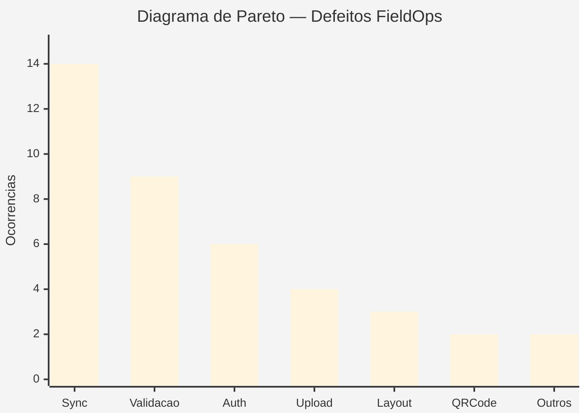
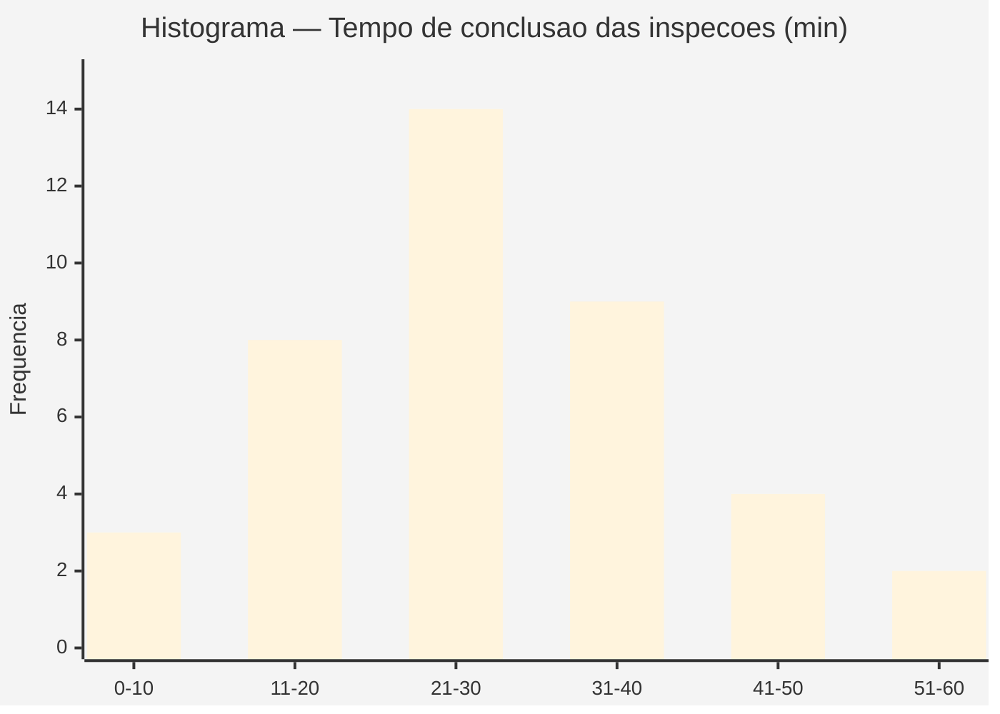
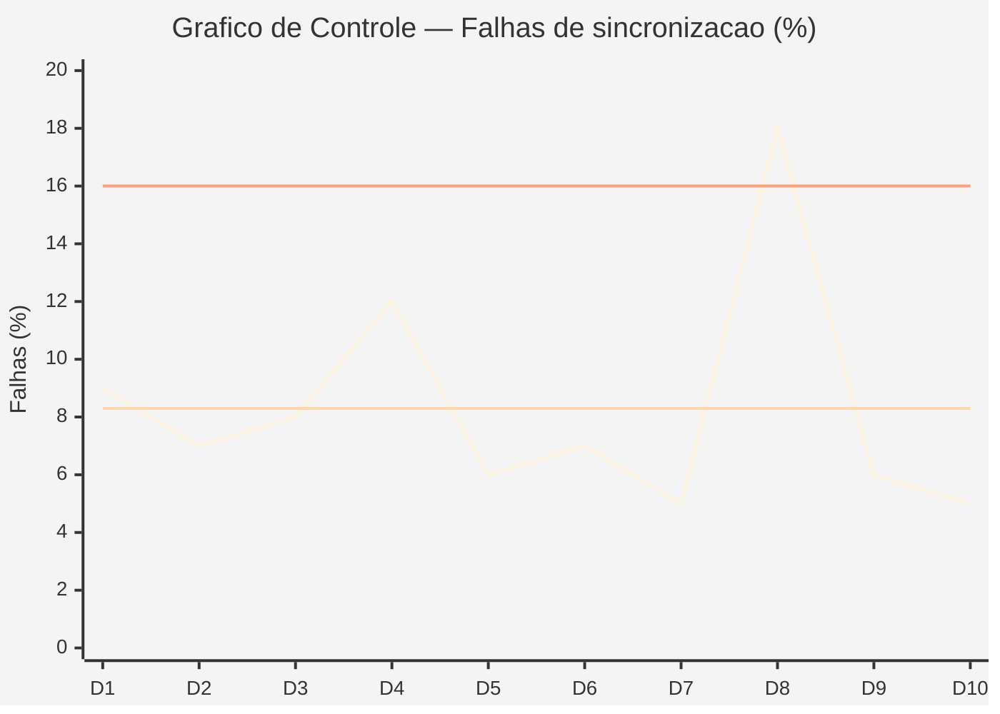

# 6 GERENCIAMENTO DA QUALIDADE

> **Projeto:** FieldOps — Plataforma de Inspeção em Campo
> **Equipe:** 404 Not Found
> **Documento:** Capítulo 6 do Relatório Final, adaptado ao *Template - Relatório Final*
> (seção *Gerenciamento da Qualidade*, itens 6.1 e 6.2).
>
> Este capítulo reaproveita a análise realizada em
> [`aula05-analise-qualidade.md`](./aula05-analise-qualidade.md), que aplicou as
> **Sete Ferramentas da Qualidade** ao projeto FieldOps. O que muda é a
> organização no formato do template: 6.1 apresenta os critérios e indicadores
> de qualidade; 6.2 apresenta como o controle e a garantia são exercidos na
> prática, com as ferramentas e os resultados obtidos.

Neste capítulo é descrito como a qualidade é planejada, garantida e controlada
no projeto FieldOps. O gerenciamento da qualidade acompanha três processos
complementares do PMBOK (área 8): **planejar a qualidade** (definir padrões e
indicadores), **garantir a qualidade** (verificar se os processos seguem o que
foi planejado) e **controlar a qualidade** (medir resultados, identificar desvios
e acionar correções).

---

## 6.1 Critérios e Indicadores de Qualidade

Esta seção define os **padrões de qualidade** que o projeto se compromete a
atender e os **indicadores** usados para medir se esses padrões estão sendo
alcançados. Os critérios derivam diretamente dos objetivos do projeto (documento
[`docs/referencias/notion.md`](../referencias/notion.md), seção 2.7 —
*Indicadores de sucesso do MVP*) e das regras de negócio que o produto deve
respeitar.

### 6.1.1 Critérios de qualidade do produto

Os critérios abaixo representam os padrões mínimos que o FieldOps deve atingir
para ser considerado de qualidade em cada dimensão relevante.

| Dimensão | Critério de qualidade | Referência |
|---|---|---|
| **Funcionalidade offline** | A inspeção deve poder ser executada sem internet após o download e nenhuma resposta confirmada deve ser perdida ao fechar o app | RN-065, RN-066, UC-13 |
| **Idempotência de sincronização** | O reenvio de uma operação já aplicada não deve criar registros duplicados | RN-068, RN-067 |
| **Integridade do checklist** | Todos os itens obrigatórios devem ser respondidos antes da conclusão; itens não conformes com exigência de observação ou evidência devem bloquear a conclusão | RN-037, RN-038, RN-039 |
| **Rastreabilidade** | Toda resposta deve estar vinculada a um snapshot imutável da versão do modelo utilizado; alterações no modelo não afetam inspeções em andamento | RN-021, RN-019 |
| **Segurança** | Tokens e senhas não podem aparecer em logs; autorizações são validadas pela API, não apenas pelo front | RN-003, RN-007 |
| **Revisão e aprovação** | Toda inspeção enviada deve passar por revisão antes da aprovação; uma inspeção aprovada não pode ser editada | RN-044, RN-082 |
| **Conformidade de dados** | O banco de dados central (PostgreSQL) é a fonte oficial após a sincronização | RN-073 |

### 6.1.2 Indicadores de qualidade

Os indicadores permitem medir numericamente se os critérios estão sendo
atendidos. Foram definidos a partir da folha de verificação e do diagrama de
Pareto aplicados na análise da qualidade.

| Indicador | Fórmula / Definição | Meta | Período de coleta |
|---|---|:--:|---|
| **Taxa de falha de sincronização** | (Operações com erro / Total de operações enviadas) × 100 | < 10% | Por sprint |
| **Taxa de cobertura de testes unitários** | (Linhas cobertas por testes / Total de linhas testáveis) × 100 | ≥ 70% | Por sprint |
| **Defeitos abertos por categoria** | Contagem de issues abertas no board por tipo (sync, auth, validação, upload) | Redução progressiva | Semanal |
| **Conformidade do fluxo ponta a ponta** | Checklists do MVP (seção 2.7 de notion.md) verificados manualmente na demo | 100% concluídos | Por demo |
| **Tempo médio de conclusão de inspeção** | Média do tempo entre "início" e "conclusão" (device timestamp) | 15–35 min | Por sprint de testes |
| **Regressões introduzidas por sprint** | Issues reabertas ou quebras em funcionalidades previamente funcionais | 0 | Por sprint |

> **Relação com os objetivos do projeto:** os dois primeiros indicadores
> (falhas de sync e cobertura de testes) endereçam diretamente o objetivo
> acadêmico de "sincronização baseada em fila e idempotência" (seção 8.6 de
> notion.md) e o indicador técnico mais crítico apontado pelo diagrama de Pareto
> (35% dos defeitos são de sincronização).

### 6.1.3 Critérios de qualidade do processo

Além do produto, a equipe adota padrões de processo que reduzem a probabilidade
de defeitos na origem:

| Padrão de processo | Como é verificado |
|---|---|
| Pull Requests revisados antes do merge para `develop` | Nenhum merge direto na branch principal; toda mudança passa por PR |
| Nomenclatura de commits seguindo iuricode (emoji + tipo + descrição) | Histórico do repositório |
| Testes (Jest / Vitest) devem passar antes do merge | CI ou verificação manual pré-merge |
| TypeScript strict sem erros (`tsc --noEmit`) | Verificação obrigatória antes de abrir PR |
| Issues rastreadas no board (Backlog → In Review → Done) | Kanban no GitHub Projects |
| Documentação de API no Swagger/OpenAPI atualizada | Verificação na revisão de PR de back-end |

---

## 6.2 Controle e Garantia da Qualidade

Esta seção descreve como a qualidade é **monitorada em tempo real** e como
**ações corretivas** são acionadas quando os indicadores saem dos limites
aceitáveis. As ferramentas apresentadas foram aplicadas ao projeto e seus
resultados estão detalhados na análise de base
([`aula05-analise-qualidade.md`](./aula05-analise-qualidade.md)).

### 6.2.1 Ferramentas de controle aplicadas

#### Diagrama de Causa e Efeito (Ishikawa)

Aplicado ao problema central de qualidade do projeto: *"Perda ou inconsistência
de respostas de inspeção durante o uso offline/sincronização"*.

A análise identificou que as causas mais críticas concentram-se em duas
categorias:

- **Método:** falta de idempotência no reenvio e regras de conflito mal
  definidas — endereçadas pelos PBIs 050–055 do backlog.
- **Máquina/Tecnologia:** falha de gravação no SQLite e instabilidade de rede —
  tratadas pelo mecanismo de outbox com retry e pelo estado de sincronização
  exibido ao técnico.

O diagrama completo está em [`aula05-analise-qualidade.md`](./aula05-analise-qualidade.md),
seção 2.1.

#### Fluxograma do ciclo de vida da inspeção

O fluxograma (seção 2.2 da análise) evidenciou dois **pontos de controle de
qualidade** no fluxo principal:

1. **Validação de obrigatórios** (mobile, antes da conclusão) — impede que
   itens sem resposta, sem observação ou sem evidência avancem para a revisão.
2. **Revisão do supervisor** (web) — barreira humana antes da aprovação; o
   supervisor pode reprovar e solicitar correção.

Esses dois pontos atuam como filtros de prevenção de defeitos, alinhados ao
princípio de qualidade *built-in* (qualidade embutida no processo, não só
verificada no final).

#### Folha de Verificação e Diagrama de Pareto

A coleta de defeitos em 40 casos de teste resultou na seguinte distribuição:

| Categoria | Ocorrências | % Acumulado |
|---|:--:|:--:|
| Falha de sincronização offline | 14 | 35,0% |
| Validação de formulário/checklist | 9 | 57,5% |
| Autenticação / sessão (token) | 6 | 72,5% |
| Upload de evidências (foto) | 4 | 82,5% |
| Layout / responsividade | 3 | 90,0% |
| Leitura de QR Code | 2 | 95,0% |
| Outros | 2 | 100,0% |

**Resultado do Pareto:** as três primeiras categorias (sincronização, validação
e autenticação) respondem por **72,5%** dos defeitos. A ação de qualidade de
maior retorno é concentrar esforços de testes e correção nessas três áreas —
exatamente o que os PBIs das sprints 1 e 2 priorizaram.

#### Histograma — Tempo de conclusão das inspeções

O histograma (seção 2.5 da análise) mostrou distribuição aproximadamente normal
com concentração na faixa de **21–30 minutos** por inspeção. A cauda acima de
40 minutos (6 casos em 40) indica inspeções com muitas não conformidades ou
problemas de conexão — casos que justificam atenção específica de testes.

#### Gráfico de Controle — Taxa de falhas de sincronização

O gráfico de controle (seção 2.6 da análise) monitorou a taxa de falhas de
sincronização (%) ao longo de 10 dias de testes:

- **Média (linha central):** 8,3%
- **Limite Superior de Controle (LSC):** 16%
- **Limite Inferior de Controle (LIC):** 0%

**Resultado:** o **Dia 8 (18%)** ultrapassa o LSC — ponto **fora de controle**
causado por instabilidade de rede/deploy naquele dia (causa especial). Os demais
9 pontos estão dentro dos limites, indicando que o processo opera com
**variação comum** (estável). A ação corretiva foi investigar e isolar a causa
especial; a tendência de queda nos dias 9 e 10 confirma que a correção surtiu
efeito.

#### Diagrama de Dispersão — Complexidade do checklist × defeitos

A análise de correlação (seção 2.7) revelou relação positiva entre número de
itens no checklist e quantidade de defeitos reportados. Checklists com mais de
25 itens concentram os casos com mais defeitos, o que levou à adoção de testes
de regressão específicos para modelos grandes.

### 6.2.2 Mecanismos de garantia da qualidade (processo)

A garantia da qualidade verifica se os **processos** estão sendo seguidos
conforme planejado — não apenas se os resultados são bons.

| Mecanismo | Frequência | Responsável |
|---|:--:|---|
| Revisão de PR por outro membro da equipe | A cada PR | Revisor designado |
| Execução de testes automatizados (Jest / Vitest) antes do merge | A cada PR | Autor do PR |
| Verificação `tsc --noEmit` sem erros | A cada PR | Autor do PR |
| Atualização do board (mover issues para "In Review" após entrega) | A cada entrega | Responsável pela issue |
| Retrospectiva de sprint (identificar melhorias de processo) | A cada sprint | Toda a equipe |
| Revisão do indicador de falhas de sincronização | Semanal | Equipe técnica |

### 6.2.3 Ações corretivas e preventivas

As ações foram derivadas das conclusões da análise de qualidade e priorizadas
pelo Pareto:

| Ação | Tipo | Prioridade | Status |
|---|:--:|:--:|---|
| Implementar idempotência na outbox (operationId único por operação) | Corretiva / Preventiva | Alta | ✅ Concluída (PBI-052) |
| Adicionar testes de regressão para o fluxo de sincronização | Preventiva | Alta | ✅ Concluída |
| Reforçar validação de itens obrigatórios no mobile antes da conclusão | Preventiva | Alta | ✅ Concluída (RN-037/038/039) |
| Tratar expiração de token com renovação automática | Corretiva | Média | ✅ Concluída |
| Criar testes específicos para checklists com mais de 25 itens | Preventiva | Média | 🔄 Em andamento |
| Manter gráfico de controle de falhas de sync como rotina de sprint | Preventiva | Média | 🔄 Em andamento |
| Investigar e corrigir causas especiais quando LSC for ultrapassado | Corretiva | Alta | ✅ Aplicada (Dia 8) |

### 6.2.4 Conclusão

O gerenciamento da qualidade do FieldOps mostrou que:

1. **A sincronização offline é o risco de qualidade mais crítico** — lidera o
   Pareto (35%) e gerou o único ponto fora de controle no gráfico de
   monitoramento. A idempotência da outbox (PBI-052) é a principal ação
   corretiva.

2. **Os dois pontos de controle do fluxo** (validação de obrigatórios e revisão
   do supervisor) funcionam como barreiras efetivas de qualidade — impõem padrão
   antes que o resultado chegue ao estado aprovado.

3. **O processo está majoritariamente estável** — 9 dos 10 dias monitorados
   operam dentro dos limites de controle, o que indica que a variação é
   predominantemente comum (previsível) e não resultado de falhas pontuais.

4. **A complexidade aumenta o risco de defeitos** — modelos com mais de 25
   itens exigem cobertura de testes redobrada, confirmada pelo diagrama de
   dispersão.
